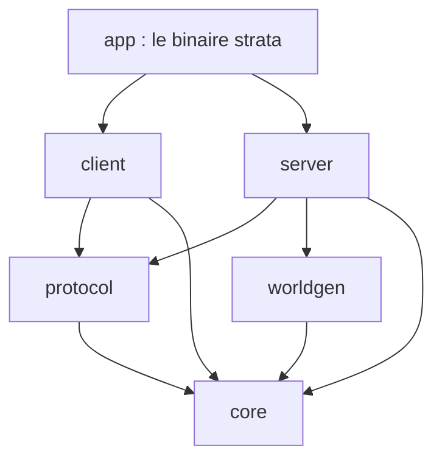

# Explications — le manuel du projet

Ce dossier explique **comment marche Strata Mundi**, pour quelqu'un qui découvre Rust et la programmation de jeux. Chaque fichier suit le même plan : *À quoi ça sert*, *Comment ça marche*, *Où c'est dans le code*, puis une partie repliée *Côté Rust* pour les notions du langage.

## Ordre de lecture conseillé

1. Ce sommaire et la carte des crates ci-dessous.
2. [Boucle de jeu](boucle-de-jeu.md) : ticks à 20 par seconde, rendu découplé.
3. [Client et serveur](client-serveur.md) : qui décide de quoi, les messages.
4. [Rendu avec wgpu](rendu-wgpu.md) : de la scène à l'image.
5. [Entrées](entrees.md) : clavier, souris, manette, actions.
6. [Mesures et captures](bench-et-captures.md) : `--screenshot`, `--bench-scene`.
7. [Chunks et maillage](chunks-et-maillage.md) : stockage des blocs, faces visibles, fusion, occlusion.
8. [Génération du monde](generation-du-monde.md) : climat, relief, biomes, grottes, arbres.
9. [Monde infini](monde-infini.md) : chargement autour du joueur, frustum.
10. [Packs, registres et traductions](packs.md) : d'où vient tout le contenu. Pour les textures, voir aussi le [guide des textures](../guide-textures.md).

Les autres systèmes (chunks, génération, packs, sauvegarde, interface, réglages…) ont leur fichier dès qu'ils apparaissent.

## Carte des crates

Le code est découpé en **crates** (des bibliothèques Rust indépendantes) qui ne se voient pas toutes entre elles. C'est volontaire : le compilateur garantit par exemple que le serveur ne touche jamais au rendu.

| Crate | Rôle | Dépend de |
|---|---|---|
| `core` | Types purs du jeu : coordonnées, blocs, chunks, registres, packs. Aucune fenêtre ni carte graphique : testable partout. | — |
| `worldgen` | Fabrique le terrain à partir d'une graine (seed). Même graine = même monde. | `core` |
| `protocol` | Les messages échangés entre client et serveur. | `core` |
| `server` | Le « maître du jeu » : simule le monde 20 fois par seconde, décide de tout, sauvegarde. | `core`, `worldgen`, `protocol` |
| `client` | Ce que voit et touche le joueur : affichage, clavier, manette, menus. Il ne modifie jamais le monde lui-même, il **demande** au serveur. | `core`, `protocol` |
| `app` | Le programme qu'on lance : il démarre un serveur et un client dans le même processus. | tous |

## Outils du projet

- `cargo fmt --all` : met le code en forme.
- `cargo clippy --all-targets -- -D warnings` : le « correcteur » qui signale le code suspect.
- `cargo test --workspace` : lance les tests.
- `cargo bench --workspace` : mesure la vitesse des opérations clés.

Côté Rust

- **Crate** : une unité de compilation (une bibliothèque ou un programme). Un **workspace** regroupe plusieurs crates qui partagent un dossier `target/` et un fichier `Cargo.lock` (les versions exactes des dépendances).
- **`Cargo.toml`** : la fiche d'identité d'une crate (nom, dépendances). Celui de la racine déclare les dépendances communes une seule fois (`[workspace.dependencies]`) ; chaque crate écrit alors `serde.workspace = true`.
- **Feature** : une option de compilation. `cargo run --features profiling` ajoute le code de profilage Tracy, absent sinon.
- **`Result` et `?`** : une fonction qui peut échouer renvoie `Result<Valeur, Erreur>` ; le `?` remonte l'erreur à l'appelant au lieu de planter. C'est pourquoi `unwrap()` (qui plante si erreur) est interdit hors des tests.

