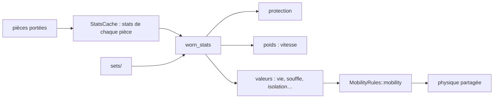

# Accessoires, ensembles, mobilité et joaillier

## À quoi ça sert

Sans classe ni arbre de compétences, le joueur se construit par son équipement. En plus de l'armure, il porte des **accessoires** (deux anneaux, une amulette, une ceinture, une cape), gagne des **bonus d'ensemble** en assortissant ses pièces, et certaines bottes ou ceintures lui donnent une **mobilité** nouvelle : double saut, esquive, escalade. Les accessoires se fabriquent au **joaillier**, premier établi à liste de recettes (la cape au métier à tisser, les bottes de mobilité à la forge depuis le jalon 6). Tout est décrit dans les packs.

## Comment ça marche

### Les cases

L'inventaire a 46 cases : barre rapide (0-8), sac (9-35), armure (36-39), main secondaire (40) et accessoires (41-45). Un objet dit où il se porte : `equip: Some(Ring)` (ou `Amulet`, `Belt`, `Cloak`, et `Head`… `Feet` pour l'armure). `PlayerInventory::accepts` refuse le reste. Une sauvegarde d'avant (41 cases) se charge avec cinq cases vides en plus : `normalize` agrandit la liste.

### Ce qu'une pièce donne

Un objet porté donne des **briques**, les mêmes que les améliorations de l'enclume :

```ron
// items/ring_of_vitality.ron
Item(
    texture: "strata:ring_of_vitality",
    max_stack: 1,
    category: Some("strata:accessories"),
    equip: Some(Ring),
    worn: [Stat(stat: "strata:max_health", op: Add, value: 4.0)],
)
```

La stat doit être déclarée dans `item_stats/` (avec ses bornes). Vie, souffle et isolation attendent les jauges du jalon 8 ; les emplacements de potion, les potions. `air_jumps`, `dash` et `climb` servent tout de suite.

### Les ensembles

```ron
// sets/iron_plate.ron
Set(
    pieces: ["strata:iron_plate_helmet", "strata:iron_plate_chestplate",
             "strata:iron_plate_leggings", "strata:iron_plate_boots"],
    bonuses: [
        Bonus(pieces: 2, effects: [Stat(stat: "strata:protection", op: Add, value: 1.0)]),
        Bonus(pieces: 4, effects: [Stat(stat: "strata:protection", op: Add, value: 3.0)]),
    ],
)
```

Chaque pièce différente portée (et pas cassée) compte une fois. Le plus grand bonus atteint compte seul : il répète ce qu'il garde des petits.

### Un seul calcul

`worn_stats` additionne protection et poids des pièces, puis rassemble les briques (pièces, bonus d'ensemble) et n'en garde **qu'une par sorte, la plus forte** (`strongest_bricks`) : c'est la règle « même effet non cumulable ». Deux anneaux de vitalité donnent +4, pas +8.



Le serveur le fait à chaque tick (`Game::apply_equipment`), le client à chaque image avec sa copie de l'inventaire : ils trouvent la même chose.

### La mobilité

`physics/abilities.rs` ajoute trois capacités au pas de physique commun au serveur et à la prédiction du client :

- **saut en l'air** : une nouvelle pression de Sauter en l'air relance vers le haut, autant de fois que `air_jumps` ; l'atterrissage les rend ;
- **esquive** : la touche « Esquive » lance le corps à vitesse fixe quelques ticks dans la direction voulue, puis une recharge ;
- **escalade** : avancer contre un mur fait monter ; accroupi, on reste accroché.

Ce dont ces capacités se souviennent (sauts utilisés, recharge…) est dans `Body::abilities`, que le serveur renvoie : la prédiction rejoue les entrées sur le bon état. Les valeurs sont dans `mobility.ron` ; l'option de monde « Mobilité par l'équipement » les coupe.

### Le joaillier

Un bloc `station: Some(Bench("strata:jeweller"))` et des recettes :

```ron
// bench_recipes/ring_of_vitality.ron
BenchRecipe(
    bench: "strata:jeweller",
    ingredients: [(Item("strata:gold_ingot"), 1), (Item("strata:copper_ingot"), 2)],
    result: Result(item: "strata:ring_of_vitality"),
)
```

L'écran liste tout ce que l'établi sait faire ; l'infobulle donne les ingrédients et dit s'il en manque. Choisir une recette envoie au serveur `ChooseCut`, qui pose les ingrédients de l'inventaire dans les quatre cases ; on prend le résultat comme au craft. La forge, la tannerie et le métier à tisser sont d'autres établis du même genre : voir [Stations de travail](stations.md).

## Dans le code

| Quoi | Où |
|---|---|
| Cases, migration | `crates/core/src/inventory/container.rs` |
| Ensembles, calcul, textes, `mobility.ron` | `crates/core/src/worn/` |
| Non-cumul des briques | `strongest_bricks` dans `crates/core/src/upgrade/stats.rs` |
| Double saut, esquive, escalade | `crates/core/src/physics/abilities.rs` |
| Établis à liste (joaillier) | `crates/core/src/crafting/bench.rs`, `bench_load.rs`, `crates/server/src/game/bench.rs`, `crates/client/src/screens/bench.rs` |
| Équipement côté serveur | `crates/server/src/game/equipment.rs` |
| Prédiction côté client | `advance_player` dans `crates/client/src/gameplay.rs`, `LocalPlayer` |
| Wiki | `crates/wikigen/src/worn.rs` |
| Contenu | `assets/packs/strata/{items,sets,bench_recipes,item_stats}/`, `mobility.ron`, `blocks/jeweller.ron` |

<details><summary>Côté Rust</summary>

- **Une valeur par défaut pour les vieilles données** : `#[serde(default)]` sur `Body::abilities` ou `MoveInput::dash` permet de lire un message ou une sauvegarde qui n'a pas le champ.
- **`impl IntoIterator<Item = (&'a ItemStack, Arc<ItemStats>)>`** : `worn_stats` accepte n'importe quelle suite de pièces ; le serveur et le client y branchent leur cache, les tests `stack_stats` directement.
- **`Option::filter` et `then_some`** : `mobility.dash.filter(|_| input.dash)` ne garde l'esquive que si la touche est pressée ; `(valeur > 0.0).then_some(Dash { … })` crée la capacité seulement quand la stat la donne.
- **Pourquoi `StationDef` n'est plus `Copy`** : `Bench` contient un `Identifier` (des `String`), qui ne se copie pas bit à bit ; on clone (`.cloned()`) là où on copiait.
- **`Box` dans un `enum`** : un message très gros grossit toutes les variantes ; `Box<Body>` met la donnée sur le tas et ne garde qu'un pointeur.

</details>

## Pour aller plus loin

- Décisions D086 à D089 dans `docs/decisions.md` ; valeurs dans `docs/regles/equilibrage.md` (« Accessoires, ensembles et mobilité »).
- [Outils, armes et armures](outils-et-armures.md), [Améliorations](ameliorations.md), [Joueur et interaction](joueur-et-interaction.md).
