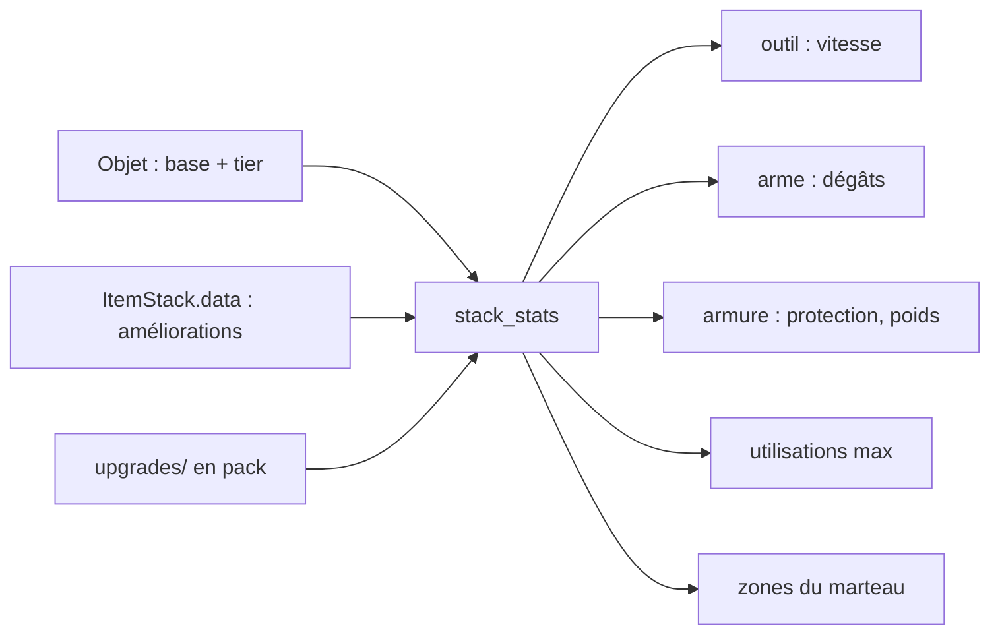

# Améliorations, enclume et marteau de mineur

## À quoi ça sert

Sans classe ni arbre de compétences, le joueur progresse par son équipement. Les **améliorations** rendent un outil, une arme ou une armure meilleurs : plus tranchant, plus solide, plus léger. Elles se posent à l'**enclume**, qui sert aussi à **réparer**. Le **marteau de mineur** est un outil dont la tête s'élargit à l'enclume pour casser plusieurs blocs d'un coup. Tout est décrit dans les packs : un autre pack peut ajouter ses améliorations sans toucher au moteur.

## Comment ça marche

### Les emplacements et leurs familles

Chaque objet a une liste d'**emplacements typés** (jalon 4a) : `upgrade_slots: ["strata:area", "strata:craft"]`. Une famille (`upgrade_slots/<nom>.ron`) dit seulement combien d'emplacements d'elle un objet peut avoir. Les familles existantes : `strata:craft` (artisanal) et `strata:area` (tête du marteau). Les modules mécaniques (v0.8), les runes et les pièces de bâton (v0.9) seront d'autres familles : le moteur ne change pas.

### Une amélioration en pack

```ron
// upgrades/sharpening.ron
Upgrade(
    slot: "strata:craft",
    applies_to: [Tool, Weapon],
    excludes: [],
    requires: [],
    levels: [
        Level(effects: [Damage(10.0), MiningSpeed(10.0)], xp: 2, material: Item("strata:copper_ingot"), count: 2),
        Level(effects: [Damage(20.0), MiningSpeed(20.0)], xp: 4, material: Item("strata:iron_ingot"), count: 2),
    ],
)
```

- `slot` : la famille de l'emplacement qu'elle occupe ;
- `applies_to` : outils, armes, armures (vide : tout équipement) ;
- `levels` : chaque niveau **remplace** le précédent ; il dit ses **briques d'effet**, son coût en **XP** et son **matériau** (un objet ou un tag, en nombre) ;
- `requires` / `excludes` : autres améliorations demandées ou interdites.

Les briques : `Damage(%)`, `MiningSpeed(%)`, `Durability(%)`, `Protection(points)`, `Lighten(%)` (poids de l'armure), `Area(largeur, hauteur)` (marteau). En ajouter une, c'est une variante de l'`enum Effect` et une ligne dans `apply`.

### Où vivent les améliorations d'un objet

Dans les **métadonnées** de la pile (`ItemStack::data`, jalon 1), sous des clés à espace de noms : `strata:upgrades` (liste de paires amélioration, niveau), `strata:repairs` (nombre de réparations), `strata:area` (zone choisie du marteau). Elles se sauvegardent avec la pile, sans rien de plus.

### Un seul calcul des statistiques

`stack_stats(pile, objets, améliorations)` part des valeurs de l'objet (base et tier, déjà résolues au chargement), puis applique les améliorations. **Même effet non cumulable** : si deux améliorations donnent `Damage`, seule la plus forte compte (`strongest`). Tout passe par là : temps de casse (serveur et prédiction du client), protection et poids de l'armure portée, utilisations maximales (barre d'usure, infobulle), zones du marteau.



### L'enclume

Une station (`station: Some(Anvil)`) à deux cases : l'objet, puis ce qui paie. Comme l'établi, ses cases appartiennent au joueur et reviennent à l'inventaire quand l'écran se ferme ou que l'enclume disparaît. Le client calcule la liste des améliorations possibles avec les mêmes packs (montrées par leur matériau ; l'infobulle donne niveau, effets, coût, et pourquoi c'est impossible : plus d'emplacement, prérequis, exclusion). Le serveur reçoit `ChooseUpgrade(Some(index))` et décide ; `None` veut dire « réparer ». `anvil_outcome` calcule le résultat (pur, testé) ; `take_outcome` le donne et retire l'objet et le matériau payé.

**Réparer** : le matériau de l'objet (celui de son tier, `repair` dans `tiers/`, ou le sien, `repair` dans `items/` pour le cuir et le tissu) rend un quart des utilisations par unité ; un second objet identique sans amélioration ajoute ses utilisations et 12 % de plus. Chaque réparation coûte un point d'XP de plus que la précédente. Un objet cassé gardé (option « Objets usés ») se répare comme un autre.

**L'XP** n'existe pas encore : les coûts sont dans les données et affichés, mais `can_pay_xp` répond toujours oui et `pay_xp` ne retire rien (`crates/server/src/game/anvil.rs`). Le jalon 9 n'aura qu'à remplir ces deux fonctions.

### Le marteau de mineur

Un outil du type pioche, plus lent, avec un emplacement de tête. La **tête élargie** a cinq niveaux, de plus en plus chers : 3×1, 5×1, 3×3, 3×5, 5×5. Toutes les zones débloquées restent au choix : la touche « Zone du marteau » (R, clic du stick droit) passe à la suivante (`ChooseArea`), affichée au-dessus de la barre rapide.

À chaque coup, le client envoie la **face** visée (`StartBreak { pos, face }`). Le serveur calcule la zone (`swing_cells`) : en travers de la face, largeur × hauteur sur un mur, largeur × profondeur devant soi sur un sol (selon l'orientation du joueur). Seuls les blocs du type de l'outil qu'il récolte partent ; la casse dure autant que le **bloc le plus dur** de la zone (comme les mods connus) ; chaque bloc use le marteau d'une utilisation ; les butins tombent en un tas par objet, comme la faucille. Le client fait le même calcul pour prédire le temps et dessine le **contour** de toute la zone autour du bloc visé.

## Dans le code

| Quoi | Où |
|---|---|
| Lecture des packs, briques, statistiques, enclume, zones | `crates/core/src/upgrade/` |
| Textes (effets, coûts, infobulles d'objet amélioré) | `crates/core/src/upgrade/describe.rs` |
| Enclume côté serveur, point d'accroche de l'XP | `crates/server/src/game/anvil.rs` |
| Marteau côté serveur (zone, usure, butin) | `crates/server/src/game/hammer.rs`, `mining.rs` |
| Écran de l'enclume | `crates/client/src/screens/anvil.rs`, `assets/ui/inventory.ron` |
| Zone, contour et touche côté client | `crates/client/src/hammer.rs`, `render/overlays/` |
| Page du wiki | `crates/wikigen/src/upgrades.rs` |
| Contenu | `assets/packs/strata/{upgrades,upgrade_slots,anvil.ron,items,tiers}` |

<details><summary>Côté Rust</summary>

- **`std::mem::discriminant`** : `Effect::same_kind` compare la *variante* de deux valeurs d'un `enum` sans regarder leurs données (`Damage(10.0)` et `Damage(30.0)` sont de la même sorte). C'est ce qui permet « le plus fort compte ».
- **Données extensibles** : `ItemData` est une `BTreeMap<Identifier, DataValue>` ; on lit avec un `match` sur la forme attendue (`DataValue::List(...)`) et on ignore le reste, ce qui rend les vieilles sauvegardes et les données d'autres packs inoffensives.
- **Fonction pure + fermeture** : `swing_cells(centre, face, (zone, lacet), outil, blocs)` reçoit `blocs: impl Fn(BlockPos) -> Option<&Block>` ; le serveur y branche son chargeur de colonnes, le client son monde, les tests une carte en mémoire. Le `'a` dit que les blocs rendus vivent au moins aussi longtemps que l'appel.
- **`Option::is_none_or`** : `choice.is_none_or(offered)` accepte « aucun choix » (réparer) ou un choix proposé, en une ligne.

</details>

## Pour aller plus loin

- Décisions D081 à D084 dans `docs/decisions.md` ; valeurs dans `docs/regles/equilibrage.md` (« Améliorations, enclume et marteau de mineur »).
- [Outils, armes et armures](outils-et-armures.md), [Craft](craft.md), [Récolte](recolte.md).
