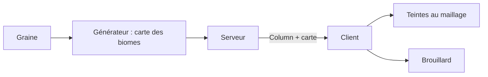

# Atmosphère : couleurs de biome, brouillard et nuit

## À quoi ça sert

Un marais ne doit pas avoir la même herbe, la même eau ni la même brume qu'une savane. L'atmosphère donne à chaque biome sa teinte (herbe, feuillage, eau, brouillard), mélange ces teintes en douceur aux frontières, et rend la nuit sombre mais lisible.

## Comment ça marche

### Le client apprend les biomes

Le serveur calcule le biome de chaque bloc de surface avec la graine du monde. Il envoie avec chaque colonne une **carte 16 × 16** (un biome par case) et, à la connexion, la liste des biomes. Le client ne décide de rien : il affiche (F3 : « Biome : … »). La carte n'est **jamais sauvegardée** : on la recalcule depuis la graine, car un numéro stocké deviendrait faux si un pack ajoutait un biome.

### Facteurs de teinte

Chaque biome (`biomes/<nom>.ron`) porte quatre **facteurs** : herbe, feuillage, eau, brouillard. Un facteur multiplie la couleur de la texture : 1 = inchangée, 0,7 en vert = moins de vert. Les plaines valent 1 : elles restent comme avant, et les icônes ou le wiki n'ont pas de teinte à appliquer. Chaque bloc dit s'il est teinté (`tint`) : herbe, feuillage ou eau, et sur quelles faces. L'herbe n'est teintée que sur le dessus et sur la **frange** des côtés ; la terre en dessous garde sa couleur. Les feuilles de bouleau et de sapin gardent leur couleur propre.

Pour la frange, les pixels d'herbe d'une face latérale sont marqués par une transparence presque invisible (alpha 254) ; le shader teinte seulement ceux-là.

### Mélange aux frontières

Sans mélange, l'herbe change de couleur d'un coup à la limite d'un biome. Le mailleur calcule donc la couleur de chaque **coin** de bloc en moyennant les blocs autour (rayon réglable). Comme un coin ne dépend que de sa position dans le monde, il n'y a aucune cassure entre deux colonnes. Le réglage « Mélange des biomes » vaut 0 (très bas, frontières nettes) à 4 (ultra) ; le profil DS prend 1. Le changer remaille le monde.

La fusion des faces (voir [Chunks et maillage](chunks-et-maillage.md)) ne fusionne que des faces de même teinte : loin des frontières tout fusionne comme avant, près d'elles les faces restent seules avec une couleur par coin.

### Brouillard teinté

Le client moyenne la teinte de brouillard des biomes chargés à ±24 blocs de la caméra, puis la **suit en douceur** (environ 1,5 s) pour qu'entrer dans un marais ne fasse pas « clignoter » l'écran. Cette teinte multiplie l'horizon du ciel, donc elle dépend de l'heure. Le ciel prend la même teinte : le terrain lointain et ce qu'il y a derrière restent d'une seule couleur.

Le brouillard se termine à `(distance de rendu − 2) × 16` blocs : les deux derniers anneaux de colonnes chargées ne sont jamais dessinés (une section n'est maillée qu'avec ses voisines éclairées). Le bord visible du monde est ainsi toujours noyé.

### Nuit

La clarté de nuit passe de 0,2 à 0,1, le plancher d'ambiance de 0,2 à 0,15, et le réglage de luminosité agit au carré (à 50 %, un quart de l'effet). Plein jour inchangé.

## Où c'est dans le code

| Quoi | Où |
|---|---|
| Carte des biomes (`BiomeMap`, `BiomeId`) | `crates/core/src/chunk/biomes.rs` |
| Message `Column` et `BiomeInfo` | `crates/protocol/src/messages.rs` |
| Calcul côté serveur (threads de génération) | `crates/server/src/generation.rs`, `crates/worldgen/src/generator.rs` (`biome_map`) |
| Facteurs et sortes de teinte (`Tint`) | `crates/core/src/content/tint.rs` |
| Biomes connus du client | `crates/client/src/world/biomes.rs` |
| Mélange des coins (`ColumnTints`) | `crates/client/src/mesher/tints.rs` |
| Sommet 12 octets (`PackedVertex`) | `crates/client/src/mesher/vertex.rs` |
| Lissage du brouillard (`BiomeFog`) | `crates/client/src/sky/biome_fog.rs` |
| Fin du brouillard (`fog_end`) | `crates/client/src/render/options.rs` |
| Courbe de lumière | `crates/client/src/render/shaders/light.wgsl` |
| Données | `assets/packs/strata/biomes/*.ron` |

Côté Rust

- **Bits empaquetés** : un `u32` contient plusieurs petites valeurs côte à côte (`r | (g << 8) | (b << 16)`). `<<` décale les bits vers la gauche ; le shader refait l'opération inverse.
- **`Arc`** : pointeur partagé compté. Les sections d'une même colonne partagent le même tableau de teintes sans le copier.
- **`Option<Vec3>`** : « une couleur, ou rien ». `BiomeFog::follow` garde la dernière couleur s'il n'y a aucun biome chargé.
- **Interpolation exponentielle** : `1 − exp(−dt / 1,5)` donne un pas qui ne dépend pas du nombre d'images par seconde.
- **Sérialisation** : `BiomeMap` est envoyée comme une liste de nombres (`serde`, `postcard`), environ 256 octets par colonne.

