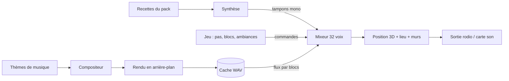

# Audio

## À quoi ça sert

Faire entendre le monde : pas, casse et pose des blocs, eau, vent, grottes, et une musique rare et calme. **Aucun fichier audio n'est livré** : tous les sons et morceaux sont *calculés* à partir de recettes écrites dans les packs, puis joués par un petit mixeur maison. Un pack peut changer une recette ou la remplacer par un `.ogg`. Le format des recettes, matériaux, ambiances et thèmes est dans le [guide des sons](../guide-sons.md) (non dupliqué ici).

## Comment ça marche

### Synthèse : fabriquer un son avec des maths

Une recette empile des **couches** : du bruit coloré filtré (frottements, souffles), des grains (cliquetis), des modes résonants (un « toc » de pierre ou de bois) et des bulles. Chaque couche a une enveloppe (le son monte vite puis s'éteint). Le résultat est un tampon de nombres, un par 1/44 100 s, ramené à un volume maximal. Exemple : le pas sur la pierre est un claquement bref (mode résonant grave) posé sur un court bruit filtré.

Chaque recette a plusieurs **variantes**, chacune avec sa graine (même recette = mêmes variantes, toujours). À chaque lecture, le jeu tire une variante différente de la précédente et une hauteur légèrement variable : deux pas ne sonnent jamais pareil. Les variantes sont fabriquées à la première lecture puis gardées. Les **fonds d'ambiance** sont des boucles : la dernière seconde est fondue dans le début pour qu'on n'entende pas la couture.

### Mixage : additionner des voix

Le jeu ne joue pas les sons un par un : une seule source stéréo infinie est confiée à la carte son, qui réclame régulièrement un petit bloc de 512 échantillons (~12 ms). Le **mixeur** additionne alors toutes les voix en cours (32 au plus : une nouvelle remplace la plus faible si elle est plus forte). Les volumes (général × catégorie : blocs, ambiance, musique) sont **rampés** d'un bloc à l'autre, sinon chaque changement ferait un « clic ». Le jeu parle au mixeur par un canal de commandes, sans verrou.

### Le son en 3D

- **Distance** : le volume baisse en 1/distance et tombe à zéro à la limite de portée de la recette.
- **Panoramique** : un son à droite sort plus fort dans l'oreille droite. Les oreilles suivent la rotation horizontale de la caméra, pas le fait de regarder en haut ou en bas.
- **Derrière soi** : −20 % de volume, un repère avant/arrière simple.

### Réverbération : le son du lieu

Une grotte résonne, un champ non. Le jeu lance 26 rayons autour de la tête (7 par image) et regarde jusqu'où ils vont avant de toucher un bloc : ciel visible ou rayons qui s'échappent = **plein air** (sec) ; sinon **intérieur**, **petite grotte** ou **grande caverne** selon la portée moyenne. La réverbération (style Freeverb : des délais bouclés qui s'amortissent, comme des échos très rapprochés) mélange alors un peu de « salle » au son. Le passage d'un lieu à l'autre est glissé, et seuls les sons positionnés la subissent (pas les fonds).

### Occlusion : derrière un mur

Pour un son lointain, le jeu suit la ligne droite entre lui et l'oreille et additionne la « densité » des blocs traversés (pierre pleine = 1, vitre = 0,6, eau = 0,4, feuillage = 0,2, air = 0). Plus c'est dense, plus le son est assourdi : un **filtre passe-bas** (qui garde les graves) et un volume réduit. Le calcul est fait au départ du son, puis 10 fois par seconde pour ceux qui durent.

### Ambiances

Toutes les 0,25 s, le jeu échantillonne les biomes autour du joueur et mesure s'il est sous terre. Chaque ambiance (plaines, forêt, mer, sous terre…) reçoit une part, et ses fonds en boucle sont fondus doucement (un tiers par seconde au plus). Elle lance aussi des sons ponctuels (goutte, grenouille…) à des endroits tirés au hasard, donc spatialisés et étouffés comme les autres.

### Musique : composée, rendue, mise en cache

1. **Composition** : à partir d'un thème (tonalité, mode, tempo, accords, petits motifs), le compositeur invente une partition déterministe : phrases variées, longs silences (47 à 68 % de silence mesuré pour Terra).
2. **Rendu** : piano et nappe sont synthétisés, avec une réverbération propre au morceau, puis écrits **par blocs de 4 096 échantillons** directement dans un fichier WAV (jamais le morceau entier en mémoire). Un morceau de 2 minutes se rend en moins d'une seconde.
3. **Cache** : le fichier est rangé dans `<données>/cache/music/`. Son nom contient la version de l'algorithme et une empreinte du thème : si l'un change, un nouveau fichier est fabriqué et l'ancien effacé au démarrage. Un rendu interrompu (`.part`) n'est jamais lu.
4. **Lecture** : pendant le silence qui précède un morceau, il est rendu à l'avance ; il est ensuite lu en flux et mélangé avec fondu de 3 s.

La musique est **rare** : écran titre après 2 à 5 s, puis en jeu toutes les 10 à 20 min (rare), 5 à 10 (normale) ou 2 à 5 (souvent). Volume de la musique à 0 ou pas de carte son : ni rendu, ni fichier.

### Les fils d'exécution (threads)

| Fil | Rôle |
|---|---|
| principal (le jeu) | décide des sons, rend les variantes, envoie des commandes |
| sortie audio (créé par `rodio`) | demande des blocs au mixeur, ne doit jamais attendre |
| `music-render` | compose et rend un morceau à la fois, seulement quand la musique est voulue |
| `music-read` | lit le WAV (ou un `.ogg`) et envoie des blocs de 0,5 s au mixeur |

La règle d'or : **le fil audio ne bloque jamais**. Un bloc de musique en retard devient du silence plutôt qu'un craquement ; les canaux sont bornés.

### Réglages et sous-titres

Onglet **Son** : volumes (général, blocs, ambiance, musique), sous-titres, fréquence de la musique, **audio spatial**. Voir [Réglages](reglages.md). Les sous-titres affichent la direction du son (← → ↑ ↓) dans le HUD.

## Où c'est dans le code

Synthèse (sans périphérique, testable partout) dans `crates/core/src/audio/` :
- `recipe.rs` (`SoundDef`, `Layer`), `synth.rs` (`render`, `seamless`), `dsp.rs` (`Rng`, `Biquad`, `Noise`).
- `load.rs` (`Sounds`, `load_sounds`, bornes des valeurs), `ambience.rs` (`AmbienceDef`), `wav.rs`.
- `music/` : `theme.rs` (`ThemeDef`), `compose.rs` (`compose`, `Score`), `voices.rs`, `render.rs` (`PieceRenderer`), `cache.rs` (`cached_piece`, `prune`, `WavStream`).

Lecture et mixage dans `crates/client/src/audio/` :
- `mod.rs` (`Audio`, `Hearing`), `output.rs` (`Output`, lien avec `rodio`), `mixer.rs` (`Mixer`, `Command`, `Voice`).
- `spatial.rs` (distance, panoramique), `space.rs` (`SpaceProbe`, le lieu), `reverb.rs` (`Reverb`, `Room`), `surroundings.rs` et `muffles.rs` (occlusion, `MuffleTracker`).
- `triggers.rs` (pas, blocs, `Cue`), `environment.rs` et `beds.rs` (ambiances), `subtitles.rs`.
- `music.rs` (planification), `music_threads.rs` (`RenderWorker`, `spawn_reader`), `stream.rs` (`MusicFeed`).
- Réglages : `crates/client/src/settings/sound.rs` (`SoundSettings`, `SpatialAudio`, `MusicFrequency`).

Décisions : D053 (sortie, mixeur, synthèse), D054 (ambiances, lieu, occlusion), D055 (musique).

Côté Rust

- **Thread** (`std::thread::Builder::new().spawn(...)`) : un travail qui tourne en parallèle du jeu. Nommer le fil (`music-render`) aide à le retrouver dans un profileur.
- **Canal borné** (`mpsc::sync_channel`) : une file de messages entre fils avec une taille maximale. `try_send`/`try_recv` ne bloquent pas : indispensable pour le fil audio.
- **`Arc` et `AtomicBool`** : `Arc` partage une valeur entre fils ; un `AtomicBool` est un drapeau lisible et modifiable sans verrou (par exemple pour demander l'arrêt d'un fil).
- **Trait `Iterator` / `Source` de `rodio`** : la sortie est un objet qui, appelé en boucle, produit un échantillon à la fois ; le jeu y branche son mixeur. Ne pas allouer dans cette boucle.
- **`f32` et `f64`** : les échantillons sont des `f32` (assez précis, moitié moins de mémoire) ; les oscillateurs du piano cumulent des erreurs et utilisent des `f64`.
- **Déterminisme** : un générateur pseudo-aléatoire (`Rng`, SplitMix64) initialisé par une graine donne toujours la même suite. Sans lui, un cache de musique ne pourrait pas être reconstruit à l'identique.
- **`Option` pour l'absence de carte son** : `Output::open()` renvoie `None` si aucun périphérique n'existe ; tout le reste du code accepte cela et joue sans son.
- **Biquad** : petit filtre à deux mémoires (passe-bas, passe-bande…). Le même code sert à la synthèse et à l'occlusion.

