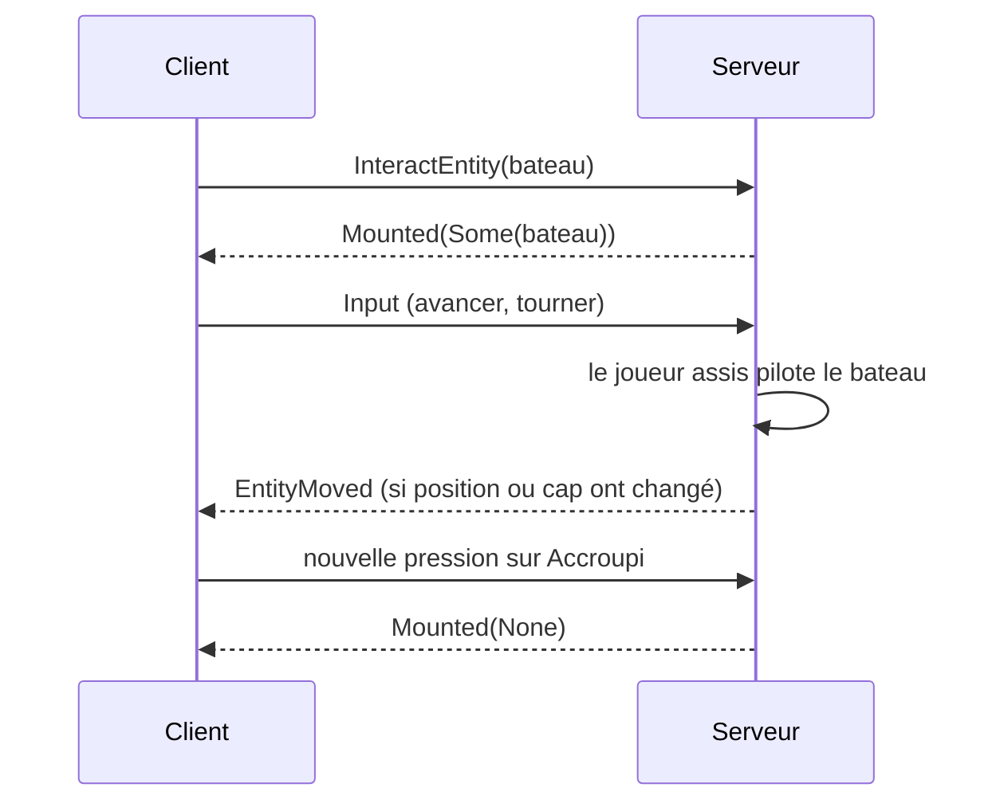

# Bateaux et entités génériques

## À quoi ça sert

Les bateaux sont les premières **entités** du monde autres que le joueur : on les pose, on monte dedans, on les pilote sur l'eau (ou la glace), on en descend. Pour les construire, le jeu a gagné des briques réutilisables par les futures créatures : des types d'entité décrits en pack, un modèle fait de boîtes, et des messages pour les faire apparaître, bouger et disparaître chez le client.

## Comment ça marche

### Décrits par le pack

Un type d'entité est un fichier `entities/<nom>.ron` (modèle, texture, taille de la boîte de collision, réglages de bateau) ; son modèle est un fichier `models/<nom>.ron` : une liste de **boîtes** (en seizièmes de bloc). Les cinq bateaux (chêne, sapin, bouleau, jungle, acacia) partagent le même modèle et ne changent que de texture. L'objet « bateau » a l'action `PlaceEntity(<entité>)` : clic droit sur l'eau, le serveur crée l'entité.

### Physique du bateau

Elle est dans `core` et sans carte graphique, donc testable partout.

- **Flottaison** : on cherche la surface du liquide sous le bateau ; sa vitesse verticale est amortie vers « surface moins tirant d'eau ». Il ne coule jamais et remonte s'il est enfoncé.
- **Vitesse** : à chaque tick, `vitesse = vitesse × élan + poussée`. L'élan vaut 0,9 sur l'eau, et sur terre il dépend de la **glissance** du bloc dessous : forte sur la glace (le bateau file), faible sur le sol (il rampe).
- La boîte de collision reste alignée sur les axes, quel que soit le cap du bateau (comme Minecraft).

### Monter, piloter, descendre

Le joueur assis n'a plus de déplacement propre : ses entrées deviennent des commandes du bateau (avancer/reculer, tourner), et son corps est posé au siège à chaque tick. Au moment de descendre, le serveur cherche une rive libre à côté ; sinon on reste sur le bateau. Clic gauche en créatif : le bateau est retiré.

### Côté client

Le client ne prédit pas le bateau (un tick de latence en solo, invisible). Il garde les deux dernières positions reçues et **interpole** entre elles pour un mouvement fluide, en prenant le plus court chemin pour le cap. Il ne choisit jamais lui-même un identifiant : il désigne les entités par un `NetEntity`, construit à partir de l'indice et de la génération (voir [ECS](ecs.md)) et qui n'est jamais réutilisé.

### Dessin des modèles

Chaque image, le client garde les modèles visibles (test contre le champ de vision), calcule leur place par rapport à la caméra, puis les dessine **en un seul appel** après les blocs opaques et avant l'eau, avec le même brouillard et la même texture en tableau que les blocs. Un bateau coûte 252 sommets.

### Sauvegarde

Les bateaux sont écrits dans `entities/<espace>/<dimension>.ron` (type par identifiant texte, position, cap). Un monde sans ce fichier n'a simplement aucun bateau. Le joueur se rassoit au rechargement grâce à `player.ron`.

## Où c'est dans le code

| Quoi | Où |
|---|---|
| Types d'entité et modèles du pack | `crates/core/src/content/entity.rs` (`EntityTypeId`) |
| Physique du bateau | `crates/core/src/physics/boat.rs` (`BoatBody`, `BoatControls`, `step_boat`, `liquid_surface`) |
| Composants `boats` et `mounts` | `crates/server/src/ecs/mod.rs` (`Boat`) |
| Pose, montée, descente, retrait, sauvegarde | `crates/server/src/game/boat.rs` |
| Système des bateaux et des joueurs assis | `crates/server/src/systems.rs` (`boat_movement`, `player_movement`) |
| Fichier de sauvegarde des entités | `crates/server/src/save/entities.rs` |
| Messages | `crates/protocol/src/messages.rs` (`EntitySpawned`, `EntityMoved`, `EntityRemoved`, `Mounted`, `InteractEntity`, `AttackEntity`) |
| Entités côté client, interpolation | `crates/client/src/entities.rs` (`ClientEntities`) |
| Bibliothèque de modèles | `crates/client/src/models.rs` (`ModelLibrary`) |
| Dessin | `crates/client/src/render/model_pipeline.rs`, `shaders/model.wgsl` |

Côté Rust

- **`Option<T>`** : `Mounted(Option<NetEntity>)` veut dire « monté sur ce bateau » (`Some`) ou « descendu » (`None`). Rust n'a pas de valeur « nulle » : l'absence est écrite dans le type.
- **Identifiant à génération** : `NetEntity(u64)` range l'indice dans les 32 bits bas et la génération dans les 32 bits hauts (`index | génération << 32`). Un identifiant périmé ou inventé ne retrouve rien.
- **`#[serde(default)]`** : un champ ajouté à un fichier de sauvegarde (`boat` dans `player.ron`) prend une valeur par défaut quand les vieux fichiers ne l'ont pas : les anciens mondes restent lisibles.
- **Sphère englobante et frustum** : pour savoir si un modèle est à l'écran, on teste une sphère qui l'enveloppe contre les six plans de la pyramide de vision, bien moins cher que tester chaque triangle.
- **Un seul appel de dessin** : les sommets de tous les modèles sont recopiés dans un même tampon GPU, puis dessinés d'un coup ; chaque appel a un coût fixe, mieux vaut en faire peu.

