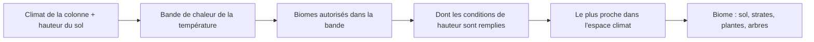

# Biomes et végétation

## À quoi ça sert

Les **biomes** décident de l'aspect d'un endroit : sol, arbres, fleurs, couleurs des roches. Depuis le jalon 4 de la v0.2 il y en a **19**, et la végétation s'enrichit de **plantes en croix** (herbes, fleurs, champignons) et de nouvelles **formes d'arbres**. Tout est décrit dans le pack `strata` : on peut ajouter ou changer un biome sans toucher au code.

## Comment ça marche

### Choisir le biome dans l'espace climat

Chaque colonne du monde a quatre valeurs de climat : température, humidité, continentalité (loin de la mer ?) et érosion (terrain plat ou jeune). Chaque biome est un **point** dans cet espace à quatre dimensions. Pour une colonne, on garde le biome dont le point est **le plus proche**. Imagine des drapeaux plantés sur une carte : chaque endroit appartient au drapeau le plus proche.

Mais certaines conditions ne s'expriment pas bien en climat. Un biome peut donc ajouter une **condition de hauteur** (`min_height`, `max_height`) : il n'est candidat que si le sol est assez haut ou assez bas.

- **Plage** : continentalité côtière et `max_height: 121`, donc seulement sur les côtes basses (la mer est à 120).
- **Océan profond** : continentalité très basse et `max_height: 100`.
- **Montagnes** et **pics enneigés** ont le même climat ; l'altitude tranche : pics au-dessus de 230, montagnes en dessous ; les **montagnes chaudes** prennent leur place, jusqu'au sommet, dans les bandes chaudes (voir plus bas).
- **Badlands** : chaud, sec, érosion moyenne et `min_height: 145`, donc seulement sur les plateaux surélevés ; en dessous, c'est désert ou savane.
- **Champignons** : placés à un point « impossible » (humidité 1,1, érosion 1,0). Il n'est choisi que là où ces deux valeurs sont extrêmes, soit environ 0,4 % du monde : de petites taches isolées.

Les biomes de terre ferme sont rangés sur une **grille température × humidité** : des voisins sur la carte climatique sont des voisins dans le monde, donc les transitions sont douces (toundra, taïga, forêt de bouleaux, plaines, prairie fleurie, forêt, savane, désert, jungle).

### Bandes de chaleur : pas de désert contre la neige

Le plus proche voisin seul ne suffit pas : en v0.2.0, un désert pouvait toucher une toundra, parce que l'érosion ou la continentalité comptaient autant que la température. Depuis la v0.2.1, la température découpe le monde en **bandes de chaleur**, comme les bandes de température de Minecraft :

- `heat_bands` (dans `dimensions/terra.ron`) donne les températures qui séparent les bandes : `[-0.38, -0.13, 0.13, 0.38]`, soit 5 bandes, de 0 (glaciale) à 4 (brûlante).
- Chaque biome dit dans quelles bandes il peut apparaître : `heat: Some((première, dernière))`. Sans `heat`, il va partout (océans, plages, rivières, champignons).
- Une colonne ne choisit que parmi les biomes autorisés dans sa bande, puis garde le plus proche dans l'espace climat comme avant.

La température change très lentement (quelques millièmes par bloc) : deux colonnes voisines sont toujours dans la même bande ou dans deux bandes qui se suivent. Donc **deux biomes dont les bandes sont écartées de plus d'une** (désert en bande 4, toundra en bande 0) ne peuvent jamais se toucher : il y a toujours entre eux une large zone de bandes intermédiaires, occupée par des biomes intermédiaires (plaines, forêt, savane…).

| Bande | Biomes |
|---|---|
| 0 glaciale | toundra enneigée, taïga, pics enneigés, montagnes |
| 1 froide | taïga, forêt de bouleaux, plaines, forêt, montagnes, pics |
| 2 tempérée | forêt de bouleaux, plaines, forêt, prairie fleurie, marais, montagnes, pics |
| 3 chaude | plaines, forêt, marais, savane, jungle, montagnes chaudes |
| 4 brûlante | désert, badlands, montagnes chaudes |

Les montagnes chaudes vont jusqu'au sommet (plus de limite à 230) : dans les bandes chaudes, il n'y a pas de pics enneigés.

### Taille des biomes

La taille des formes de chaque carte de climat est dans le pack (`climate_sizes` de `terra.ron`) : température 2 200 blocs, humidité 2 000, continentalité 2 400, érosion 1 400 (2 à 2,5 fois la v0.2.0). Le curseur « Taille des biomes » de l'éditeur de monde multiplie ces tailles. Les cartes `docs/maquettes/v0.2.1/biomes-avant-*.png` et `biomes-apres-*.png` (graines 42, 7, 99, 4 096 blocs de côté) montrent la différence.

### Les 19 biomes

| Biome | Particularités |
|---|---|
| Plaines | herbe, herbes hautes, fleurs, buissons ; départ possible |
| Prairie fleurie | beaucoup de fleurs ; départ possible |
| Forêt | chênes denses, fougères, champignons ; départ possible |
| Forêt de bouleaux | bouleaux, quelques chênes ; départ possible |
| Taïga | sapins, fougères, sol de podzol |
| Toundra enneigée | herbe enneigée, eau gelée, sapins |
| Désert | sable, cactus, buissons morts |
| Savane | acacias penchés, herbes hautes |
| Jungle | grands arbres à tronc 2×2, lianes, buissons de jungle |
| Marais | mares peu profondes, boue, chênes des marais à lianes |
| Badlands | sable rouge, strates de terracotta colorées |
| Montagnes | herbe puis roche, sapins |
| Montagnes chaudes | herbe, sable rouge puis roche, acacias, buissons morts ; font la transition vers les badlands |
| Pics enneigés | sommets au-dessus de 230, hors des bandes chaudes |
| Océan | eau, sable et gravier |
| Océan profond | fonds de l'océan |
| Plage | sable des côtes basses |
| Rivière | seulement sur le lit des rivières |
| Champs de champignons | mycélium, champignons géants rouges et bruns |

### Le marais : un terrain affaissé

Le marais n'est pas qu'une couche de boue : le **relief** change. Une courbe `wetlands` (dans `dimensions/terra.ron`) rabat le terrain vers le niveau de la mer là où l'humidité et l'érosion sont fortes, avec de petites bosses de ±3 blocs. Le terrain n'est jamais relevé. On obtient des mares au fond de boue et des îlots d'herbe : le champ de biome `shore_height` (-1 pour le marais, 1 par défaut) limite la boue au sol sous l'eau. Voir aussi [Relief](relief.md).

### Les strates des badlands

Un biome peut avoir des **bandes** (`bands`) : une liste de blocs qui se répètent en hauteur, par exemple terracotta blanche, orange, jaune, rouge. Le bloc d'un niveau `y` est `blocs[(y + décalage) modulo n]`. Le décalage vient d'un bruit lisse : les couches ondulent au lieu d'être parfaitement plates. Répéter un bloc dans la liste fait une couche plus épaisse.

Les bandes s'appliquent sous le sol jusqu'à une profondeur `depth`, et aussi **en surface sur toute pente** : le sable rouge ne reste que sur les replats. Ainsi chaque marche d'un plateau en terrasses montre ses couleurs, comme dans un canyon. Jamais sous l'eau.

### Plantes en croix

Une herbe ou une fleur n'est pas un cube. Son bloc a le rendu `Cross` : **deux plans verticaux qui se croisent en X** à l'intérieur de la case. La texture (16×16, avec des pixels transparents) est collée sur chaque plan.

- Chaque plan est émis **deux fois**, une fois par sens, pour qu'il reste visible des deux côtés sans second pipeline de rendu. Une plante coûte donc 8 sommets.
- Une croix **ne cache aucune face** voisine et **n'est jamais cachée** ; la fusion gloutonne l'ignore ([Chunks et maillage](chunks-et-maillage.md)).
- Éclairage plat (0,9) et occlusion pleine pour l'instant.
- Une plante n'a **pas de collision** : on la traverse, et on peut poser un bloc dedans comme dans l'air. Pour la viser, le raycast utilise une **boîte de visée** plus petite que le cube (`HitBox::PLANT`, environ 0,75 de large et 0,8 de haut).
- Dans l'inventaire, une plante s'affiche en **sprite plat** plutôt qu'en cube isométrique.

### Touffes de végétation

La feature `Plants` pose des plantes **par touffes**. Elle précise les blocs possibles avec un poids (herbes fréquentes, fleurs rares), les sols autorisés (`on`), un rayon et un nombre de plantes.

1. Chaque colonne tente 8 centres de touffe, depuis elle-même **et ses 8 voisines**. Une touffe à cheval sur deux colonnes est donc complète, dans n'importe quel ordre de génération.
2. Le biome fixe `per_column`, le nombre moyen de touffes par colonne.
3. Pour chaque plante tirée, on regarde le plus haut bloc solide de la colonne : s'il est dans `on` et qu'il y a de l'air au-dessus, la plante est posée. Jamais sous l'eau, jamais sur une feuille.

Le hasard est initialisé par la graine, la position et l'identifiant de la feature : le monde reste identique pour une même graine.

### Arbres : tronc × couronne

Un arbre est la combinaison de deux choix indépendants, écrits dans le pack :

| Tronc | Effet |
|---|---|
| `Straight` | droit, un bloc de large |
| `Thick` | 2×2 (jungle) |
| `Leaning` | droit puis penché d'un bloc par niveau vers l'une des 8 directions (acacia) |

| Couronne | Effet |
|---|---|
| `Blob(rayon, hauteur)` | ellipsoïde de feuilles, coquille éclaircie au hasard (bouleau, jungle, chêne des marais) |
| `Flat(rayon)` | deux disques à bord déchiqueté (acacia) |
| `Cap(rayon, jupe)` | chapeau plat, ou dôme dont les bords descendent de `jupe` blocs (champignons géants) |

Les couronnes déjà là (boule du chêne, cône du sapin) restent disponibles. On peut ajouter des **lianes** (`vines`) : elles pendent sous les feuilles les plus basses du bord et s'arrêtent au premier bloc non vide. L'arbre entier est calculé comme une liste de pièces (feuilles, puis bûches, puis lianes) ; chaque colonne n'écrit que sa part, comme pour les touffes. Le pack borne tout (portée ≤ 8 blocs, tronc ≤ 32) pour qu'un arbre ne déborde jamais plus loin que les colonnes voisines.

Deux arbres proches se partagent l'espace : une bûche remplace les feuilles de **n'importe quel** arbre (un bouleau pousse à travers la couronne d'un chêne voisin au lieu de s'arrêter dedans), les feuilles ne remplacent que l'air. Les signes des gisements sont posés **après** les arbres, pour qu'aucun tronc ne pousse sur une pierre ferreuse.

## Où c'est dans le code

| Quoi | Où |
|---|---|
| Choix du biome, bandes de chaleur, relief des marais | `crates/worldgen/src/climate.rs` (`ClimateMaps::biome`, `sink_wetlands`), `crates/worldgen/src/content/biomes.rs` (`Biome::allows_heat`, `may_touch`) |
| Définition des biomes, des features | `crates/worldgen/src/defs.rs`, `content.rs` |
| Strates et pentes | `crates/worldgen/src/surface.rs` (`Ground::sloped`, `band`) |
| Touffes de plantes | `crates/worldgen/src/plants.rs` (`place_plants`) |
| Formes d'arbres | `crates/worldgen/src/trees.rs` (`Tree::parts`) |
| Maillage des croix | `crates/client/src/mesher/cross.rs` (`mesh_crosses`) |
| Boîte de visée | `crates/core/src/raycast.rs`, `crates/core/src/content/block.rs` (`hit_box`) |
| Biomes, features et blocs du pack | `assets/packs/strata/biomes/`, `features/` |
| Tests | `crates/worldgen/tests/plants.rs`, `trees.rs`, `generation.rs`, `biome_borders.rs` (aucun voisinage interdit sur 6 144 blocs de côté, graines 42, 7, 99) |

Côté Rust

- **`enum` avec données** : `Trunk::Leaning(lean)` et `Crown::Blob(rayon, hauteur)` sont des variantes qui portent des valeurs. Un `match` oblige à traiter toutes les variantes, donc ajouter une forme de couronne fait signaler par le compilateur chaque endroit à compléter.
- **`Option`** : `min_height` et `bands` valent `Some(..)` ou `None` (absent). Le `let Some(x) = .. else { return }` sort tôt si la valeur manque.
- **Closure** : `|[cx, cz], up, u| ...` dans `cross.rs` est une petite fonction anonyme qui retient `y` et `layer` ; elle évite de répéter la construction d'un sommet.
- **Destructuration** : `[x, y, z]: [u32; 3]` dans la signature déballe un tableau directement en trois variables.
- **Itérateurs** : `.iter().map(..).sum()` additionne les poids sans boucle manuelle.
- **Côté GPU** : un quad est deux triangles. Le *back-face culling* ne dessine qu'une face d'un triangle (celle tournée vers la caméra) ; émettre le plan dans les deux sens contourne cela. Le *rejet alpha* du shader jette les pixels transparents de la texture, ce qui découpe la forme de l'herbe.

