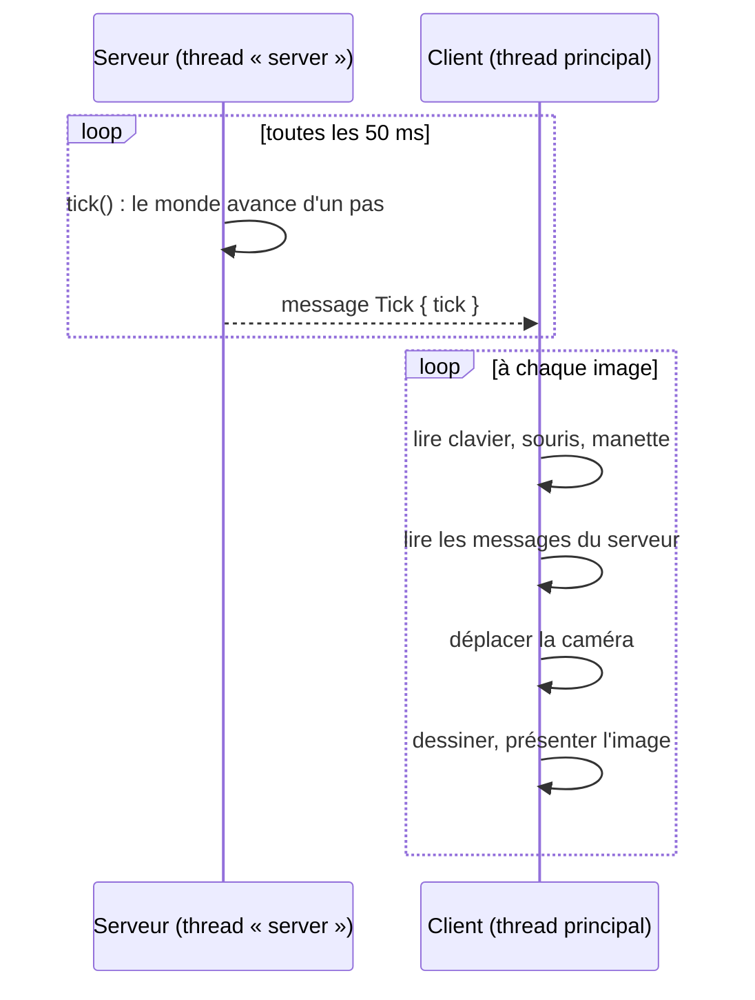

# Boucle de jeu

## À quoi ça sert

Un jeu tourne en boucle : lire les entrées, faire avancer le monde, dessiner l'image, recommencer. Strata Mundi sépare **deux rythmes** : la simulation du monde avance à un rythme fixe de **20 pas par seconde** (les *ticks*, comme Minecraft), tandis que l'affichage va aussi vite que l'écran le permet (60, 144 images par seconde…).

## Comment ça marche

Le serveur et le client tournent dans **deux fils d'exécution** (*threads*) différents du même programme :

- **Côté serveur**, une horloge (`TickClock`) dit combien de ticks sont « dus » depuis la dernière fois. Le serveur les exécute, puis dort jusqu'au prochain. Si le programme a été bloqué longtemps (ordinateur en veille…), l'horloge ne rattrape pas des milliers de ticks d'un coup : elle en fait au plus 10 puis repart de maintenant.
- **Côté client**, chaque image mesure le temps écoulé depuis la précédente (`dt`) et déplace la caméra de `vitesse × dt`, pour que le mouvement soit le même à 30 ou à 144 images par seconde. Un `dt` énorme (fenêtre bloquée) est plafonné à 0,1 s pour éviter de téléporter la caméra.
- Le client reçoit le numéro du dernier tick : plus tard (jalon 6), il s'en servira pour **interpoler** la position des entités entre deux ticks, afin que tout paraisse fluide même si le monde n'avance que 20 fois par seconde.

Mesure de contrôle : le rapport `--bench-scene` indique les « ticks serveur par seconde » (20,0 attendu).

## Où c'est dans le code

| Quoi | Où |
|---|---|
| Horloge à pas fixe | `crates/server/src/clock.rs` (`TickClock`, `TICKS_PER_SECOND`) |
| Boucle du serveur intégré | `crates/server/src/integrated.rs` (`IntegratedServer::run`) |
| Boucle du client (fenêtre) | `crates/client/src/app.rs` (`ClientApp`), `crates/client/src/frame.rs` (`Frame::draw`) |
| Lancement des deux | `crates/app/src/main.rs` (`play`) |

Côté Rust

- **Thread** : `std::thread::Builder::new().name("server").spawn(...)` lance une fonction en parallèle. `join()` attend qu'elle se termine (le jeu attend que le serveur ait fini avant de quitter).
- **`Instant` et `Duration`** : un `Instant` est un moment précis (horloge monotone, qui ne recule jamais) ; la soustraction de deux `Instant` donne une `Duration`.
- **`winit` et `ApplicationHandler`** : `winit` possède la boucle d'événements du système. On lui fournit un objet qui implémente le *trait* `ApplicationHandler` ; `winit` appelle ses méthodes (`window_event`, `about_to_wait`…) quand il se passe quelque chose. Dans `about_to_wait`, on redemande un dessin, ce qui crée la boucle de rendu.
- **`Option<Frame>`** : la fenêtre n'existe pas au démarrage (sur certains systèmes elle ne peut être créée qu'après l'événement `resumed`), d'où un `Option` qui vaut `None` puis `Some(frame)`.

