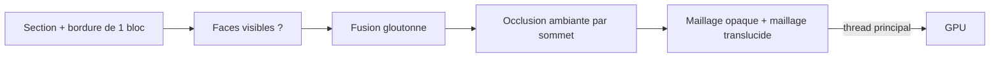

# Chunks et maillage

## À quoi ça sert

Le monde est découpé en **sections** de 16×16×16 blocs, empilées par 32 en **colonnes** (y de 0 à 511). Le **maillage** transforme une section en triangles que la carte graphique sait dessiner, en ne gardant que les faces visibles.

## Comment ça marche

### Stockage compact (palette)

Une section contient 4 096 blocs, mais rarement plus d'une poignée de sortes différentes. Plutôt que 4 096 numéros de bloc complets, elle garde :
- une **palette** : la liste des blocs présents (par exemple `[air, pierre, terre]`) ;
- pour chaque case, un **petit index** dans cette palette, sur le nombre de bits juste nécessaire (0, 1, 2, 4, 8 ou 16).

| Contenu de la section | Bits par bloc | Mémoire des indices |
|---|---|---|
| Que de l'air (le ciel) | 0 | rien |
| 2 sortes de blocs | 1 | 512 octets |
| 3-4 sortes | 2 | 1 Kio |
| 5-16 sortes | 4 | 2 Kio |

Quand un nouveau bloc apparaît, la palette grandit et les indices sont recopiés avec plus de bits. `compact()` fait le ménage quand des blocs ont disparu.

### Maillage

1. **Voisinage** : on copie la section avec une bordure d'un bloc prise chez ses voisines (`Neighborhood`, 18×18×18). Le mailleur n'a ainsi besoin de rien d'autre et peut tourner sur n'importe quel thread.
2. **Faces visibles** : une face est dessinée seulement si le bloc d'à côté n'est pas opaque. Entre deux blocs transparents identiques (eau contre eau, verre contre verre), la face est cachée ; les feuilles gardent la leur (`cull_same: false`).
3. **Fusion gloutonne** (*greedy meshing*) : dans chaque tranche, les faces voisines identiques (même texture, même ombrage) sont fusionnées en un seul grand rectangle. Un sol plat de 16×16 devient 2 triangles au lieu de 512. La texture se répète simplement sur le rectangle.
4. **Occlusion ambiante** : chaque coin de face regarde ses trois voisins devant lui ; plus il y a de blocs, plus le coin est sombre (4 niveaux). C'est ce qui assombrit doucement le pied d'un arbre ou le fond d'un couloir. La diagonale de chaque carré est choisie pour éviter un dégradé de travers. Réglable (0 = désactivée).
5. **Deux maillages** : opaque et « découpé » (feuilles, verre : pixels gardés ou jetés) d'un côté, **translucide** (eau, glace : mélangée) de l'autre. Le translucide est dessiné après, des sections lointaines aux proches, sans écrire la profondeur.

### Format des sommets

Chaque sommet tient en **8 octets** : position dans la section (0 à 16), face, occlusion, répétition de texture, numéro de couche de texture. Le shader décode ces bits. La position de la section est envoyée à part (relative à la caméra). C'est 3,5 fois moins qu'un sommet « classique » : moins de mémoire GPU, important pour le DS.

### Threads

Le maillage tourne sur des **threads de travail** (`MeshWorkers`, nombre réglable : par défaut tous les cœurs sauf deux). Le thread principal choisit les sections à remailler (les plus proches d'abord, dans la **distance verticale** réglable autour du joueur), et n'envoie à la carte graphique que pendant 4 ms par image, pour ne jamais geler l'affichage. Chaque section a un numéro de version : un maillage devenu obsolète entre-temps est jeté. Les sections enfouies (pleines d'un seul bloc opaque et entourées de sections pleines) ne sont pas maillées du tout. Les sections au-delà de la distance verticale ne sont ni maillées ni dessinées.

Mesures (`cargo bench -p strata-client`, machine cloud) : ~0,27 ms par section de surface, ~1,3 ms dans le pire cas (damier, aucune fusion possible).

## Où c'est dans le code

| Quoi | Où |
|---|---|
| Sections, palette, colonnes | `crates/core/src/chunk/` (`Section`, `PackedArray`, `Column`) |
| Monde côté client | `crates/client/src/world.rs` (`ClientWorld`) |
| Mailleur | `crates/client/src/mesher/` (`greedy.rs`, `neighborhood.rs`, `vertex.rs`) |
| Threads de maillage | `crates/client/src/mesher/workers.rs`, `crates/client/src/mesh_scheduler.rs` |
| Rendu des sections | `crates/client/src/render/mod.rs`, `block_pipeline.rs`, `shaders/block.wgsl` |
| Benchmarks | `crates/client/benches/meshing.rs` |

Côté Rust

- **Opérations sur les bits** : `(valeur >> décalage) & masque` lit un petit nombre rangé dans un `u64` ; `|` et `<<` l'y écrivent. C'est ainsi que `PackedArray` range 16 indices de 4 bits dans un seul `u64`.
- **`crossbeam-channel`** : des files de messages utilisables par plusieurs threads à la fois. La file des travaux est **bornée** : si elle est pleine, `try_send` rend le travail au lieu d'attendre, et on réessaie à l'image suivante.
- **`Arc<BlockTable>`** : la table des blocs est partagée en lecture par tous les threads sans copie ; `Arc` compte les utilisateurs et libère la table quand plus personne ne s'en sert.
- **`Drop`** : quand `MeshWorkers` disparaît, il ferme la file ; les threads voient la fin de la file, sortent de leur boucle, et sont attendus (`join`).

