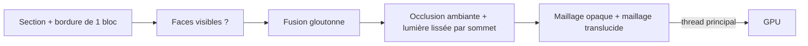

# Chunks et maillage

## À quoi ça sert

Le monde est découpé en **sections** de 16×16×16 blocs, empilées par 32 en **colonnes** (y de 0 à 511). Le **maillage** transforme une section en triangles que la carte graphique sait dessiner, en ne gardant que les faces visibles.

## Comment ça marche

### Stockage compact (palette)

Une section contient 4 096 blocs, mais rarement plus d'une poignée de sortes différentes. Plutôt que 4 096 numéros de bloc complets, elle garde :
- une **palette** : la liste des blocs présents (par exemple `[air, pierre, terre]`) ;
- pour chaque case, un **petit index** dans cette palette, sur le nombre de bits juste nécessaire (0, 1, 2, 4, 8 ou 16).

| Contenu de la section | Bits par bloc | Mémoire des indices |
|---|---|---|
| Que de l'air (le ciel) | 0 | rien |
| 2 sortes de blocs | 1 | 512 octets |
| 3-4 sortes | 2 | 1 Kio |
| 5-16 sortes | 4 | 2 Kio |

Quand un nouveau bloc apparaît, la palette grandit et les indices sont recopiés avec plus de bits. `compact()` fait le ménage quand des blocs ont disparu.

### Maillage

1. **Voisinage** : on copie la section avec une bordure d'un bloc prise chez ses voisines (`Neighborhood`, 18×18×18). Elle contient aussi la lumière de la section et de sa bordure. Le mailleur n'a ainsi besoin de rien d'autre et peut tourner sur n'importe quel thread.
2. **Faces visibles** : une face est dessinée seulement si le bloc d'à côté n'est pas opaque. Entre deux blocs transparents identiques (eau contre eau, verre contre verre), la face est cachée ; les feuilles gardent la leur (`cull_same: false`).
3. **Fusion gloutonne** (*greedy meshing*) : dans chaque tranche, les faces voisines identiques (même texture, même ombrage, même lumière et même teinte aux 4 coins) sont fusionnées en un seul grand rectangle. Un sol plat de 16×16 devient 2 triangles au lieu de 512. La texture se répète simplement sur le rectangle.
4. **Occlusion ambiante** : chaque coin de face regarde ses trois voisins devant lui ; plus il y a de blocs, plus le coin est sombre (4 niveaux). C'est ce qui assombrit doucement le pied d'un arbre ou le fond d'un couloir. La diagonale de chaque carré est choisie pour éviter un dégradé de travers. Réglable (0 = désactivée). La **lumière lissée** suit le même principe : chaque coin moyenne la lumière des cases autour (voir [Lumière](lumiere.md)) ; réglage `smooth_lighting`.
5. **Plantes en croix** : les blocs `Cross` (herbes, fleurs) sont mis de côté avant la fusion : deux plans diagonaux, chacun émis dans les deux sens (8 sommets), sans occlusion ni masquage de voisines. Voir [Biomes et végétation](biomes-et-vegetation.md). Une **torche murale** garde la même croix, soulevée de 3/16 et cisaillée vers son mur : le pied glisse de 7/16 vers le mur, le haut de 2/16 seulement, si bien qu'elle penche vers la pièce. La lanterne suspendue est une croix droite avec une texture à chaînette.
6. **Liquides** : la hauteur de chaque coin suit les cases voisines de la même famille (pentes, cascades) ; les faces inclinées ne sont jamais fusionnées, les océans plats si. Pas d'occlusion sur les liquides. Voir [Fluides](fluides.md).
7. **Variantes et raccords** : pour une texture aléatoire ou connectée, le mailleur remplace la couche du bloc par celle de la bonne variante (hachage de la position, ou voisins identiques) *avant* la fusion : seules des faces de même image fusionnent. Voir [Textures vivantes](textures-vivantes.md). Les textures animées, elles, sont choisies par le shader et ne coûtent aucun remaillage.
8. **Deux maillages** : opaque et « découpé » (feuilles, verre : pixels gardés ou jetés) d'un côté, **translucide** (eau, glace : mélangée) de l'autre. Le translucide est dessiné après, des sections lointaines aux proches, sans écrire la profondeur.

### Format des sommets

Chaque sommet tient en **12 octets** (8 avant les couleurs de biome) : position dans la section (0 à 16), face (0 à 5, ou 6 pour une plante en croix, éclairée à plat), occlusion, répétition de texture, numéro de couche de texture (16 bits ; le format n'a pas changé avec les textures vivantes), abaissement du sommet (liquides), animation (code de défilement des liquides), puis la lumière : 4 bits de ciel et 4 bits de blocs, gardés séparés pour que la nuit n'assombrisse que le ciel. Un troisième mot de 32 bits porte la **teinte de biome** (rouge, vert, bleu sur 8 bits chacun, 128 = couleur peinte inchangée) et un drapeau « masqué » pour la frange d'herbe des côtés ; ses 7 derniers bits disent vers quel mur pousser le sommet et de combien de seizièmes (torches murales). La surélévation passe par l'abaissement des liquides (un bloc plus haut, puis abaissé). Le shader décode ces bits. La position de la section est envoyée à part (relative à la caméra). C'est encore environ 2,3 fois moins qu'un sommet « classique » : moins de mémoire GPU, important pour le DS (mesuré : +7,5 Mo en profil DS, +27 Mo en haut, pour un monde entièrement chargé). Le calcul des teintes est expliqué dans [Atmosphère](atmosphere.md).

### Threads

Le maillage tourne sur des **threads de travail** (`MeshWorkers`, nombre réglable : par défaut tous les cœurs sauf deux). Le thread principal choisit les sections à remailler (les plus proches d'abord, dans la **distance verticale** réglable autour du joueur), et n'envoie à la carte graphique que pendant 4 ms par image, pour ne jamais geler l'affichage. Une section n'est maillée qu'une fois sa colonne et ses 8 voisines **éclairées** (la lumière arrive d'un thread à part) ; ensuite seules les sections dont la lumière a changé sont remaillées. Chaque section a un numéro de version : un maillage devenu obsolète entre-temps est jeté. Les sections dont la palette ne contient aucun liquide sautent tous les tests de liquide. Les sections enfouies (pleines d'un seul bloc opaque et entourées de sections pleines) ne sont pas maillées du tout. Les sections au-delà de la distance verticale ne sont ni maillées ni dessinées.

Mesures (`cargo bench -p strata-client`, machine cloud) : ~0,21 ms par section de surface, ~1,4 ms dans le pire cas (damier, aucune fusion possible, lumière variable).

## Où c'est dans le code

| Quoi | Où |
|---|---|
| Sections, palette, colonnes | `crates/core/src/chunk/` (`Section`, `PackedArray`, `Column`) |
| Monde côté client | `crates/client/src/world.rs` (`ClientWorld`) |
| Mailleur | `crates/client/src/mesher/` (`greedy.rs`, `cross.rs`, `neighborhood.rs`, `vertex.rs`) |
| Threads de maillage | `crates/client/src/mesher/workers.rs`, `crates/client/src/mesh_scheduler.rs` |
| Rendu des sections | `crates/client/src/render/mod.rs`, `block_pipeline.rs`, `shaders/block.wgsl` |
| Variantes et raccords de textures | `crates/client/src/mesher/variants.rs` |
| Lumière lissée | `crates/client/src/mesher/shading.rs` |
| Benchmarks | `crates/client/benches/meshing.rs` |

Côté Rust

- **Opérations sur les bits** : `(valeur >> décalage) & masque` lit un petit nombre rangé dans un `u64` ; `|` et `<<` l'y écrivent. C'est ainsi que `PackedArray` range 16 indices de 4 bits dans un seul `u64`.
- **`crossbeam-channel`** : des files de messages utilisables par plusieurs threads à la fois. La file des travaux est **bornée** : si elle est pleine, `try_send` rend le travail au lieu d'attendre, et on réessaie à l'image suivante.
- **`Arc<BlockTable>`** : la table des blocs est partagée en lecture par tous les threads sans copie ; `Arc` compte les utilisateurs et libère la table quand plus personne ne s'en sert.
- **`Drop`** : quand `MeshWorkers` disparaît, il ferme la file ; les threads voient la fin de la file, sortent de leur boucle, et sont attendus (`join`).

