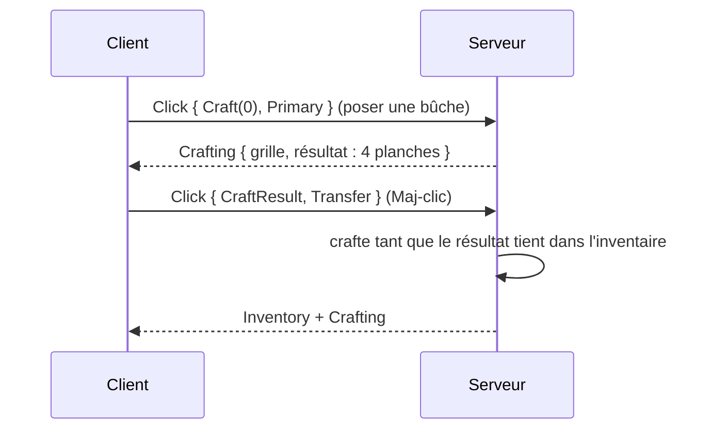

# Craft : recettes, grilles et livre de recettes

## À quoi ça sert

Le craft transforme des objets en d'autres : une bûche en quatre planches, quatre planches en établi, du charbon et un bâton en torches. On pose les ingrédients dans une **grille** (2×2 dans l'inventaire, 3×3 à l'établi) et le résultat apparaît à côté. Les recettes viennent toutes des packs. Le joueur ne les connaît pas toutes au départ : il les **apprend** en essayant, et retrouve celles qu'il sait dans le **livre de recettes** du journal.

## Comment ça marche

### Une recette dans le pack

```ron
// recipes/chest.ron
Shaped(
    pattern: ["PPP", "P P", "PPP"],
    key: {'P': Tag("strata:planks")},
    result: Result(item: "strata:chest"),
    starting: true,
)
```

- `Shaped` : une **forme** ; chaque caractère du motif est une case, l'espace une case vide. La forme peut être posée n'importe où dans la grille, et aussi retournée de gauche à droite.
- `Shapeless` : une liste d'ingrédients, dans n'importe quelles cases.
- `Tag("strata:planks")` : n'importe quel objet du **tag** `tags/planks.ron` (toutes les planches). Un pack qui ajoute un bois ajoute ses planches au tag sans recopier les autres.
- `starting: true` : connue dès le début d'une partie.
- Un objet peut laisser un **reste** (`remainder`) : le seau d'eau utilisé dans la recette de la boue laisse un seau vide dans la grille.

Au chargement, chaque nom inconnu est signalé avec le fichier fautif, et la recette est ignorée.

### Trouver la recette posée

On garde le plus petit rectangle qui contient tous les objets posés, puis on le compare aux formes de même taille (et à leur miroir). Pour aller vite, chaque objet connaît la liste des recettes qui l'utilisent : on ne teste que celles du premier objet posé.

### Qui fabrique ?

Le **serveur**, comme pour l'inventaire. La grille appartient au joueur côté serveur ; le client envoie ses clics et affiche ce que le serveur renvoie.



- Clic sur le résultat : un craft dans la pile tenue. **Maj-clic** : autant de crafts que possible ; le serveur vérifie avant chaque craft que le résultat entier rentre, donc rien n'est jamais perdu.
- Fermer l'écran rend la pile tenue **et** le contenu de la grille à l'inventaire. S'éloigner de l'établi ou le casser fait pareil.

### Apprendre une recette

- Le joueur connaît d'abord les recettes de départ. Une recette inconnue **fonctionne quand même** : la poser correctement donne l'objet, et la recette s'apprend (« Nouvelle recette apprise : … »).
- Quand les objets posés font partie d'une recette inconnue, un petit indice s'affiche : « Ces objets semblent aller ensemble… ».
- Les recettes apprises sont enregistrées par nom dans `player.ron`.
- Option de monde « Recettes : toutes connues », et en créatif : tout est connu.

### Le livre de recettes

L'écran **Journal** (touche J, ou bouton « Journal » de l'inventaire et de l'établi) a un onglet par section ; la première est le livre de recettes. Il ne montre **que les recettes apprises**, avec une recherche et un filtre « réalisables maintenant ». Ouvert depuis une grille, un second clic sur une recette (ou « Placer ») demande au serveur de déplacer les ingrédients de l'inventaire vers la grille ; « Placer tout » en met autant que possible.

## Dans le code

| Quoi | Où |
|---|---|
| Lecture des recettes, ingrédients | `crates/core/src/crafting/recipe.rs` |
| Tags d'objets | `crates/core/src/content/tags.rs` |
| Index et correspondance, indice | `crates/core/src/crafting/matching.rs` |
| Prendre le résultat (clic, Maj-clic, restes) | `crates/core/src/crafting/craft.rs` |
| « Réalisable », remplissage par le livre | `crates/core/src/crafting/plan.rs` |
| Grille d'un joueur, établi, savoir | `crates/server/src/game/crafting.rs` |
| Messages | `CraftingView`, `InventoryRequest::FillRecipe`, `ServerMessage::Crafting`, `Recipes`, `RecipeLearned` |
| Copie du client | `crates/client/src/crafting.rs` |
| Écrans | `assets/ui/inventory.ron`, `assets/ui/journal.ron`, `crates/client/src/screens/slots.rs`, `journal.rs` |
| Wiki (grilles dessinées) | `crates/wikigen/src/recipes.rs` |

<details><summary>Côté Rust</summary>

- **`BTreeMap<char, IngredientDef>`** : en RON, `{'P': Tag("strata:planks")}` ; la clé est un caractère entre apostrophes.
- **Retour arrière** (`assign`, `choose`) : une fonction qui essaie un choix, s'appelle elle-même pour la suite, et défait son choix si la suite échoue. Avec 9 cases au plus, c'est instantané.
- **Essayer sur une copie** : `let mut trial = window.player.clone();` puis `*window.player = trial;` seulement si tout a réussi. C'est la façon la plus simple de garantir « tout ou rien ».
- **`Arc::clone(&self.rules.recipes)`** : les recettes sont partagées en lecture ; on clone le pointeur (pas les recettes) pour pouvoir modifier `self` pendant qu'on les lit.
- **`message @ (A | B | C) => …`** : dans un `match`, `@` donne un nom à la valeur entière quand elle a l'une de ces formes.

</details>

## Pour aller plus loin

- Décisions D069 à D071 dans `docs/decisions.md`.
- [Inventaire, coffres et objets au sol](inventaire.md), [Récolte](recolte.md), [Packs](packs.md).
