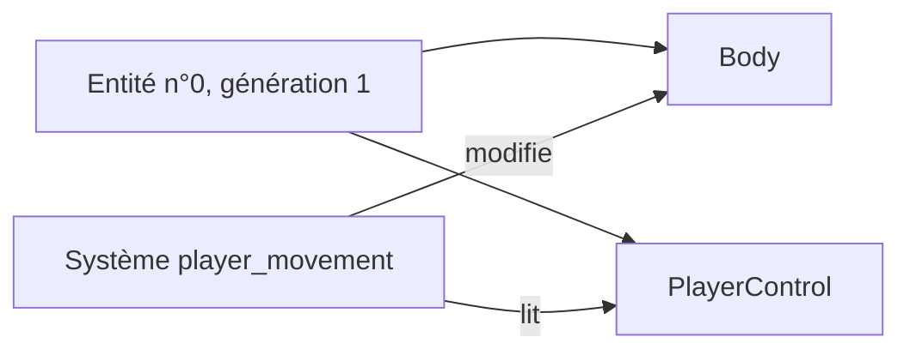

# ECS : entités et composants

## À quoi ça sert

Le serveur doit simuler des choses très différentes : le joueur aujourd'hui, puis des animaux, des monstres, des objets lâchés, des projectiles… Plutôt qu'une classe par sorte de chose, on utilise un **ECS** (*Entity Component System*) : une chose du monde n'est qu'un numéro, auquel on accroche des morceaux de données, et des fonctions traitent tous ceux qui ont les bons morceaux.

## Comment ça marche

- **Entité** : un simple identifiant (`Entity`), fait d'un **indice** et d'une **génération**. Quand une entité disparaît, son indice est réutilisé avec une génération +1 : un vieil identifiant gardé quelque part ne peut donc pas désigner par erreur la nouvelle entité.
- **Composant** : une donnée accrochée à une entité. Aujourd'hui :
  - `Body` : position, vitesse, au sol ou non, en vol ou non (le corps physique) ;
  - `PlayerControl` : les entrées reçues du client du joueur, pas encore appliquées.
- **Stockage** (`Storage<T>`) : un par sorte de composant. Les composants sont rangés **serrés** dans un tableau (rapide à parcourir), avec une table « entité → case » pour les retrouver (*sparse set*).
- **Système** : une fonction appelée à chaque tick qui parcourt un ou plusieurs stockages. Exemple : `player_movement` prend chaque `PlayerControl`, retrouve le `Body` de la même entité et applique les entrées avec la physique.

Ajouter une sorte de composant = ajouter un champ `Storage<…>` dans `Ecs`. Ajouter un comportement = écrire un système. Les mobs (v0.4) réutiliseront `Body` et la même physique.

## Où c'est dans le code

| Quoi | Où |
|---|---|
| Entités à génération | `crates/server/src/ecs/entity.rs` (`Entities`, `Entity`) |
| Stockage par composant | `crates/server/src/ecs/storage.rs` (`Storage`) |
| Liste des stockages | `crates/server/src/ecs/mod.rs` (`Ecs`, `PlayerControl`) |
| Systèmes | `crates/server/src/systems.rs` |
| Qui appelle quoi à chaque tick | `crates/server/src/game.rs` (`Game::tick`) |

Côté Rust

- **Pourquoi pas une crate ECS (`bevy_ecs`, `hecs`) ?** Elles sont excellentes mais grosses et changent souvent d'API. Notre besoin v0.1 tient en deux cents lignes qu'on comprend entièrement ; on pourra migrer plus tard si les mobs le demandent (voir `docs/decisions.md`, D021).
- **Emprunts séparés** : `ecs.controls.iter_mut()` et `ecs.bodies.get_mut(…)` empruntent deux champs différents de `Ecs` en même temps. Rust l'accepte parce que ce sont deux champs distincts ; il refuserait deux emprunts mutables du *même* stockage.
- **`Option<&mut T>`** : `get_mut` renvoie `None` si l'entité n'a pas ce composant (ou n'existe plus) ; le `let Some(body) = … else { continue }` saute alors l'entité au lieu de planter.

