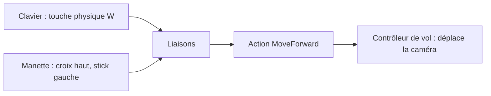

# Entrées : clavier, souris, manette

## À quoi ça sert

Le jeu doit se jouer aussi bien au clavier et à la souris qu'à la manette (et plus tard au tactile sur l'écran du bas du DS). Plutôt que de demander « la touche Z est-elle enfoncée ? », le jeu demande « le joueur veut-il **avancer** ? ». Ce sont les **actions**.

## Comment ça marche

- **Actions** (`Action`) : avancer, reculer, gauche, droite, sauter/monter, s'accroupir/descendre, sprinter, pause.
- **Liaisons** (`Bindings`) : une liste « entrée physique → action ». Plusieurs entrées peuvent viser la même action (Espace **et** le bouton A). Elles seront modifiables dans les options (jalon 8).
- **Touches physiques** : on lit l'*emplacement* de la touche, pas la lettre écrite dessus. La liaison `KeyW` correspond à la touche **Z** d'un clavier AZERTY : ZQSD marche donc tout seul.
- **Sticks analogiques** : le stick gauche s'ajoute aux touches de déplacement, le stick droit tourne la caméra. Une **zone morte** de 15 % ignore la petite dérive des sticks au repos.
- **Dernier périphérique utilisé** : retenu en permanence ; les invites à l'écran (« appuyez sur A » ou « appuyez sur Espace ») s'en serviront dès qu'il y aura une interface (jalon 7). Le tactile est déjà prévu comme périphérique.
- **Souris** : un clic dans la fenêtre capture le curseur ; Échap (ou Start) le libère. Quand la fenêtre perd le focus, tout est relâché (sinon une touche relâchée hors de la fenêtre resterait « enfoncée »).

Contrôles par défaut (vol libre du jalon 1) :

| Action | Clavier (QWERTY / AZERTY) | Manette |
|---|---|---|
| Avancer, reculer, gauche, droite | W A S D / Z Q S D | stick gauche ou croix |
| Monter | Espace | A (bas) |
| Descendre | Maj gauche | clic stick droit ou B (droite) |
| Sprint | Ctrl gauche | clic stick gauche |
| Regarder | souris | stick droit |
| Libérer le curseur | Échap | Start |
| Distance de rendu − / + | F7 / F8 | — |

## Où c'est dans le code

- `crates/client/src/input/action.rs`, `bindings.rs`, `state.rs` (`InputState`), `gamepad.rs` (`Gamepads`, via la crate `gilrs`).
- `crates/client/src/fly.rs` (`FlyController`) : transforme les actions en mouvement de caméra.
- `crates/client/src/frame.rs` : reçoit les événements de la fenêtre.

Côté Rust

- **`HashSet<Binding>`** : l'ensemble des entrées actuellement enfoncées. Une action est active si l'une de ses liaisons est dans l'ensemble.
- **`impl Iterator<Item = Action> + '_`** : la fonction renvoie un itérateur paresseux sur les actions, qui emprunte la liste des liaisons (`'_`) au lieu de la copier.
- **`Option` et `?`/`let … else`** : `gilrs` peut être indisponible (pas de manette, pas de droits) ; `Gamepads` garde alors `None` et le jeu continue au clavier.

