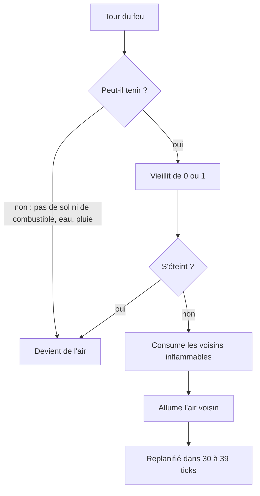

# Feu

## À quoi ça sert

Le feu **vieillit, se propage aux blocs inflammables, les consume, puis s'éteint** faute de combustible. Il s'allume au briquet, se règle par monde (`/fire`) et s'arrête au contact de l'eau. Tout vient du pack : quel bloc est un feu, quels blocs brûlent et avec quelle facilité.

## Comment ça marche

### Ce que dit le pack

- Un bloc inflammable porte `flammability: (catch, burn)` (l'échelle de Minecraft) : `catch` = facilité avec laquelle **l'air voisin** s'enflamme ; `burn` = facilité avec laquelle **le bloc lui-même** prend et disparaît. Les planches sont (5, 20), les feuilles (30, 60), les herbes (60, 100).
- Le bloc `strata:fire` porte `fire: (tick_rate: 30, max_age: 15)` : un pas toutes les 30 ticks environ, et un âge maximal de 15.

### Un pas de feu

Le feu partage la **file de blocs actifs** et le budget par tick des liquides (voir [Fluides](fluides.md)). Quand son tour vient :

- **Tenir** : sur un bloc solide ou contre un bloc inflammable, jamais contre un liquide qui l'éteint, jamais sous la pluie.
- **S'éteindre** : sans combustible autour, il meurt dès l'âge 4. À l'âge maximal, il a 1 chance sur 4 de mourir à chaque pas, sauf s'il brûle sur un combustible encore destructible.
- **Consumer** : chaque voisin inflammable prend avec une probabilité `burn / 300` (côtés) ou `burn / 250` (dessus, dessous). Il devient de l'air, ou parfois une nouvelle flamme.
- **Allumer** : l'air dans une boîte 3 × 6 × 3 autour du feu, s'il touche un bloc inflammable, s'allume avec `(catch + 54) / (âge + 30)` chances sur 100 (moins souvent en hauteur).
- **Un feu à l'âge maximal ne propage plus.** Les âges ne font que croître le long d'une chaîne de feux : tout incendie finit donc par s'éteindre (un test brûle une forêt de 9 × 9 et vérifie qu'il ne reste rien d'actif).

### Le hasard est déterministe

Les « chances » ne viennent pas d'un vrai tirage aléatoire mais d'un mélange de bits (*hachage*) de la position et du tick. Deux exécutions avec le même ordre de file brûlent **exactement pareil** : c'est ce qui permet de tester un incendie.

### L'âge n'est pas dans le monde

L'âge d'un feu est dans une petite table `position → âge` de `BlockUpdates`, pas dans 16 variantes de bloc comme les liquides : c'est une donnée éphémère. **Limite connue** : cette table n'est pas sauvegardée, un feu rechargé reste figé jusqu'à ce qu'un voisin change.

### Options, commande, briquet

- Options de monde `fire: (spread, destroy)` (par défaut `true`, `true`), boutons « Feu » et « Brûle » à la création du monde, commande `/fire spread|destroy on|off` et `/fire query`.
- `spread: false` : aucun nouveau feu (le voisin qui prend est seulement consumé). `destroy: false` : rien n'est consumé, mais le feu meurt quand même à l'âge maximal.
- `fluids.flow: false` ne fige que les liquides, pas le feu.
- Le **briquet** (`flint_and_steel`) vise la même case qu'une pose de bloc : il faut de l'air (ou une plante) et que le feu puisse y tenir. Créatif seulement pour l'instant.
- Pas encore : dégâts au joueur (pas de vie avant la v0.3) et lave qui allume (à venir avec les ticks aléatoires). La pluie est prévue via `BlockAccess::rains_on`, déjà consultée.
- Affichage : le feu est une plante en croix animée, voir [Textures vivantes](textures-vivantes.md).

## Où c'est dans le code

| Quoi | Où |
|---|---|
| Champs du pack | `crates/core/src/content/fire.rs` (`Flammability`, `FireDef`, `MAX_FIRE_AGE`) |
| Règles d'un pas de feu | `crates/core/src/updates/fire.rs` (`update_fire`, `burn`, `spread`, `Roll`, `FireSettings`) |
| File, âges, voisinage | `crates/core/src/updates/mod.rs` (`BlockUpdates`), `rules.rs` (`UpdateRules`) |
| Briquet | `crates/server/src/game/bucket.rs` (`fire_target`) |
| Commande `/fire` | `crates/server/src/commands.rs` |
| Tests | `crates/core/src/updates/fire_tests.rs` |
| Bloc et texture | `assets/packs/strata/blocks/fire.ron`, `textures/fire.ron` |

Côté Rust

- **`Option<bool>`** : `fire_can_stay` renvoie `Some(true)`, `Some(false)` ou `None` (« voisin pas chargé, je ne devine pas »). Le `match` oblige à traiter les trois cas.
- **`let ... else`** : `let Some(fire) = ... else { return; }` sort de la fonction si la valeur manque, sans niveau d'indentation de plus.
- **`wrapping_mul`** : une multiplication qui reboucle au lieu de planter en cas de dépassement ; indispensable pour un hachage.
- **`&mut impl BlockAccess`** : « n'importe quel monde qu'on peut lire et modifier » (serveur ou petit monde de test). Le feu ne dépend donc pas du serveur.
- **`#[serde(deny_unknown_fields)]`** : une faute de frappe dans un `.ron` devient une erreur claire.

