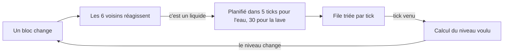

# Fluides : eau, lave, nage et seau

## À quoi ça sert

L'eau et la lave **coulent** : elles tombent, s'étalent, se rejoignent pour former des lacs, se figent au contact l'une de l'autre. Le joueur peut y nager, les voir onduler, et les déplacer avec un seau. Tout est décrit dans le pack (`fluid: (...)` d'un bloc), rien n'est codé en dur pour « l'eau » en particulier.

## Comment ça marche

### Un niveau = un bloc

Il n'y a pas de « niveau d'eau » caché dans un bloc. À la place, le jeu fabrique **plusieurs blocs** à partir de la source du pack : `water` (source), `water__1` … `water__7` (écoulement, 1 = presque plein, 7 = presque vide) et `water__falling` (chute). Ces variantes portent le même nom affiché que la source et n'ont pas d'objet. C'est la même astuce que les bûches couchées : le stockage des chunks et la sauvegarde n'ont pas eu à changer (voir [Chunks et maillage](chunks-et-maillage.md)).

### La file de blocs actifs

Parcourir tout le monde à chaque tick pour voir si de l'eau bouge serait bien trop lent. À la place, une **file** garde la liste des positions « à surveiller » avec le tick où elles doivent agir :

- L'eau générée avec le monde est **inerte** : rien n'est planifié tant qu'un voisin ne change pas. Casser le bloc qui retenait un lac suffit à tout réveiller.
- À chaque réveil, on calcule le niveau voulu : liquide au-dessus = chute ; sinon 1 + le niveau le plus plein parmi les 4 côtés ; au-delà de 7 blocs (3 pour la lave) le liquide s'assèche.
- Le liquide cherche le **trou le plus proche** (jusqu'à 4 blocs pour l'eau) et coule dans cette direction plutôt qu'au hasard.
- Deux sources voisines au-dessus d'un sol créent une nouvelle source : un étang se remplit tout seul (« renouvelable »).
- Lave et eau qui se touchent : la source de lave devient de l'**obsidienne**, la lave qui coule devient de la **pierre**.
- Un budget (2048 blocs par tick) borne le travail ; le reste attend le tick suivant. Le réglage de monde `fluids: (flow, updates_per_tick)` permet de figer les liquides (`flow: false`) ; il se choisit à la création du monde (bouton « Fluides ») et se change en jeu avec `/fluids on`, `/fluids off` ou `/fluids <budget>`.
- Une colonne pas encore chargée n'est jamais devinée : le liquide réessaie 20 ticks plus tard.

### Mises à jour de voisinage

Le même mécanisme sert à d'autres blocs : quand un bloc change, ses 6 voisins sont prévenus. Une fleur dont le sol disparaît est retirée, une liane sans plafond aussi, et ainsi de suite en cascade. Tous les changements sont envoyés aux clients comme un `BlockChanged` ordinaire.

### Affichage

- **Surface inclinée** : une case de source est à 14/16 de hauteur, un écoulement descend jusqu'à 2/16, une chute fait 16/16. Chaque coin prend la moyenne des cases voisines de la même famille : l'eau forme des pentes douces, et les cascades sont continues. Le mailleur et la physique utilisent **la même fonction** de hauteur.
- Les faces entre deux blocs du même liquide ne sont pas dessinées ; les surfaces plates des océans sont fusionnées, les surfaces inclinées non.
- **Animation** : le temps est envoyé au shader, qui fait défiler la texture (lente pour la lave). Le réglage graphique `liquid_animation` la coupe sans remailler.
- **Sous la surface** : l'écran se teinte (brouillard de la couleur du liquide : 12 blocs de visibilité dans l'eau, 2,5 dans la lave).

### Nager

Quand la boîte du joueur touche un liquide dont la surface dépasse ses pieds, il est « immergé » : il avance moins vite (moitié de la marche dans l'eau), on coule doucement, saut maintenu pour remonter. Contre une berge, une poussée aide à sortir. Le vol créatif ignore les liquides. Cette physique est dans `core` : le client la prédit et le serveur la confirme avec le même code (voir [Joueur et interaction](joueur-et-interaction.md)).

### Le seau

Un seau vide, clic droit sur une source : le serveur la retire (et l'écoulement se met à jour). Un seau plein, clic droit sur une case : le serveur pose une source. Le client envoie une simple intention `UseItem` ; en créatif le seau ne change pas.

## Où c'est dans le code

| Quoi | Où |
|---|---|
| Description d'un liquide, variantes, hauteur de surface | `crates/core/src/content/fluid.rs`, `liquid.rs` (`surface_sixteenths`) |
| File, règles d'écoulement, voisinage | `crates/core/src/updates/` (`mod.rs` : `BlockUpdates`, `BlockAccess` ; `fluid.rs` ; `rules.rs`) |
| Lien avec les colonnes chargées | `crates/server/src/loader.rs`, `crates/server/src/game/terrain.rs` |
| Seau | `crates/server/src/game/bucket.rs` |
| Nage | `crates/core/src/physics/swim.rs` (`immersion`, `steer`, `sink`, `climb_out`), trait `Terrain` dans `physics/mod.rs` |
| Maillage des liquides | `crates/client/src/mesher/`, `crates/client/src/render/shaders/block.wgsl` |
| Tests (dont coût d'un gros écoulement) | `crates/core/src/updates/tests.rs` |

Côté Rust

- **Trait** (`BlockAccess`, `Terrain`) : une liste de capacités qu'un type promet d'avoir. `BlockUpdates::tick` accepte « n'importe quoi qui sait lire et écrire un bloc » (`impl BlockAccess`) : le serveur lui donne ses colonnes, les tests un petit monde en mémoire. C'est ce qui rend la simulation testable sans serveur.
- **`BTreeMap`** : une table triée par clé. Avec la clé `(tick, ordre)`, la première entrée est toujours la prochaine à traiter, et l'ordre est identique à chaque exécution (déterminisme).
- **`enum` avec données** : `Source | Flowing(n) | Falling` dit à la fois le genre et le niveau ; le `match` force à traiter chaque cas.
- **Sommet de 8 octets** : on range plusieurs petits nombres dans un même entier (2 bits d'animation, 4 bits d'abaissement du sommet…) avec des décalages de bits ; le shader (programme de la carte graphique, en WGSL) les redécode.
- **Uniforme** : une valeur envoyée à la carte graphique une fois par image (ici le temps), lue par tous les sommets.

