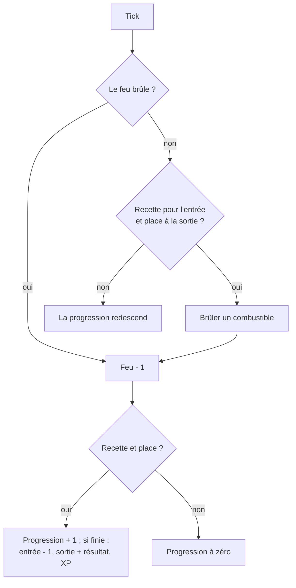

# Fours, tailleur de pierre et fours améliorables

## À quoi ça sert

Le **four** transforme un objet en un autre avec du feu : minerai de fer → lingot, sable → verre, bûche → charbon de bois. Le **haut fourneau** ne fond que les minerais et le **fumoir** ne cuit que la nourriture, deux fois plus vite. Le **tailleur de pierre** découpe un bloc en ses variantes (briques, pierre polie), sans combustible. Enfin, un four s'**améliore sur place** (pierre → fer → or → diamant) avec un kit, sans le vider : il cuit plus vite et consomme moins. Les coffres et tonneaux améliorables du jalon 7 suivront la même idée.

## Comment ça marche

### Tout est dans le pack

```ron
// blocks/furnace.ron (extrait)
placement: Facing(lit: Some(Lit(front: "strata:furnace_front_lit", light_emission: 13))),
furnace: Some(Furnace(family: "strata:furnace", tier: "strata:stone")),

// cooking/iron_ingot.ron
Cooking(ingredient: Tag("strata:iron_ores"), result: Result(item: "strata:iron_ingot"), experience: 0.7, kind: "strata:ore")

// fuels/coal.ron
Fuel(ingredient: Tag("strata:coals"), burn_time: 1600)

// furnace_tiers/iron.ron
FurnaceTier(cook_time: 80, fuel_value: 125, upgrade_slots: 1)
```

- `kind` dit quels fours cuisent la recette : le four accepte tout, le haut fourneau `strata:ore`, le fumoir `strata:food`.
- Un tier donne des **pourcentages** : `cook_time: 80` = une cuisson prend 80 % du temps ; `fuel_value: 125` = un charbon fait 25 % de cuissons en plus.
- Les kits (`kit: Some(Kit(from, to))`) et les modules (`module: Some(Furnace(...))`) sont des champs d'objets.

### Une façade qui regarde le joueur, et qui s'allume

Le pack décrit le four face au nord. Au chargement, le moteur crée huit variantes : quatre directions, éteintes puis allumées (`furnace__south`, `furnace__lit_east`…). À la pose, le serveur choisit celle dont la façade regarde le joueur. Quand le feu prend, il remplace le bloc par sa variante allumée : comme elle **émet de la lumière**, le moteur de lumière habituel éclaire les alentours, sans code spécial.

### Un tick de four



Cette fonction (`cooking::step`) est **pure** : elle prend l'état et les cases, les modifie, et dit si le four a encore quelque chose à faire. Les tests la font tourner des milliers de fois sans monde ni écran.

### Seuls les fours actifs coûtent

Le serveur garde la liste des fours **actifs** (qui brûlent ou refroidissent). Un four éteint n'est plus regardé du tout ; il redevient actif quand on clique dans son écran, quand on l'améliore ou au chargement de la sauvegarde. Un four dont la zone n'est pas chargée attend, comme dans Minecraft : rien n'est rattrapé.

### Les cases du four

L'écran du four est un conteneur comme un coffre (entrée, combustible, sortie, puis les améliorations), avec une **politique de cases** qui refuse ce qui ne va pas (du charbon dans la sortie, deux fois le même module). Maj-clic envoie chaque objet dans sa case : ce qui se cuit dans l'entrée, le combustible dans sa case, le module dans une case libre. Le contenu et l'état du feu sont écrits dans `block_entities/`, avec ceux des coffres.

### Améliorer sur place

Clic droit avec un **kit** sur un four : le serveur cherche le bloc de la **même famille** (four, fumoir ou haut fourneau) au tier suivant, avec la même façade et le même état allumé, et le pose à la place. L'entité de bloc, elle, ne bouge pas : contenu, combustible, cuisson en cours et XP restent, et des cases d'amélioration s'ajoutent.

### Le tailleur de pierre

C'est un poste de travail comme l'établi, avec une seule case : posez un bloc, la liste montre ses variantes (`stonecutting/`), choisissez-en une, prenez le résultat (Maj-clic : toute la pile).

## Dans le code

| Quoi | Où |
|---|---|
| Définitions du pack, chargement | `crates/core/src/cooking/defs.rs`, `load.rs` |
| Un tick de four, vitesses | `crates/core/src/cooking/furnace.rs` |
| Cases du four, Maj-clic | `crates/core/src/cooking/slots.rs`, `inventory::SlotPolicy` |
| Tailleur | `crates/core/src/cooking/cutting.rs`, `server/game/crafting.rs` |
| Variantes orientées et allumées | `crates/core/src/content/facing.rs`, `server/game/placing.rs` |
| Fours actifs, allumage, kits | `crates/server/src/game/furnaces.rs` |
| Écrans | `assets/ui/inventory.ron` (`furnace_side`, `cutter_side`), `client/src/screens/slots.rs`, nœud `Gauge` |
| Wiki (cuisson, combustible, tiers) | `crates/wikigen/src/cooking.rs` |

<details><summary>Côté Rust</summary>

- **`&dyn SlotPolicy`** : un « objet trait ». La fenêtre ne sait pas si elle parle à un four ou à autre chose ; elle appelle `accepts` et `route`, et chaque type de bloc fournit sa propre version. `None` = un coffre ordinaire.
- **`if a && let Some(x) = f() { … }`** : une condition et un motif dans le même `if` (Rust 2024). Écrire `if let (true, Some(x)) = (a, f())` appellerait `f()` même quand `a` est faux : c'est exactement le bogue qui effaçait le contenu d'un four en s'allumant.
- **Emprunts disjoints** : dans `step_furnace`, on lit `self.rules` pendant qu'on modifie `self.block_entities` ; Rust l'accepte parce que ce sont deux champs différents, pas deux fois `self` entier.

</details>

## Pour aller plus loin

- Décisions D072 à D074 dans `docs/decisions.md` ; valeurs dans `docs/regles/equilibrage.md`.
- [Craft](craft.md), [Inventaire, coffres et objets au sol](inventaire.md), [Lumière](lumiere.md).
