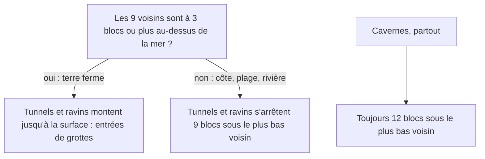

# Grottes

## À quoi ça sert

Une fois le relief posé, le monde est un gros bloc de pierre plein. Les grottes le creusent : tunnels pour se déplacer, grandes salles pour s'émerveiller, ravins pour tomber dedans, poches d'eau et lave pour pimenter l'exploration. Tout est calculé à partir de la graine : même graine, mêmes grottes, quel que soit l'ordre dans lequel on génère les colonnes.

## Comment ça marche

### Le principe : du bruit et un seuil

Le **bruit** est une fonction qui, pour chaque point de l'espace, donne un nombre qui varie doucement (entre -1 et 1). On décide ensuite qu'un bloc est « vide » selon la valeur du bruit. Selon la règle choisie, on obtient des formes très différentes.

| Type | Règle | Forme |
|---|---|---|
| **Spaghetti** | deux bruits 3D sont **tous les deux proches de zéro** | longs tunnels sinueux |
| **Nouilles** | même idée, plus fine, seulement sous `noodle_top` (y 100) et sur la moitié de l'espace (un bruit « interrupteur ») | galeries étroites et tortueuses |
| **Cavernes « fromage »** | un bruit dépasse un seuil, de plus en plus facilement en profondeur ; aucune au-dessus de y ≈ 180 | grandes salles, avec des **piliers** là où un autre bruit, étiré à la verticale, monte |
| **Ravins** | on suit la **ligne zéro** d'un bruit 2D, uniquement où un masque rare l'autorise | fissures en V, larges en haut, étroites (20 %) au fond |

Pourquoi « proche de zéro » ? Un bruit vaut zéro le long d'une surface ; deux bruits qui valent zéro ensemble, c'est l'intersection de deux surfaces : une **ligne**, donc un tunnel. Plus on tolère de s'éloigner de zéro (la largeur du réglage), plus le tunnel est gros.

Les ravins ont deux profils : certains s'ouvrent à la surface (on les voit de loin), d'autres restent cachés entre y ≈ 0 et 80.

### La grille interpolée

Calculer plusieurs bruits 3D pour chacun des 65 000 blocs d'une colonne coûterait cher. On ne les calcule donc que **tous les 4 blocs** (aux coins d'une grille alignée sur le monde), puis on **interpole** : pour un bloc entre huit coins, on fait la moyenne pondérée par la distance (interpolation « trilinéaire »). Les grottes sont lisses, donc on y perd peu ; on y gagne environ 60 fois en vitesse.

La grille est alignée sur les coordonnées du monde, pas sur la colonne : deux colonnes voisines calculent exactement les mêmes coins sur leur frontière, donc les tunnels se raccordent sans couture.

Une fonction jumelle, `at_point`, redonne la même valeur pour **un seul bloc** sans construire la grille. Elle sert aux arbres : une colonne voisine doit savoir si une entrée de grotte s'ouvre sous le pied d'un arbre pour ne pas le laisser flotter.

### Les toits : ne jamais percer une mer

Chaque colonne reçoit une hauteur maximale à ne pas dépasser, calculée à partir du **point le plus bas parmi les 9 blocs** du voisinage (le bloc et ses 8 voisins) :

Résultat : on trouve des entrées de grottes sur les collines, mais jamais une grotte qui s'ouvrirait dans le fond d'un lac, d'une rivière ou de la mer. Ne sont jamais creusés non plus : le socle indestructible, l'eau, la glace et la lave.

### Aquifères : l'eau sous terre

Le monde est découpé en **régions d'environ 64 × 64 blocs** (`aquifer_cell`). Pour que leurs frontières ne soient pas des lignes droites, la position est d'abord déformée par un bruit (jusqu'à un tiers de région) avant de chercher sa région. Une part des régions (réglage `aquifers`, 35 %) a une nappe : un **niveau d'eau plat**, tiré au hasard entre `aquifer_top - aquifer_depth` et `aquifer_top`. Tout l'espace creusé sous ce niveau se remplit d'eau, ce qui donne des lacs souterrains.

Problème : deux régions voisines ont des niveaux différents, et l'eau pendrait en l'air à la frontière. On laisse donc **2 blocs de roche** de chaque côté d'une frontière, seulement entre le plus bas et le plus haut des deux niveaux (depuis le fond si une des régions est sèche) : un petit mur qui retient l'eau.

### Lave

Tout ce qui est creusé **à y ≤ 10** se remplit de lave (bloc `strata:lava`), au fond du monde. Les fluides restent immobiles pour l'instant : l'écoulement viendra plus tard.

### Les réglages du pack

Dans `assets/packs/strata/dimensions/terra.ron`, le bloc `caves: (...)`. Sans ce bloc, la dimension n'a pas de grottes.

| Réglage | Valeur | Effet |
|---|---|---|
| `enabled` | `true` | `false` coupe toutes les grottes |
| `density` | `1.0` | multiplie toutes les largeurs et rapproche le seuil des cavernes (0 = aucune grotte) |
| `spaghetti` | `0.075` | largeur des tunnels |
| `noodles` | `0.05` | largeur des nouilles |
| `noodle_top` | `100` | hauteur max des nouilles |
| `cheese` | `0.3` | seuil des cavernes : plus haut = moins de cavernes |
| `cavern_top` | `140` | les cavernes se raréfient vers cette hauteur et cessent un tiers plus haut |
| `ravines` | `0.03` | largeur des ravins |
| `ravine_depth` | `(30, 80)` | profondeur minimale et maximale des ravins |
| `aquifers` | `0.35` | part des régions avec une nappe |
| `aquifer_cell` | `64` | côté d'une région de nappe |
| `aquifer_top` | `100` | niveau d'eau maximal |
| `aquifer_depth` | `48` | écart entre le niveau le plus bas et `aquifer_top` |
| `lava_level` | `10` | en dessous, la lave |
| `lava` | `"strata:lava"` | bloc de lave |

Les valeurs sont bornées au chargement : une faute de frappe ne peut pas casser le monde. Les réglages omis prennent leur valeur par défaut.

## Où c'est dans le code

| Quoi | Où |
|---|---|
| Orchestration, spaghetti, nouilles, cavernes, remplissage | `crates/worldgen/src/caves/mod.rs` (`Caves`, `Caves::carve`, `Caves::may_open`) |
| Grille interpolée | `crates/worldgen/src/caves/grid.rs` (`CaveGrid`, `at_point`) |
| Ravins | `crates/worldgen/src/caves/ravines.rs` (`Ravines`, `Span`) |
| Aquifères | `crates/worldgen/src/caves/aquifers.rs` (`Aquifers`, `Table`) |
| Calcul des toits | `crates/worldgen/src/generator.rs` (`Generator::cave_roofs`), type `Roofs` dans `caves/mod.rs` |
| Réglages lus dans le pack | `crates/worldgen/src/defs.rs` (`CavesDef`), `content.rs` (`Caves`) |
| Tests (côtes, rivières, déterminisme) | `crates/worldgen/tests/caves.rs` |
| Décision | `docs/decisions.md` (D037) |

Côté Rust

- **`Option<T>`** : une valeur qui peut être absente. `Table.level: Option<i32>` vaut `Some(62)` s'il y a une nappe, `None` sinon. Le compilateur oblige à traiter les deux cas, d'où `map_or`, `is_some_and`, `then_some` dans le code. De même, `caves: Option<CavesDef>` dans le pack : absent = pas de grottes.
- **Fermetures (closures)** : de petites fonctions anonymes qu'on passe en argument, comme `|x, y, z| self.openness(x, y, z)`. `CaveGrid::sample` reçoit ainsi « la formule du bruit » sans rien savoir des grottes. Le type `impl Fn(i32, i32, i32) -> f64` signifie « n'importe quelle fermeture de cette forme ».
- **Tableaux de taille fixe** : `[[i32; 16]; 16]` est un carré de 16 × 16 entiers, de taille connue à la compilation, donc rangé sans allocation. `std::array::from_fn` en construit un en appelant une fonction pour chaque case.
- **`div_euclid` / `rem_euclid`** : division et reste qui arrondissent toujours vers le bas, même pour les coordonnées négatives. Avec `/` et `%`, le bloc -1 serait rangé dans la mauvaise case de la grille et les grottes auraient une couture en x = 0.
- **`Vec<T>`** : tableau redimensionnable sur le tas ; la grille y range ses couches de hauteur.
- **`#[serde(default = "…")]`** : indique à la lecture du fichier RON la valeur à prendre quand un champ manque. `deny_unknown_fields` refuse au contraire les champs inconnus (fautes de frappe).
- **Fonction pure** : un résultat qui ne dépend que des entrées (graine et position). C'est ce qui permet de générer les colonnes sur plusieurs threads, dans n'importe quel ordre.
- **Interpolation trilinéaire** : `lerp(a, b, t) = a + (b - a) * t` appliquée sur x, puis z, puis y. Même idée qu'un dégradé entre deux couleurs.

