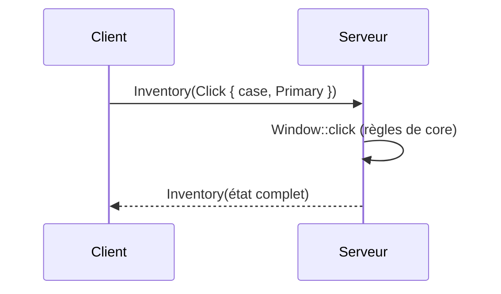

# Inventaire, coffres et objets au sol

## À quoi ça sert

En survie, chaque objet du joueur a une place : 27 cases de sac, la barre rapide, 4 cases d'armure et la main secondaire. Les objets s'empilent, s'usent, portent des informations en plus (améliorations, enchantements plus tard) ; ils se rangent dans des coffres et des tonneaux, tombent au sol et se ramassent. Tout cela doit rester juste même en multijoueur : c'est le **serveur** qui décide.

## Comment ça marche

### Une pile d'objets

Une `ItemStack` dit **quel objet**, **combien**, **combien d'usages il reste** (pour un outil) et des **données** libres : une petite table « clé → valeur » où chaque clé a un espace de noms (`strata:parts`). Deux piles ne se rejoignent que si tout, sauf le nombre, est identique : une pioche usée ne rejoint pas une neuve. La taille maximale d'une pile et la durabilité viennent du pack (`max_stack`, `durability`).

### L'inventaire et les clics

L'inventaire du joueur est une liste de 41 cases : 0-8 la barre, 9-35 le sac, 36-39 l'armure, 40 la main secondaire. Quand un écran est ouvert, le joueur peut aussi « tenir » une pile sous le pointeur.

Toutes les règles des clics sont des **fonctions pures** dans `core` (sans réseau ni écran), testées une par une :

| Geste | Effet |
|---|---|
| clic gauche | prendre la pile, la poser, ou échanger |
| clic droit | prendre la moitié (arrondie au-dessus), ou poser un seul objet |
| Maj + clic | envoyer la pile de l'autre côté (barre ↔ sac, coffre ↔ inventaire) |
| double clic | regrouper sur la pile tenue les objets identiques, les piles incomplètes d'abord |
| 1 à 9 | échanger la case avec une case de la barre |

Le client n'applique rien lui-même : il **affiche** l'état reçu. Seule la case en main est changée tout de suite côté client (pour que la molette réponde sans attendre), puis annoncée au serveur.

### Survie et créatif

En créatif, l'écran montre tous les objets et chaque choix devient un `CreativeSet` (le serveur vérifie qu'on est bien en créatif). En survie, poser un bloc retire un objet de la main, casser un bloc laisse son objet par terre, un seau se remplit ou se vide, le briquet s'use.

### Coffres et tonneaux : des « entités de bloc »

Les fichiers de régions ne contiennent que des numéros de blocs, très compacts. Le contenu d'un coffre est rangé **à part**, dans une table « position → contenu » écrite dans `block_entities/<espace>/<dimension>.ron`. Quand un bloc change, le serveur vérifie s'il reste un conteneur ; sinon, le contenu tombe au sol.

Deux coffres côte à côte se joignent si chacun est le **premier** voisin de l'autre : trois coffres alignés donnent un coffre double et un simple. Chaque moitié garde ses 27 cases ; l'écran les montre l'une après l'autre.

### Confort

- **Trier** : les cases non verrouillées du sac sont vidées, les piles fusionnées, triées (par catégorie ou par nom traduit), puis remises en place.
- **Verrouiller** une case la protège du tri, du regroupement et du dépôt.
- **Ranger** (dépôt rapide) : les piles du sac vont dans les coffres proches qui contiennent déjà le même objet.
- **Rechercher** dans un coffre assombrit les cases qui ne correspondent pas.

### Objets au sol

Un objet jeté ou tombé est une entité : il tombe, glisse, flotte, se rassemble avec ses semblables proches, est **ramassé** quand le joueur passe à côté (pas tout de suite après l'avoir lancé) et **disparaît** après 5 minutes. Tous ces chiffres sont dans l'entité `strata:item` du pack. Le client le dessine comme un petit cube (bloc) ou une image (autre objet) qui tourne.

## Dans le code

- `crates/core/src/inventory/` : piles, conteneurs, clics, tri, dépôt.
- `crates/core/src/physics/item.rs` : mouvement des objets au sol.
- `crates/protocol/src/inventory.rs` : `InventoryRequest`, `OpenedContainer`.
- `crates/server/src/game/inventory.rs`, `containers.rs`, `drops.rs` : application des demandes, coffres, objets au sol.
- `crates/server/src/save/stacks.rs`, `block_entities.rs` : sauvegarde par identifiants.
- `crates/client/src/hotbar.rs` : copie locale de l'inventaire et file des demandes.
- `crates/client/src/screens/slots.rs`, `slot_input.rs`, `assets/ui/inventory.ron` : écran et gestes.

## Pour aller plus loin

- Décisions D062 à D065 dans `docs/decisions.md`.
- [Client et serveur](client-serveur.md), [ECS](ecs.md), [Sauvegarde](sauvegarde.md), [Bateaux et entités](bateaux-et-entites.md).
