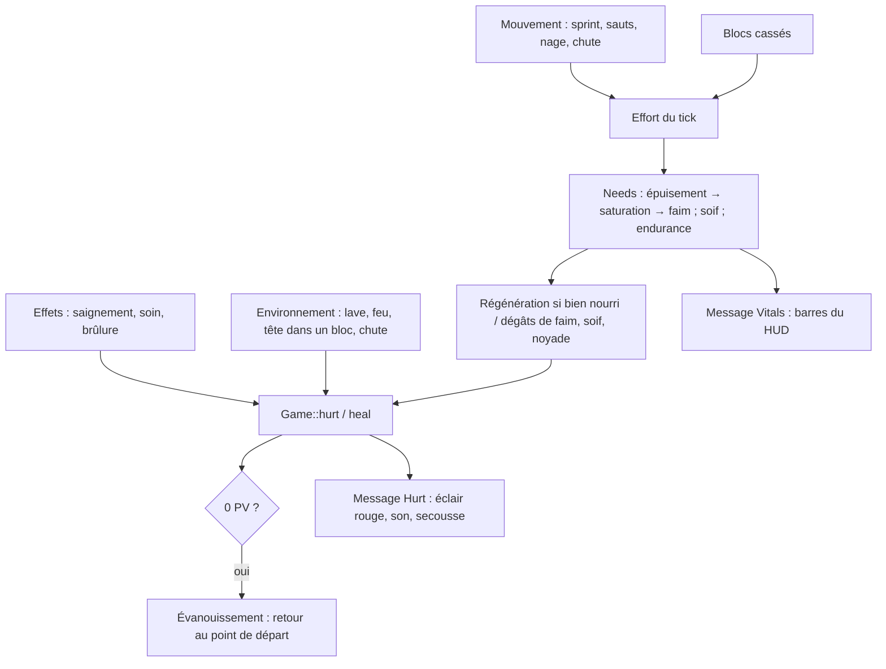

# Jauges de survie : vie, faim, soif, endurance, souffle, dégâts

## À quoi ça sert

En survie, le joueur doit manger, boire, reprendre son souffle et éviter les chutes, la lave ou la noyade. Ce fichier explique comment le serveur tient ces jauges à jour, comment les dégâts sont calculés et comment le HUD les affiche.

## Comment ça marche

Chaque tick (20 par seconde), le serveur fait, pour le joueur en survie :

- **L'épuisement** (une idée de Minecraft) : chaque effort ajoute un peu d'épuisement ; à 4, on perd un point de saturation (réserve invisible), puis un point de faim. La soif reçoit 75 % de cet épuisement et baisse aussi toute seule avec le temps.
- **La vie** revient seule quand la faim est à 18 ou plus (vite si la faim est pleine et qu'il reste de la saturation) ; chaque point soigné coûte de l'épuisement. À faim ou soif nulle, on perd 1 PV toutes les 4 secondes, jamais en dessous de 1.
- **L'endurance** se vide en sprintant, sautant, esquivant ; elle revient après un court repos. À zéro, plus de sprint jusqu'à 25. L'armure lourde baisse son maximum.
- **Les dégâts** passent par une seule fonction : l'armure réduit certains genres (chute, coups), une résistance en pourcentage en réduit d'autres (feu, lave), puis une **invulnérabilité** de 10 ticks empêche deux coups d'affilée.
- **Les effets** (saignement, soin, brûlure) durent quelques secondes ; un même effet n'est jamais là deux fois : le plus fort reste.
- **Manger** : on maintient le clic droit ; le client dit « je commence » et « j'arrête », le serveur compte le temps et décide.

La température (froid, chaud, abri, vêtements) a son propre fichier : [temperature.md](temperature.md).

Tout se règle dans les packs : `survival.ron` pour les nombres, `consumables/` pour ce que donne chaque aliment, `damage_types/`, `status_effects/`, `contacts/` (lave, feu), `fills/` (bouteilles). À la création du monde, faim, soif et endurance se coupent et leur vitesse se règle.

## Où c'est dans le code

- `crates/core/src/survival/` : `rules.rs` (`survival.ron`), `defs.rs` (formats des packs), `health.rs` (`Health`, chute, réduction), `needs.rs` (`Needs`, `SurvivalOptions`, `Exertion`), `effects.rs` (`StatusEffects`), `load.rs`, `describe.rs` (infobulles).
- `crates/server/src/game/vitals.rs` (tick, environnement, message `Vitals`, sauvegarde), `damage.rs` (`Game::hurt`, `faint`), `consume.rs` (manger, remplir, boire, sac nourricier) ; `systems.rs` (`track_effort`).
- `crates/protocol/src/vitals.rs` (`VitalsView`, `HurtView`).
- `crates/client/src/gameplay/vitals.rs` (éclair, secousse, manger), `screens/hud.rs` (`Bars`), `assets/ui/hud.ron`, couleurs dans `assets/ui/theme.ron`.

Côté Rust

- **Composants ECS** : `Storage<Health>` est un tableau de valeurs indexé par entité ; ajouter une jauge à un mob plus tard, c'est insérer un `Health` pour son entité.
- **`std::mem::take`** : récupère l'effort accumulé et laisse une valeur vide à sa place, en une opération.
- **`Arc<Survival>`** : les règles sont partagées sans copie ; `Arc::clone` ne copie qu'un pointeur.
- **`#[serde(default)]` et `#[serde(skip)]`** : un ancien monde sans jauges se charge (valeurs par défaut), et les compteurs internes (minuteries) ne sont pas sauvegardés.

