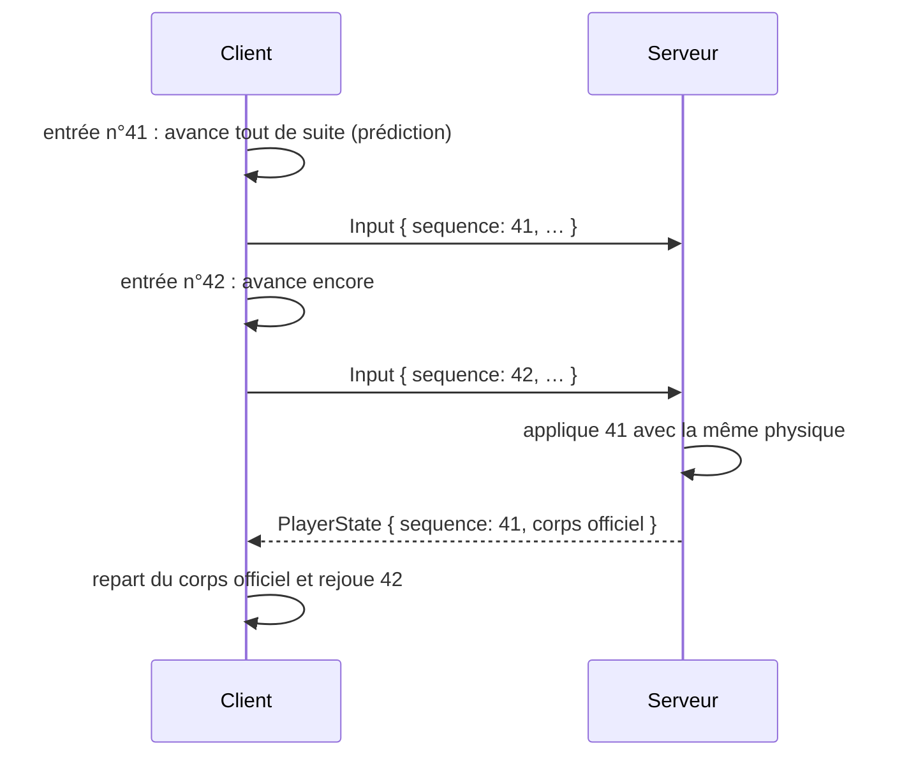

# Joueur et interaction

## À quoi ça sert

Le joueur marche, saute, sprinte, s'accroupit, vole en créatif, vise un bloc, le casse, en pose un autre. Tout cela doit être **immédiat** à l'écran, mais c'est quand même le **serveur** qui décide (règle d'or du projet, et condition pour le multijoueur).

## Comment ça marche

### Une seule physique, des deux côtés

La physique du joueur (`step`) est écrite **une fois**, dans `core`, et tourne à la fois sur le client et sur le serveur, au même rythme fixe de 20 pas par seconde. Avec les mêmes entrées, elle donne exactement le même résultat des deux côtés.

- **Boîte de collision** de 0,6 × 1,8 bloc (yeux à 1,62), comme Minecraft.
- **Gravité**, saut d'environ 1,25 bloc, marche 4,3 blocs/s, sprint 5,6, accroupi 1,3.
- **Collisions axe par axe** et par petits pas (jamais plus de 0,4 bloc d'un coup) : même très vite, on ne traverse pas un mur.
- **Accroupi** : on ne tombe pas du bord d'un bloc.
- **Montée automatique d'un demi-bloc** (dalles, escaliers à venir) et **saut automatique** quand on marche contre une marche d'**un** bloc (jamais contre un mur, jamais accroupi) : les deux se règlent (`ControlSettings`).
- **Vol créatif** : deux appuis rapides sur saut (moins de 0,3 s) ; Espace monte, Maj descend ; se poser coupe le vol.
- Les colonnes pas encore chargées comptent comme pleines : personne ne tombe dans un monde qui n'est pas arrivé.

### Prédiction et réconciliation

1. À chaque pas, le client lit les touches, fabrique une `MoveInput` (direction voulue, regard, saut, sprint…), **l'applique tout de suite** à son joueur et l'envoie numérotée au serveur.
2. Le serveur range ces entrées et les applique **au rythme de son horloge** : une par tick en moyenne, avec une petite réserve de 3 pour rattraper un retard (un client ne peut donc pas aller plus vite en envoyant plus de messages). Un client qui n'envoie plus rien pendant une demi-seconde ne flotte pas : son joueur retombe. Le serveur renvoie le corps officiel et le numéro de la dernière entrée appliquée.
3. Le client **repart du corps officiel** et rejoue les entrées que le serveur n'a pas encore vues. Si tout va bien, on retombe exactement au même endroit et rien ne bouge à l'écran ; si le serveur a corrigé (téléportation, triche), le client suit le serveur.
4. L'affichage **interpole** entre les deux derniers pas : le mouvement est fluide à 30, 60 ou 144 images par seconde alors que la physique ne tourne qu'à 20.

### Viser, casser, poser

- **Raycast** (algorithme d'Amanatides et Woo) : depuis les yeux, on avance bloc par bloc dans la direction du regard jusqu'à 5 blocs, en sachant par quelle face on est entré. Le bloc visé est entouré d'un **contour**.
- **Casser** (clic gauche) : instantané en créatif. Le client envoie `BreakBlock` ; le serveur vérifie la position (dans la bordure et la hauteur du monde), la portée (6 blocs, un peu plus que le client pour les arrondis), la dureté (hors créatif, le socle est incassable) et le rythme (10 actions par seconde au plus), puis renvoie `BlockChanged` ; seulement alors le bloc disparaît chez le client.
- **Poser** (clic droit) : `PlaceBlock { contre, face, bloc }`. Le serveur vérifie : bloc posable, support solide, case libre, dans la hauteur du monde, à portée, et pas dans le corps d'un joueur.
- **Orientation** : les bûches se posent **couchées dans l'axe de la face cliquée**. Dans le pack, il suffit d'écrire `placement: Axis` : au chargement, le jeu crée tout seul les variantes couchées `…__x` et `…__z`, sans objet ni nom propre (elles s'appellent comme la bûche debout). Le maillage tourne la texture d'écorce pour que les fibres suivent la bûche.
- **Maintenir le bouton** répète l'action toutes les 0,25 s.
- **Prise de bloc** (clic molette) : met l'objet du bloc visé dans la barre.
- **Nom du bloc visé** en haut de l'écran (façon mod Jade), désactivable (`show_block_name`). L'outil requis s'y ajoutera avec la survie (v0.3).

### Barre et inventaire créatif

- **Barre** de 9 cases : touches 1 à 9, molette, L/R à la manette.
- **Inventaire créatif** (E ou X) : onglets par catégorie (Tout, Construction, Nature… venant des packs), champ de **recherche** (sur le nom traduit), grille de tous les objets. Un clic, A ou une touche 1-9 met l'objet dans la barre. Voir [Interface](interface.md).

## Où c'est dans le code

| Quoi | Où |
|---|---|
| Physique partagée, boîte de collision | `crates/core/src/physics/` (`Body`, `MoveInput`, `step`, `Aabb`) |
| Raycast | `crates/core/src/raycast.rs` |
| Joueur côté serveur (entité, validations) | `crates/server/src/game.rs`, `systems.rs`, `rules.rs` |
| Prédiction, réconciliation, double saut | `crates/client/src/player.rs` (`LocalPlayer`) |
| Touches → `MoveInput`, caméra | `crates/client/src/gameplay.rs`, `look.rs` |
| Visée, casser, poser, prise de bloc | `crates/client/src/interaction.rs` |
| Contour du bloc visé | `crates/client/src/render/outline.rs` |
| Variantes orientées | `crates/core/src/content/` (`Placement`, `Orientation`, `insert_turned`) |
| Barre | `crates/client/src/hotbar.rs` |

Côté Rust

- **`impl Fn(i32, i32, i32) -> bool`** : la physique ne sait rien des chunks ; on lui passe une *fonction* qui répond « ce bloc est-il solide ? ». Le serveur lui donne ses colonnes, le client les siennes, les tests un simple sol plat. C'est ce qui permet d'écrire la physique une seule fois.
- **`VecDeque`** : une file où l'on ajoute à la fin et retire au début en temps constant, idéale pour les entrées en attente.
- **`wrapping_add` / `wrapping_sub`** : les numéros d'entrée sont des `u32` qui repartent à zéro après 4 milliards ; ces opérations le font sans plantage, et la comparaison `(a - b) as i32 <= 0` reste juste au passage.
- **`f64` pour les positions** : à 10 millions de blocs de l'origine, un `f32` n'a plus que ~1 bloc de précision ; un `f64` reste précis au micromètre.

