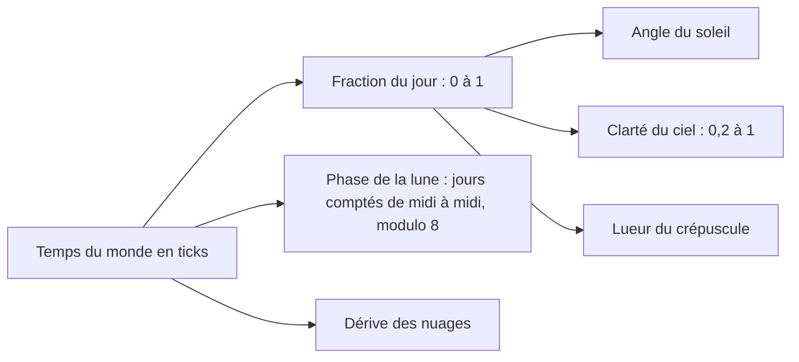

# Jour, nuit et ciel

## À quoi ça sert

Le monde a une heure : le soleil se lève, traverse le ciel, se couche, puis la lune et les étoiles prennent le relais. La lumière du ciel baisse la nuit (les torches, elles, éclairent toujours autant), et des nuages dérivent au-dessus des collines. Tout se règle dans des fichiers de pack : durée du jour, couleurs, astres, nuages.

## Comment ça marche

### Une seule horloge : le temps du monde

Le monde compte des **ticks** (20 par seconde, voir [Boucle de jeu](boucle-de-jeu.md)) depuis le **premier lever de soleil**. Il ne revient jamais à zéro : on garde le total pour savoir quel jour on est (et donc quelle phase de lune). Une journée complète dure 24 000 ticks, soit 20 minutes réelles, dont 10 de jour et 10 de nuit.

Tout le reste se **déduit** de ce seul nombre : position du soleil, clarté, couleur du ciel, phase de la lune, dérive des nuages. Rien d'autre n'est sauvegardé, et pour une même heure on obtient toujours le même ciel (c'est ce qui permet les captures `--time`).

### Le cycle (`DayCycle`)

Le fichier de la dimension (`dimensions/terra.ron`, section `day`) donne quatre réglages :

| Réglage | Sens | Valeur de Terra |
|---|---|---|
| `length` | ticks d'un jour complet | 24 000 |
| `day_share` | part du cycle où le soleil est levé | 0,5 |
| `twilight` | part du cycle que prend chaque lever ou coucher pour éclaircir ou assombrir | 0,06 |
| `night_light` | clarté du ciel la nuit, en part du plein jour | 0,2 |

Tout est **borné** : un pack ne peut pas demander un jour de 0 tick ni une nuit de 0 %. Le calcul clé est le **facteur du ciel** :

1. On mesure la distance (en part de cycle) au lever ou au coucher le plus proche, positive le jour, négative la nuit.
2. Une courbe douce (*smoothstep*) la transforme en 0 (nuit) à 1 (jour), avec une transition progressive autour du lever et du coucher.
3. Le facteur final vaut `night_light + (1 − night_light) × cette valeur` : il ne descend jamais sous 0,2 et ne fait jamais de saut. Un test le vérifie tick par tick, y compris avec des jours très inégaux (70 % de jour).

Le soleil fait un demi-tour pendant le jour et un demi-tour pendant la nuit, quelle que soit la part du jour : il se lève à l'est, passe haut vers le sud (le chemin est penché de `path_tilt` degrés) et se couche à l'ouest. La lune est à l'opposé. Elle a **8 phases**, une par nuit, de pleine à nouvelle puis de nouveau pleine. La phase change **à midi**, quand la lune est sous l'horizon : on ne la voit jamais changer.

### Le temps voyage du serveur au client

Le serveur est seul maître de l'heure (il la sauvegarde dans `world.ron`, champ `day_time`). Elle avance à chaque tick joué, donc elle **gèle en pause**. À l'arrivée du joueur, le message de bienvenue (`Welcome`) contient l'heure **et le cycle du serveur** (durée, part du jour, crépuscule, lumière de nuit) : le client calcule le ciel avec les règles du serveur, pas avec ses propres packs, et connaît l'heure dès la première image. Ensuite, un message `DayTime` arrive toutes les 20 ticks (une fois par seconde) et après chaque commande.

Entre deux messages, le client ne reste pas figé (le soleil sauterait chaque seconde) : sa propre horloge, `DayClock`, avance toute seule au rythme de 20 ticks par seconde.

- Si elle est en retard, elle accélère (jusqu'à deux fois) ; en avance, elle ralentit, jusqu'à s'arrêter. **Elle ne recule jamais.**
- En pause, elle s'arrête tout de suite ; et elle ne dépasse jamais le dernier message de plus d'une seconde et demie (si le serveur s'arrête, elle s'arrête aussi).
- Un écart de plus de 200 ticks (typiquement `/time set`) est rejoint d'un coup.

### Dessiner le ciel

À chaque image, le client calcule un `SkyFrame` : toutes les couleurs et directions du moment. Les couleurs du fichier de ciel (`skies/terra.ron`) sont mélangées entre le jeu de couleurs de nuit et celui de jour selon la clarté, puis tirées vers celui du **crépuscule** (horizon orangé du côté du soleil) selon la lueur.

Le ciel est dessiné par **un seul triangle plein écran** (`sky.wgsl`) posé sur le plan le plus lointain, **après** les blocs opaques : le test de profondeur ne laisse calculer que les pixels où rien n'a été dessiné (inutile de colorier le ciel derrière une montagne). Pour chaque pixel, le shader retrouve la direction regardée, puis ajoute :

- un dégradé zénith (en haut) vers horizon ;
- la lueur orangée près de l'horizon, côté soleil ;
- des **étoiles** calculées à la volée : le ciel est découpé en cellules, certaines (selon la densité) contiennent une étoile de 2 pixels environ qui scintille. Elles tournent avec le soleil, disparaissent près de l'horizon et en plein jour ;
- le **soleil** et la **lune**, lus pixel par pixel dans leurs textures 16 × 16 (pixel art net, pas de flou). La phase de la lune est un ombrage elliptique.

Le **brouillard** du terrain prend la couleur de l'horizon du moment : au loin, les collines se fondent dans le ciel du soir, pas dans un bleu fixe. Sous l'eau, pas de ciel (le brouillard du liquide le cache).

### La nuit sans remailler

La clarté du ciel est un simple nombre dans l'uniforme de la caméra. Le shader des blocs le multiplie à la lumière du ciel de chaque sommet (voir [Lumière](lumiere.md)). Le terrain n'est donc **pas recalculé** quand la nuit tombe : seul ce nombre change.

### Les nuages

Le fichier de ciel peut contenir une section `clouds` (hauteur, épaisseur, taille de cellule, couverture, vitesse, direction, couleurs de jour, de crépuscule et de nuit). Sans elle, pas de nuages.

- **Pas de maillage** : une grille d'instances suit la caméra, une par cellule de 12 blocs. Le *vertex shader* tire pour chaque cellule une valeur de bruit (deux échelles) ; si elle est sous la couverture, la cellule est réduite à rien. Cela donne des nuages en carrés façon pixel art.
- **Dérive** : le motif glisse à `vitesse × temps du monde`. Même heure, mêmes nuages ; en pause, ils s'arrêtent.
- **Motif répété** toutes les 256 cellules, avec la position de la caméra calculée en grande précision : pas de tremblement loin de l'origine.
- **Deux passes** (mode complet) : d'abord la profondeur seule, puis la couleur là où la profondeur est exactement la même. Résultat : une seule surface par pixel, donc des nuages translucides qui ne s'empilent pas en zones plus sombres. En mode simple, une couche plate ne peut pas se recouvrir : une seule passe suffit.
- Couleur : de la teinte de nuit à celle de jour selon la clarté, rosée au crépuscule, fondue dans le brouillard au loin.

Réglages : **étoiles** (oui/non, coupées en « très bas ») et **nuages** (désactivés, simples = une face plate par cellule, complets = boîtes avec dessus, dessous et côtés ombrés). Ils s'appliquent à chaud.

### Commandes et captures

- `/time set day|noon|night|midnight|<ticks>` avance jusqu'au **prochain** moment demandé (jamais en arrière, pour que les phases de lune continuent) ; `/time add <ticks>` ajoute ; `/time query` donne l'heure, la durée du jour et son numéro.
- `/daycycle on|off|query` arrête ou relance l'écoulement du temps ; le choix est sauvegardé avec le monde (option aussi à la création).
- `app --screenshot … --time <tick>` fixe l'heure d'une capture (midi par défaut).

## Où c'est dans le code

| Quoi | Où |
|---|---|
| Cycle, soleil, lune | `crates/core/src/sky/cycle.rs` (`DayCycle`, `DayCycleDef`, `Moment`) |
| Fichiers de ciel | `crates/core/src/sky/mod.rs` (`SkyDef`, `Sky`, `load_days`, `load_skies`) |
| Nuages (données) | `crates/core/src/sky/clouds.rs` (`CloudsDef`, `Clouds`) |
| Contenu des packs | `assets/packs/strata/skies/terra.ron`, `assets/packs/strata/dimensions/terra.ron`, textures `sun.ron` et `moon.ron` |
| Horloge du client | `crates/client/src/sky/clock.rs` (`DayClock`) |
| Couleurs du moment | `crates/client/src/sky/mod.rs` (`SkyFrame`, `CloudFrame`) |
| Passe du ciel | `crates/client/src/render/sky_pipeline.rs` (`SkyPipeline`), `shaders/sky.wgsl` |
| Passes des nuages | `crates/client/src/render/cloud_pipeline.rs` (`CloudPipeline`), `shaders/clouds.wgsl` |
| Réglages | `crates/client/src/settings/graphics.rs` (`stars`, `clouds`, `CloudMode`) |
| Message d'heure | `crates/protocol/src/messages.rs` (`ServerMessage::DayTime`, `DAY_TIME_PERIOD`) |
| Heure côté serveur | `crates/server/src/integrated.rs`, `crates/server/src/commands.rs` (`/time`, `/daycycle`) |
| Option `--time` | `crates/app/src/cli.rs` |

Décisions : D047 (cycle, horloge, ciel) et D048 (nuages), dans `docs/decisions.md`.

Côté Rust

- **`f64` et `f32`** : le temps du monde est un `f64` (précis, pour les parties qui durent des jours) ; la carte graphique reçoit des `f32`. Pour les nuages, la position est d'abord réduite à une période en `f64`, puis convertie.
- **Valeurs par défaut serde** (`#[serde(default = "…")]`) : si un champ manque dans le fichier RON, une fonction donne sa valeur. `deny_unknown_fields` fait au contraire échouer une faute de frappe au lieu de l'ignorer.
- **`Option<CloudsDef>`** : « un ensemble de réglages, ou rien ». Le compilateur oblige à traiter le cas « pas de nuages ».
- **`enum`** (`Moment`, `CloudMode`) : une liste fermée de choix ; un `match` doit tous les couvrir.
- **Fonction pure** : `DayCycle` ne garde aucun état qui change ; même entrée, même sortie. C'est pourquoi on peut la tester tick par tick sans fenêtre ni GPU.
- **Triangle plein écran** : trois sommets calculés à partir de leur numéro (`vertex_index`), sans buffer, qui couvrent tout l'écran. Le *fragment shader* tourne alors une fois par pixel.
- **Rendu instancié** : un seul ordre de dessin répété pour N copies d'un même modèle (ici une cellule de nuage), chaque copie sachant son numéro. On évite d'envoyer N maillages.
- **`@invariant`** : indique au GPU de calculer une position exactement de la même façon dans deux passes, condition pour que le test de profondeur « égal » de la seconde passe fonctionne.
- **`textureLoad`** : lit un texel précis, sans filtrage ni mélange, d'où le pixel art net du soleil et de la lune.

