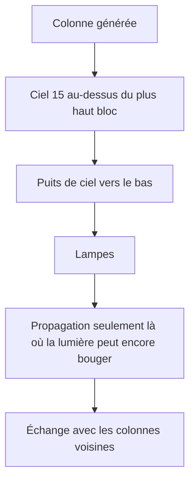
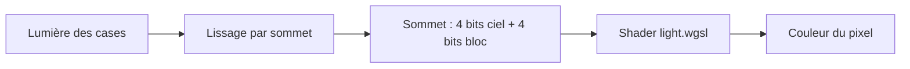

# Lumière

## À quoi ça sert

La lumière donne à chaque bloc un niveau de clarté de 0 (noir) à 15 (plein jour). Elle rend les grottes sombres, fait briller les torches, les lanternes, la pierre lumineuse et la lave, et prépare l'apparition des monstres selon l'obscurité (v0.4). Le joueur règle aussi l'éclairage lissé et la luminosité.

## Comment ça marche

### Deux lumières par case

Chaque case du monde porte deux niveaux de 0 à 15 :
- la **lumière du ciel** : 15 en plein air, elle baisse sous un toit ;
- la **lumière des blocs** : elle part des sources (torche 14, lanterne, pierre lumineuse et lave 15, valeur `light_emission` du pack) et baisse en s'éloignant.

Elles restent séparées : la nuit (jalon 7) ne baissera que le ciel, pas les torches.

### Propagation

Chaque bloc a une **opacité** (dans le pack) : 0 pour l'air, le verre, les plantes et les torches ; 1 pour les feuilles ; 2 pour l'eau et la glace ; 15 pour un bloc plein. La lumière perd `1 + opacité` à chaque pas vers un voisin. Exemple : une torche (14) éclaire à 13 la case à côté, 12 la suivante, et s'éteint à 14 cases dans l'air. Le ciel a une règle en plus : à 15, il **descend sans perte** à travers les blocs d'opacité 0 (un puits de ciel reste clair jusqu'au fond).

- **Calcul initial** : on ne propage pas partout. Le ciel ouvert est rempli d'un coup ; on ne lance la propagation qu'aux bords des puits, sous le premier bloc qui atténue, autour des lampes et aux frontières entre colonnes.
- **Mise à jour** : quand on pose ou casse un bloc, le moteur fait deux passes comme Minecraft. D'abord un **retrait** (éteindre tout ce qui tenait sa lumière de cette case), puis un **ajout** (rallumer depuis les voisins restés lumineux). Poser puis casser une torche redonne exactement l'état d'avant (testé, même à cheval sur deux colonnes).
- **Rien n'est sauvegardé ni envoyé** : la lumière se déduit des blocs, le client la recalcule. Le serveur réutilisera le même moteur en v0.4 (décision D045).

### Stockage

Un octet par case : 4 bits de ciel, 4 bits de bloc. Une section 16×16×16 est soit **uniforme** (une seule valeur, aucune mémoire : tout le ciel au-dessus du terrain, tout noir dans la roche), soit **mixte** (4 096 octets, partagés sans copie jusqu'à la prochaine modification).

### Thread dédié

Le calcul tourne sur un thread `lighting`, à part du rendu et du maillage : la propagation se fait case après case sur une carte commune, ce qui se partage mal entre plusieurs threads. Le client lui confie les colonnes ; il renvoie les sections dont la lumière a changé. Une colonne est éclairée quand ses 8 voisines sont arrivées, comme pour le maillage.

### Du niveau à l'écran

1. **Lissage** : au lieu d'une clarté par face (qui ferait des paliers visibles), chaque coin d'une face fait la **moyenne** de la case devant la face et des trois cases voisines du coin. Les cases opaques sont ignorées, et la lumière ne passe pas en diagonale entre deux blocs pleins. Si toutes les cases autour ont la même lumière (air libre, roche), aucun calcul n'est fait.
2. **Fusion** : deux faces de lumières différentes ne fusionnent plus en un seul rectangle ; un sol uniformément éclairé reste gros, un sol près d'une torche se découpe.
3. **Shader** : il prend `max(ciel × facteur du ciel, bloc)`, applique la courbe de Minecraft (la clarté ne monte pas en ligne droite), la relève selon le réglage **luminosité**, garde un **plancher d'ambiance** (jamais tout noir), et teinte en chaud là où les blocs dominent le ciel. En plein jour, les couleurs sont inchangées.
4. **Bateaux et modèles** : ils n'ont pas de cases propres ; ils prennent la lumière de la case juste au-dessus de leur position.

Réglages : « éclairage lissé » (coupé en très bas : la face prend la lumière de la case devant elle) et « luminosité » (50 % par défaut).

### Ordre du maillage

Comme le lissage lit la lumière des voisines, une section n'est maillée qu'une fois **sa colonne et ses 8 voisines éclairées**. Cela évite de mailler deux fois au chargement. Ensuite, seules les sections dont la lumière (ou la bordure lue par le lissage) a changé sont remaillées. Poser un bloc remaille tout de suite les sections voisines, et la lumière suit quelques millisecondes plus tard.

## Où c'est dans le code

| Quoi | Où |
|---|---|
| Moteur (table d'opacité et d'émission, règles) | `crates/core/src/light/mod.rs` (`LightTable`, `Lighting`, `BlockSource`) |
| Stockage | `crates/core/src/light/storage.rs` (`PackedLight`, `SectionLight`, `ColumnLight`) |
| Calcul d'une colonne | `crates/core/src/light/column.rs` (`light_column`) |
| Mise à jour après un bloc changé | `crates/core/src/light/propagate.rs` (`block_changed`) |
| Carte rapide par colonne | `crates/core/src/coords.rs` (`ColumnMap`) |
| Thread de lumière | `crates/client/src/lighting.rs` (`LightWorker`, `LightResult`) |
| Lumière dans le monde client | `crates/client/src/world/light.rs` (`ClientWorld::light_at`, `compute_light`) |
| Lissage | `crates/client/src/mesher/shading.rs` (`shade_face`, `light_at`) |
| Ordonnancement | `crates/client/src/streaming.rs`, `crates/client/src/mesh_scheduler.rs` |
| Shader | `crates/client/src/render/shaders/light.wgsl` (ajouté à `block.wgsl` et `model.wgsl`) |
| Réglages | `crates/client/src/settings/graphics.rs` (`smooth_lighting`, `brightness`) |
| Benchmark | `crates/worldgen/benches/light.rs` |

Décisions : D045 (moteur et thread) et D046 (rendu), dans `docs/decisions.md`.

Côté Rust

- **Trait** (`BlockSource`) : une liste de fonctions qu'un type doit offrir. Le moteur de lumière demande seulement « quel bloc est ici ? » ; le client et, plus tard, le serveur le fournissent chacun à leur façon. Le moteur reste donc testable sans GPU.
- **`enum` à deux variantes** (`SectionLight::Uniform` ou `Mixed`) : le compilateur oblige à traiter les deux cas, d'où l'absence d'oubli.
- **`Arc<[u8; 4096]>`** : un pointeur partagé et compté. Plusieurs propriétaires lisent la même mémoire ; on ne copie qu'à l'écriture (`Arc::make_mut`).
- **Thread et canaux** : le thread `lighting` reçoit des travaux par un canal et renvoie ses résultats par un autre ; rien n'est partagé directement, donc pas de verrou à gérer.
- **Hachage** : `ColumnMap` est une `HashMap` avec une fonction de hachage plus simple que celle par défaut (qui est lente mais résistante aux attaques, inutile ici).
- **WGSL** : le langage des shaders de `wgpu`. `light.wgsl` est un morceau de code ajouté au source de deux autres shaders, qui partagent ainsi la même courbe. `mix(a, b, t)` mélange `a` et `b`, `pow(x, 2.2)` convertit une valeur d'affichage en valeur linéaire.

