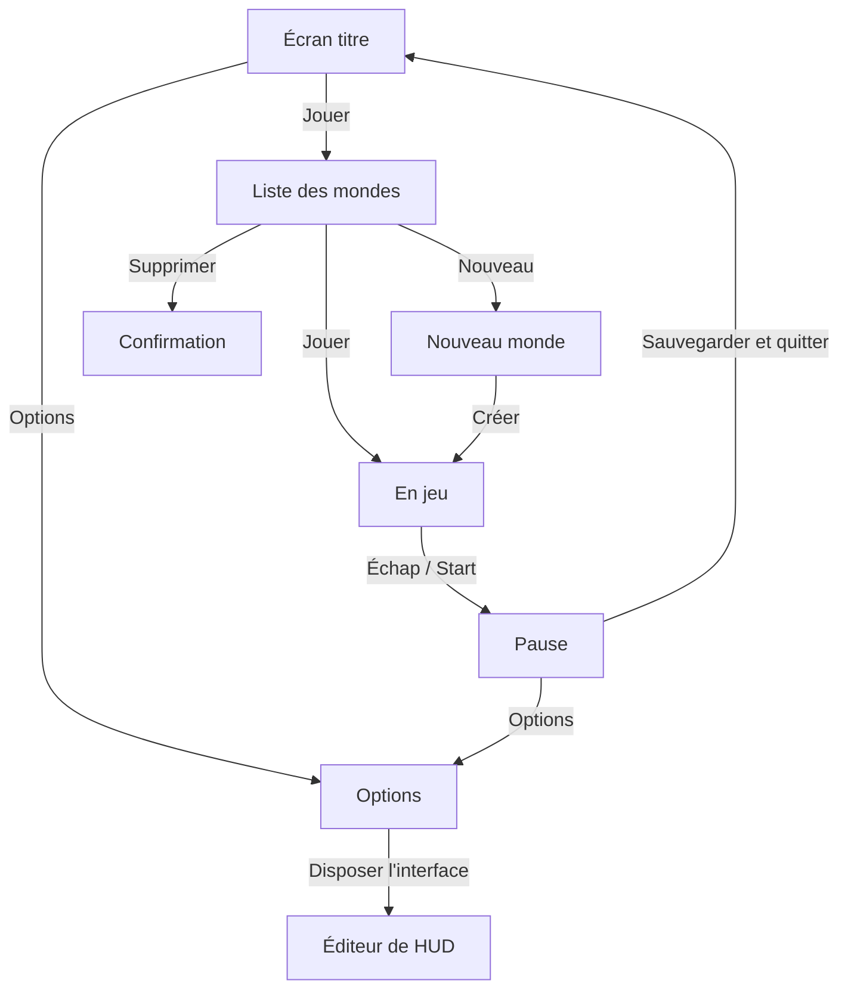

# Menus et écran titre

## À quoi ça sert

Tout ce qui se passe hors du jeu proprement dit : l'écran titre, la liste des mondes, la création d'un monde, le menu pause, les options d'interface et l'éditeur de HUD. Tout se pilote à la souris, au clavier ou à la manette.

## Comment ça marche

### L'enchaînement

- **Écran titre** : un petit monde généré tourne lentement derrière le logo.
- **Liste des mondes** : capture du monde (prise en le quittant), nom, date, mode et temps de jeu. Un monde d'une version incompatible est grisé.
- **Nouveau monde** : nom, graine (vide = au hasard), bordure du monde (10 millions de blocs par défaut), mode de jeu (créatif seulement jusqu'à la v0.3).
- **Pause** : le monde s'arrête. Dans les autres menus (inventaire…), le monde continue comme dans Minecraft, sauf si l'option « Pause dans tous les menus » est activée.
- **Options** (le grand écran de réglages arrive au jalon 8) : langue, taille de l'interface (auto, ×1 à ×6), pause dans tous les menus, éditeur de HUD.
- **Éditeur de HUD** : on choisit un élément (viseur, barre, nom du bloc), puis on le déplace aux flèches, à la croix ou en le faisant glisser à la souris (Sprint : 8 pixels d'un coup). Chaque élément garde son ancrage (centre, bas…), donc la disposition suit toutes les tailles d'écran. « Défaut » remet tout en place.

Ces choix sont gardés dans `config/interface.toml`.

### Une pile de menus

Les menus ouverts forment une **pile** : ouvrir pousse un menu, « Retour » retire celui du dessus. Chaque menu a un fichier de disposition dans `assets/ui/` et un **modèle** en Rust qui répond aux questions de l'affichage (« quel texte ici ? ») et aux actions (« le bouton *play* a été cliqué »). Un modèle ne lance rien lui-même : il demande, et la session exécute (créer le monde, l'ouvrir, quitter…).

### Le client ne touche pas aux fichiers

Le client ne sait pas où sont les sauvegardes. Le programme principal lui fournit un **lanceur** (`Launcher`) qui sait lister, créer, ouvrir et supprimer les mondes, et démarrer le serveur. C'est ce qui permettra, plus tard, de remplacer « un monde sur le disque » par « un serveur en ligne » sans toucher aux menus.

### Saisie de texte et manette

- Au clavier, un clic (ou Entrée) sur un champ de texte permet de taper directement ; Entrée ou Échap termine.
- À la manette, le même geste ouvre un **clavier à l'écran** : lettres, chiffres, accents, majuscule (`Aa`), espace, effacer (`<-`) et OK. Sa disposition est dans `assets/ui/keyboard.ron`.

### Les touches affichées suivent le joueur

Les textes peuvent contenir `<key:Inventory>` : l'interface affiche alors la touche ou le bouton réellement associé, selon le **dernier périphérique utilisé**. Au clavier, la lettre affichée est celle **imprimée sur la touche** : le jeu l'apprend en voyant ce que tape chaque touche physique (`Z` sur un AZERTY, `W` sur un QWERTY).

## Où c'est dans le code

| Quoi | Où |
|---|---|
| Pile de menus, actions | `crates/client/src/screens/menu.rs` (`Menu`, `Effect`, `UiAction`) |
| Entrées dans les menus | `crates/client/src/screens/handling.rs` |
| Modèles des écrans | `crates/client/src/screens/{title,worlds,pause,editor,keyboard,inventory}.rs` |
| Écran titre, monde en cours | `crates/client/src/stage.rs`, `session.rs` |
| Lanceur | `crates/client/src/launcher.rs` (trait), `crates/app/src/launcher.rs` (fichiers) |
| Noms des touches | `crates/client/src/input/labels.rs` (`KeyNames`) |
| Options d'interface | `crates/client/src/interface_settings.rs` |
| Dispositions | `assets/ui/*.ron` |

Côté Rust

- **`trait Launcher`** et **`Box<dyn Launcher>`** : le client ne connaît qu'une liste de fonctions ; c'est `app` qui fournit la vraie implémentation. Les dépendances restent dans le bon sens (le client ne dépend pas du serveur).
- **`enum Menu`** : chaque variante porte l'état de son écran (la sélection de la liste, le formulaire en cours…). Fermer le menu jette l'état avec lui.
- **`Box<dyn ScreenModel + 'a>`** : le modèle emprunte l'état du menu et les données partagées pendant une image seulement ; la durée de vie `'a` garantit qu'il ne survit pas à ce qu'il emprunte.

