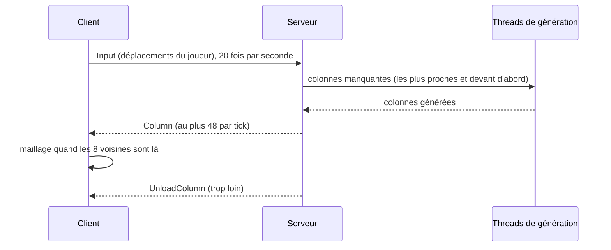

# Monde infini : chargement autour du joueur

## À quoi ça sert

Le monde est horizontalement infini (jusqu'à la bordure, 10 millions de blocs par défaut, v0.1 jalon 7). Seules les colonnes autour du joueur existent en mémoire : elles sont générées, envoyées au client, maillées, dessinées, puis oubliées quand le joueur s'éloigne.

## Comment ça marche

- **Priorité** : les colonnes d'un disque de rayon « distance de rendu » sont triées par distance, celles **devant** le joueur passant avant celles derrière.
- **Files bornées** : le serveur ne demande pas plus de travail que les threads de génération peuvent en absorber ; s'il a déjà quitté une zone, les demandes la concernant sont abandonnées.
- **Hystérésis** : une colonne n'est oubliée qu'à 2 colonnes au-delà de la distance de rendu, pour qu'un aller-retour sur une frontière ne la recharge pas sans cesse.
- **Maillage** : une colonne est maillée quand ses 8 voisines sont arrivées ; ses bords et son occlusion ambiante sont alors justes du premier coup.
- **Frustum culling** : seules les sections dans le champ de vision de la caméra sont dessinées (les 4 côtés et le plan proche du cône de vision ; pas de plan lointain).
- **Sans gel** : génération et maillage tournent sur d'autres threads ; le thread principal ne fait qu'insérer les colonnes reçues et envoyer à la carte graphique pendant au plus 4 ms par image.
- **Distance de rendu réglable à chaud** : touches **F7** (moins) et **F8** (plus), ou l'écran d'options. Le client envoie `ViewDistance` (2 à 32) ; le serveur charge ou décharge en conséquence au tick suivant.
- **Positions vérifiées** : c'est le serveur qui déplace le joueur (voir [Joueur et interaction](joueur-et-interaction.md)) ; le chargement suit cette position-là.
- **Distance verticale** : seules les sections à quelques sections au-dessus ou au-dessous de la caméra sont maillées et dessinées (4 sur le DS, 12 en ultra). Quand la caméra est plus haute que le sommet d'une colonne, la fenêtre « glisse » jusqu'au sommet de cette colonne : vu du ciel, on voit toujours le sol.
- **Réglages** : nombre de threads de maillage et de génération par préréglage (1 et 1 sur le DS).

## Où c'est dans le code

| Quoi | Où |
|---|---|
| Messages | `crates/protocol/src/messages.rs` (`Input`, `ViewDistance`, `Column`, `UnloadColumn`, `Welcome`) |
| Choix des colonnes, envoi, déchargement | `crates/server/src/loader.rs` (`ColumnLoader`) |
| Threads de génération | `crates/server/src/generation.rs` |
| Réception côté client | `crates/client/src/streaming.rs` (`WorldView`) |
| Frustum | `crates/client/src/render/frustum.rs` |

Côté Rust

- **`Box<Column>`** dans le message : une colonne est grosse ; la mettre dans une `Box` garde le message lui-même petit, quelle que soit sa variante.
- **Hystérésis** et **files bornées** sont des techniques générales pour qu'un système reste stable quand l'entrée (la position du joueur) varie vite.
- **Plans du frustum** (méthode de Gribb et Hartmann) : chaque plan est une combinaison des lignes de la matrice caméra ; une boîte est invisible si elle est entièrement du mauvais côté d'un plan.

