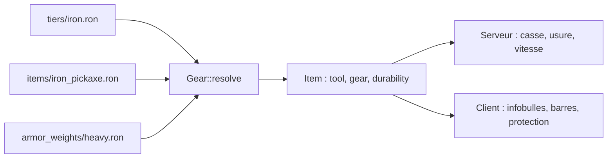

# Outils, armes et armures

## À quoi ça sert

Le joueur avance en améliorant son équipement : une pioche en fer pour le diamant, une armure plus solide pour survivre. Tout vient des packs : les **tiers** de matériau (bois, pierre, fer, or, diamant, puis Ignium, Nihilium et Siderium plus tard), les **poids** d'armure, et chaque objet. Pas de classe, pas de rareté aléatoire : un objet trouvé a toujours les mêmes chiffres.

## Comment ça marche

### Les tiers

Un fichier `tiers/<nom>.ron` donne les valeurs d'un matériau :

```ron
Tier(level: 2, speed: 6.0, durability: 250, damage: 2.0, enchantability: 14,
     upgrade_slots: ["strata:craft"], armor_durability: 15)
```

- `level` : **niveau de minage** (0 bois, 1 pierre, 2 fer et or, 3 diamant ; 4, 5, 6 pour les tiers à venir). Un bloc qui exige `level: 2` refuse son butin à une pioche en pierre.
- `speed` : vitesse de casse sur les blocs du bon type (une main vaut 1).
- `durability` : utilisations des outils et des armes du tier.
- `damage` : ajouté aux dégâts de base des armes (le combat arrive au jalon 10).
- `upgrade_slots` : la liste des emplacements d'amélioration, un par entrée, chacun d'une **famille** déclarée dans `upgrade_slots/` (`strata:craft`, « artisanal », pour l'enclume du jalon 4b ; modules, runes et pièces de bâton viendront comme d'autres familles). Un objet peut donner sa propre liste, qui remplace celle du tier.
- `armor_durability` : les pièces d'armure du tier qui ne donnent pas leur durabilité durent ce facteur × 11, 16, 15 ou 13 (tête, torse, jambes, pieds).
- `enchantability` : pour l'enchantement, plus tard.

Un objet nomme son tier et ne précise que ce qui change :

```ron
Item(
    texture: "strata:iron_pickaxe",
    tier: "strata:iron",
    category: Some("strata:tools"),
    tool: Some(Tool(kinds: ["strata:pickaxe"])),
)
```

Au chargement, `Gear::resolve` remplit ce qui manque : le niveau et la vitesse de l'outil, les dégâts de l'arme, la durabilité, les emplacements. L'outil multi-usage donne trois types (`kinds: [pioche, hache, pelle]`) et sa propre durabilité, plus faible.



### Les armures et leur poids

Une pièce d'armure a une case (`equip: Some(Chest)`), une **protection** et un **poids** :

```ron
armor: Some(Armor(protection: 6, weight: "strata:heavy")),
```

Le poids est un fichier `armor_weights/` qui dit ce qu'une pièce coûte, en parts : `ArmorWeight(speed: 0.025, stamina: 0.05, mana: 0.05)`.

| Poids | Matériaux | Vitesse par pièce | Endurance, mana par pièce |
|---|---|---|---|
| Légère | cuir, tissu | 0 | 0 |
| Intermédiaire | mailles, écailles | 0 | 2,5 % |
| Lourde | plates | 2,5 % (10 % pour quatre pièces) | 5 % |

Les parts s'additionnent sur les pièces portées (`worn_burden`), plafonnées à 90 %. Aujourd'hui seule la **vitesse** agit : le serveur règle `MovementSettings::speed` à chaque tick d'après l'armure portée, et le client fait le même calcul sur sa copie de l'inventaire, pour que la prédiction du mouvement tombe juste. L'endurance (jalon 8) et le mana (v0.9) liront les autres parts.

La **protection** totale (`worn_protection`) s'affiche dans l'inventaire ; elle réduira les dégâts au jalon 10. Le fer et l'or existent en mailles et en plates, le diamant en écailles et en plates.

### Les outils spécialisés

- **Houe et burin** : `action: Some(Work)`. Le clic droit envoie `WorldAction::Use` ; le serveur cherche dans le bloc visé un champ `worked` pour un des types de l'outil, et le change :

  ```ron
  worked: {"strata:hoe": Worked(into: "strata:farmland", open_above: true)},
  ```

  Le burin enchaîne briques de pierre → sculptées → ouvragées → briques unies : un cycle écrit bloc par bloc.
- **Faucille** : `sweep: 2`. Couper une plante (un bloc instantané dont l'outil est la faucille) coupe aussi celles du même type d'outil jusqu'à deux blocs autour, un bloc plus haut et plus bas, pour **une** utilisation.
- **Cisailles** : gardent feuilles, lianes et hautes herbes (condition `Tool` des tables de butin).

### La durabilité

Chaque pile garde ses utilisations restantes (`ItemStack::durability`). Casser un bloc qui n'est pas instantané, labourer, sculpter, faucher usent l'outil d'une utilisation. L'option de monde **« Objets usés »** (`DurabilityMode`, dans `world.ron`) décide de la fin :

- `Break` : l'objet disparaît à zéro (Minecraft) ;
- `KeepBroken` : il reste à zéro (`is_broken`), grisé dans les cases ; en main, il vaut une main nue (`held_item` le saute), porté, il ne protège plus (mais pèse toujours). La réparation se fait à l'enclume ([Améliorations](ameliorations.md)).

La barre sous chaque case montre la part restante (aussi dans la barre rapide du HUD) ; l'infobulle donne « Utilisations : 245 / 250 ».

### Les matériaux provisoires

Les hautes herbes et les fougères coupées sans cisailles donnent parfois une **fibre végétale** (une chance sur quatre). Trois fibres font un **tissu**. Le **cuir** n'a pas encore d'animal : en attendant la v0.4, une recette provisoire (deux fibres et une boue) le fabrique.

### Le rendu

Il n'y a pas encore de modèle du joueur visible en troisième personne : l'armure portée ne se voit que dans l'inventaire. Les objets au sol sont dessinés comme les autres objets (deux plans croisés de leur image).

## Dans le code

| Quoi | Où |
|---|---|
| Tiers, poids, résolution, protection et fardeau | `crates/core/src/gear/` |
| Champs d'objet (`tier`, `weapon`, `armor`, `Work`) | `crates/core/src/content/item.rs` |
| `ToolDef` (dont `sweep`), temps de casse | `crates/core/src/content/tool.rs` |
| Blocs travaillés | `crates/core/src/content/worked.rs` |
| Usure, `DurabilityMode`, `wear_slot` | `crates/core/src/inventory/stack.rs` |
| Ralentissement | `MovementSettings::speed` dans `crates/core/src/physics/body.rs` |
| Houe, burin, faucille, poids de l'armure côté serveur | `crates/server/src/game/work.rs` |
| Infobulles | `crates/core/src/content/describe.rs`, `crates/client/src/screens/slots.rs` |
| Pages du wiki | `crates/wikigen/src/gear.rs` |
| Contenu | `assets/packs/strata/{tiers,armor_weights,items,recipes}/` |

<details><summary>Côté Rust</summary>

- **`Option` pour « non précisé »** : `ToolSpec::level` est un `Option<u8>`. `self.level.or(tier.map(|t| t.level)).unwrap_or(0)` lit : la valeur du fichier, sinon celle du tier, sinon 0. Grâce à l'extension RON `IMPLICIT_SOME`, on écrit `level: 2` sans `Some(...)`.
- **Deux types pour un outil** : `ToolSpec` est ce que le fichier dit (des trous possibles), `ToolDef` ce que le jeu utilise (tout rempli). Séparer « lu » et « résolu » évite de tester des `Option` partout ailleurs.
- **`impl IntoIterator<Item = &'a ItemStack>`** : `worn_protection` accepte un tableau, un `Vec` ou un itérateur de piles ; `'a` dit que les piles empruntées vivent au moins le temps de l'appel.
- **`fold`** : `worn.fold(0, |total, armor| total.saturating_add(armor.protection))` additionne sans jamais déborder.
- **`#[serde(default)]` sur un `enum`** : `DurabilityMode` a `#[default] Break` ; un vieux `world.ron` sans le champ se charge avec « se casse ».

</details>

## Pour aller plus loin

- Décisions D075 à D080 dans `docs/decisions.md` ; valeurs dans `docs/regles/equilibrage.md` (« Outils, armes et armures »).
- [Récolte](recolte.md), [Craft](craft.md), [Inventaire](inventaire.md).
