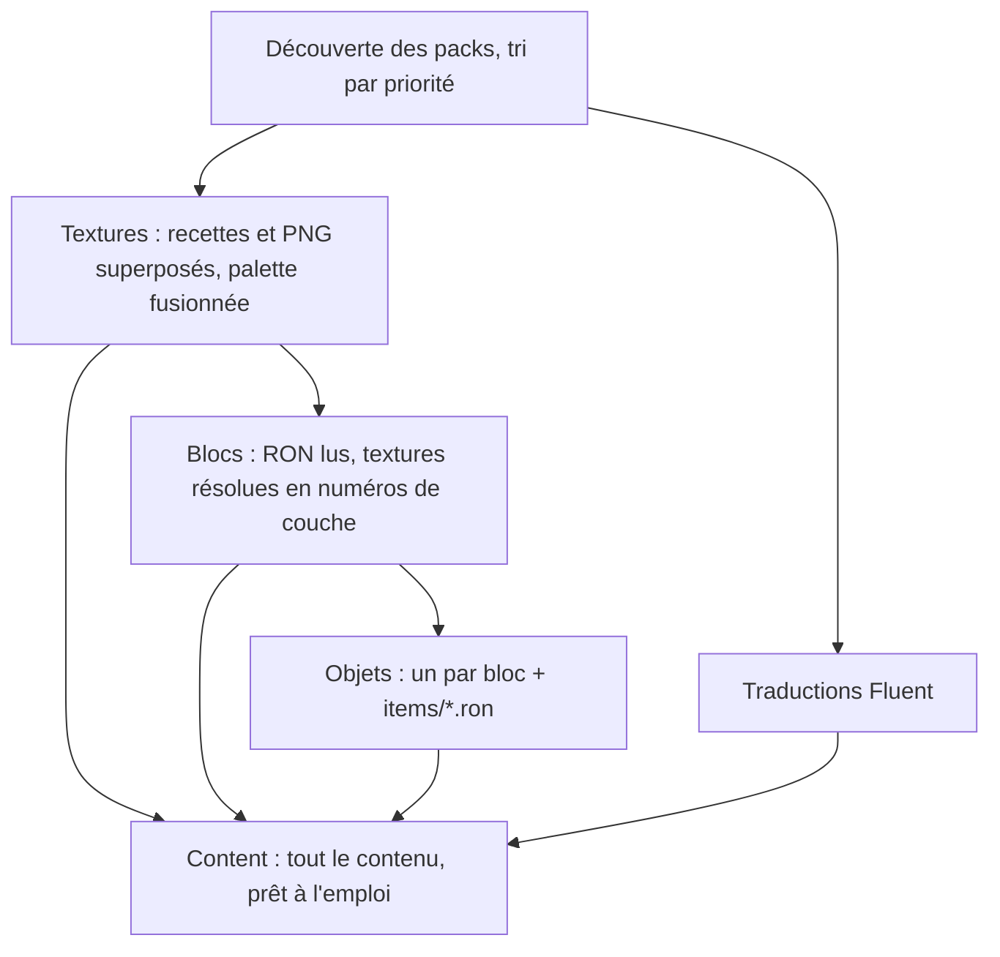

# Packs de contenu, registres et traductions

## À quoi ça sert

Aucun bloc, objet ou texte n'est écrit dans le code du jeu : tout vient de **packs**, des dossiers de fichiers texte. Le jeu de base est lui-même le pack `strata`. Un pack plus prioritaire peut **ajouter, modifier ou retirer** n'importe quoi d'un autre : c'est la base du modding (v1.1).

## Comment ça marche

```
assets/packs/strata/
  pack.ron          (namespace: "strata", priority: 0)
  palette.ron       couleurs de toutes les textures
  blocks/stone.ron  un fichier par bloc → strata:stone
  textures/stone.ron ou stone.png
  lang/fr/*.ftl, lang/en/*.ftl, lang/lol/*.ftl
  remove.ron        (facultatif) entrées d'autres packs à retirer
```



- **Ordre** : les packs sont chargés du moins au plus prioritaire (`priority`, puis nom). Pour une même entrée, le dernier gagne.
- **Ajouter** : `blocks/rubis.ron` dans le pack `gemmes` crée `gemmes:rubis`.
- **Modifier** : `blocks/strata/stone.ron` dans le pack `gemmes` remplace la définition de `strata:stone` (le sous-dossier porte le namespace visé).
- **Retirer** : `remove.ron` du pack `gemmes` : `{ "blocks": ["strata:sand"] }`.
- **Registres** : chaque bloc reçoit un numéro compact (`BlockId`, 16 bits) pour les chunks et le rendu ; l'air est toujours le numéro 0. Les numéros ne servent qu'en mémoire : les sauvegardes stockent les identifiants texte, donc ajouter un pack ne casse pas un monde.
- **Erreurs** : un fichier cassé ne fait jamais planter le jeu. Chaque problème est signalé avec le fichier, la ligne et la colonne (`blocks/typo.ron:3:5: unexpected field hardnes`), l'entrée fautive est ignorée, une texture manquante est remplacée par un damier magenta.
- **Textures** : voir [`docs/guide-textures.md`](../guide-textures.md). Les minerais et franges sont peints sur un calque transparent puis posés sur leur base, même si celle-ci est un PNG en 32 ou 64 px. Les paramètres des recettes sont bornés (6 octaves, 64 amas…) pour qu'un pack ne puisse pas figer le jeu. Les textures sont dessinées par le processeur au chargement (déterministe : même résultat partout), puis rangées dans le tableau de textures du GPU, une couche par texture.
- **Traductions** : fichiers **Fluent** `.ftl` (`block-strata-stone = Pierre`). Les clés suivent l'identifiant : `block-<namespace>-<nom>`, `item-…`, `category-…`. Un test échoue si une clé manque dans l'une des trois langues (fr, en, lol). Le glossaire LOLcat est dans `lang/lol-glossary.ron`.
- **Packs de ressources** (`resourcepacks/<nom>/`) : même format, mais ils ne peuvent que changer l'apparence (textures, palette, traductions), jamais les règles du jeu.

Format d'un bloc (tous les champs sauf `textures` ont une valeur par défaut) :

```ron
Block(
    textures: TopBottomSides(top: "strata:grass_block_top", bottom: "strata:dirt", sides: "strata:grass_block_side"),
    render: Opaque,       // Invisible, Opaque, Cutout (feuilles), Translucent (eau)
    solid: true,
    light_opacity: 15,    // 0 à 15, utilisé en v0.2
    hardness: 0.6,        // négatif = incassable ; utilisé en v0.3
    sound: Some("strata:grass"),
    category: Some("strata:natural"),
    has_item: true,
)
```

## Où c'est dans le code

| Quoi | Où |
|---|---|
| Identifiants `namespace:nom` | `crates/core/src/id.rs` |
| Découverte, ordre, superposition, retraits | `crates/core/src/pack/` (`PackSet`, `layered`, `PackError`) |
| Registres et numéros | `crates/core/src/content/registry.rs` (`Registry`, `BlockId`, `TextureId`) |
| Blocs, objets | `crates/core/src/content/block.rs`, `item.rs`, `mod.rs` (`Content::load`) |
| Textures | `crates/core/src/content/textures.rs`, `crates/core/src/texture/` (palette, recettes, motifs, sprites) |
| Traductions | `crates/core/src/lang.rs` (`Translations`) |
| Tests (pack de démonstration, pack cassé) | `crates/core/tests/packs.rs`, `crates/core/tests/fixtures/` |

<details><summary>Côté Rust</summary>

- **`serde` + RON** : `#[derive(Deserialize)]` génère la lecture des fichiers. `#[serde(default)]` donne une valeur aux champs absents ; `deny_unknown_fields` transforme une faute de frappe (`hardnes`) en erreur au lieu de l'ignorer.
- **`BTreeMap`** : un dictionnaire trié. Les entrées sont donc toujours traitées dans le même ordre, ce qui rend les numéros de registre reproductibles.
- **Génériques** : `Registry<K, T>` marche pour les blocs, les objets et les textures ; `K` est le type de numéro (`BlockId`…), ce qui empêche de confondre un numéro de bloc avec un numéro de texture.
- **Collecte d'erreurs** : les fonctions de chargement reçoivent `errors: &mut Vec<PackError>` et y ajoutent les problèmes au lieu de s'arrêter au premier.

</details>
