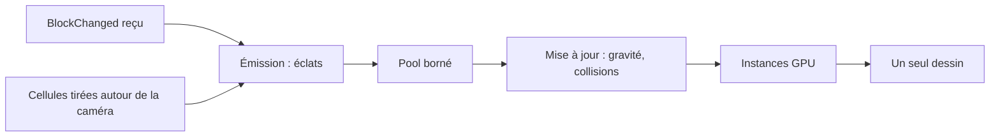

# Particules

## À quoi ça sert

Les particules sont de petits carrés qui donnent de la vie : éclats quand on casse un bloc, gouttes qui tombent des plafonds, bulles dans l'eau. Elles sont uniquement visuelles : le serveur n'en sait rien.

## Comment ça marche

**D'où elles viennent.** Le client déduit tout de ce qu'il reçoit déjà. Quand un `BlockChanged` remplace un bloc (pas un liquide) par de l'air, un bloc remplaçable ou un liquide, des éclats apparaissent : casse par le joueur, feu, plante emportée par l'eau. Poser un bloc ne donne rien. Autour de la caméra, un budget de cellules est tiré au hasard chaque seconde (±12 blocs à l'horizontale, ±8 à la verticale) : sous un bloc d'eau ou de lave au plafond, une **goutte** peut se former ; au-dessus d'un bloc plein dans l'eau, une **bulle**.

**Définitions en pack.** Chaque particule est un fichier `particles/<nom>.ron` : durée de vie, taille, gravité (négative : elle monte), vitesse, frottement, `hang` (la goutte grossit avant de tomber), collisions, lueur, `chance`, et `impact` (particules lancées à l'arrivée, par exemple l'éclaboussure). Sans texture, la particule prend un morceau de 4 × 4 pixels de la texture du bloc cassé, teinté comme lui si besoin (couleur du biome). Les blocs choisissent leurs particules (`breaking`, `drip`, `ambient`) ; `breaking: None` n'en donne aucune (feu, liquides).

**Pool borné.** Toutes les particules vivent dans un tableau de taille fixe alloué une fois. S'il est plein, les nouvelles sont refusées au lieu d'agrandir la mémoire : pas de ralentissement possible. Réglage « Particules » : complètes (4 096), réduites (1 024, profil DS), désactivées (rien n'est calculé ni dessiné).

**Physique.** Gravité, frottement de l'air, arrêt contre les blocs solides axe par axe, par petits pas pour ne jamais traverser un mur. Pas de boîte de collision : un point suffit à cette taille.

**Dessin.** Un seul appel de dessin pour toutes les particules : chaque carré est une *instance* tournée vers la caméra, éclairée par la lumière de sa cellule et noyée dans le brouillard comme un bloc.

## Où c'est dans le code

| Quoi | Où |
|---|---|
| Système et mise à jour (`ParticleSystem`) | `crates/client/src/particles/mod.rs` |
| Réserve fixe (`Pool`, `LiveParticle`, `Rng`) | `crates/client/src/particles/pool.rs` |
| Émission | `crates/client/src/particles/emit.rs` |
| Physique | `crates/client/src/particles/physics.rs` |
| Table bloc -> particule (`ParticleTable`) | `crates/client/src/particles/table.rs` |
| Définition RON (`ParticleDef`) | `crates/core/src/content/particle.rs` |
| Pipeline et shader | `crates/client/src/render/particle_pipeline.rs`, `crates/client/src/render/shaders/particle.wgsl` |
| Données | `assets/packs/strata/particles/*.ron` |
| Scène de test | `assets/scenes/particles.ron` (`--break x,y,z`, `--particles <s>`) |

Côté Rust

- **`Vec::with_capacity`** réserve la mémoire une fois ; tant qu'on ne dépasse pas, aucun agrandissement.
- **`swap_remove`** retire un élément en y mettant le dernier : instantané, mais l'ordre change (sans importance ici).
- **Générateur aléatoire maison** (`Rng`) : quelques lignes, rapide, sans dépendance, reproductible avec une graine.
- **Rendu instancié** : on décrit un carré de 4 sommets une fois, et la carte graphique le répète pour chaque instance (position, taille, couleur).
- **Transparence par seuil** : un pixel est gardé ou jeté, donc pas de tri des particules.

