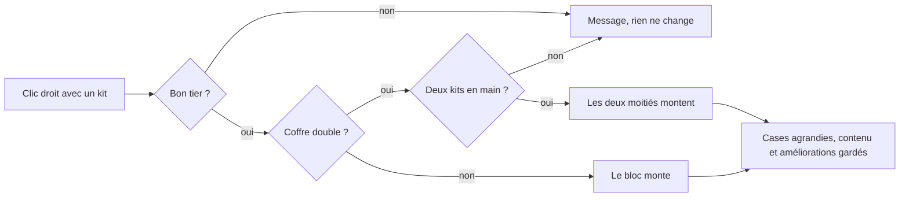
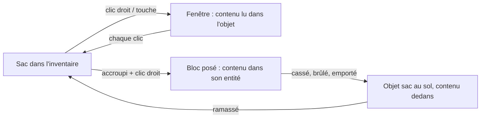

# Rangement : coffres, tonneaux, fours améliorables et sacs

## À quoi ça sert

Un coffre en bois garde 27 piles. Plus tard dans la partie, on a besoin de **plus de place** et d'un rangement **qui travaille un peu tout seul** : se trier, ne prendre que certains objets, presser les pépites en lingots, jeter les cailloux en trop, ramasser ce qui traîne. C'est l'idée du mod *Sophisticated Storage* de Minecraft :

- quatre **tiers** de coffres et de tonneaux : bois (27 cases), fer (45), or (63), diamant (81) ;
- un **kit** fait monter un coffre d'un tier **sur place**, sans le vider (comme pour les fours) ;
- des **emplacements d'amélioration** (0 à 3 selon le tier) où l'on pose des objets d'amélioration : tri, filtre, compression, destruction, aimant.

Les **modules de four** (vitesse, économie, double sortie) sont désormais des améliorations du **même système** : un seul moteur pour les objets (enclume), les fours, les coffres et bientôt le sac à dos.

## Comment ça marche

### Un seul système d'améliorations

Une amélioration est un fichier `upgrades/<nom>.ron` fait de **briques** (voir [Améliorations](ameliorations.md)). Il y a deux façons de la porter :

| Support | Exemple | Où elle est rangée |
|---|---|---|
| Dans un objet, à l'enclume | aiguisage d'une épée | les métadonnées de la pile (`strata:upgrades`) |
| Un objet posé dans une case d'un bloc | module de vitesse, aimant | les cases d'amélioration du bloc |

Pour la seconde, l'objet dit simplement quelle amélioration il est :

```ron
// items/magnet_upgrade.ron
Item(texture: "strata:magnet_upgrade", category: Some("strata:storage"), upgrade: Some("strata:magnet"))

// upgrades/magnet.ron
Upgrade(
    slot: "strata:storage",            // famille de cases (upgrade_slots/storage.ron)
    applies_to: ["strata:storages"],   // tag des objets des blocs qu'elle accepte
    levels: [Level(effects: [Magnet(radius: 5.0, period: 10)])],
)
```

Les modules de four sont pareils, avec des briques `Stat` sur trois statistiques de four (`strata:cook_time`, `strata:fuel_value`, `strata:output`) :

```ron
// upgrades/furnace_speed.ron
Upgrade(
    slot: "strata:furnace",
    applies_to: ["strata:furnaces"],
    levels: [Level(effects: [
        Stat(stat: "strata:cook_time", op: Percent, value: -25.0),
        Stat(stat: "strata:fuel_value", op: Percent, value: -20.0),
    ])],
)
```

Une case d'amélioration accepte un objet si son amélioration est **de la famille des cases**, **convient au bloc** (`applies_to`), **n'y est pas déjà** (même effet non cumulable) et respecte `requires` / `excludes`. C'est une seule fonction, `Upgrades::fits_slot`, utilisée par le four comme par le coffre.

Le calcul est aussi commun : `Upgrades::slotted_effects` rassemble les briques de toutes les améliorations posées en gardant **le plus fort gain de chaque statistique** ; les briques qui baissent une statistique (des coûts) s'additionnent toujours. Le module de vitesse (−25 % de temps) et la double sortie (+25 % de temps) se combinent, et leurs deux coûts en combustible (−20 % et −50 %) aussi : 40 % des cuissons par combustible.

### Les cases d'un bloc : les siennes, puis ses améliorations

Chaque entité de bloc (coffre, tonneau, four) a deux conteneurs :

```rust
pub struct BlockEntity {
    pub container: Container,   // la grille du coffre, ou entrée-combustible-sortie du four
    pub upgrades: Container,    // ses cases d'amélioration
    // …
}
```

Le pack décide des tailles : un tier de rangement (`storage_tiers/iron.ron`) donne `StorageTier(rows: 5, upgrade_slots: 1, upgrade_family: "strata:storage")`, un tier de four ses cases de modules. `Content::slot_layout(bloc)` rend les deux nombres (`SlotLayout`), lus par le serveur et par l'écran.

À l'écran, la fenêtre montre les cases du bloc **bout à bout, puis** ses cases d'amélioration ; pour un coffre double : les cases des deux moitiés, puis les améliorations des deux moitiés. Le message `ContainerOpened` dit où commencent les améliorations (`upgrades_at`).

**Anciennes sauvegardes** : avant ce jalon, les modules d'un four suivaient son entrée, son combustible et sa sortie dans le même conteneur. Au chargement, `migrate_furnace_modules` les déplace dans `upgrades` : rien n'est perdu (test `furnace_modules_saved_after_the_fuel_move_to_the_upgrade_slots`). Les objets ont gardé leurs noms (`strata:speed_module`…).

### Monter de tier sur place



Le kit dit sur quoi il marche : `Kit(on: Storage, from: "strata:wood", to: "strata:iron")` (les kits de four ont `on: Furnace`, la valeur par défaut). Le serveur cherche le bloc de **la même famille** (`Upgradable(family: "strata:chest", tier: …)`) au tier visé, remplace le bloc, agrandit les conteneurs et garde tout. Un coffre double monte toujours **d'un coup**, ses deux moitiés ensemble : il faut deux kits, pour qu'il n'y ait jamais un coffre double à deux tiers. Le serveur refuse aussi un kit qui **séparerait une paire** : il recalcule les jonctions comme si le bloc avait déjà changé (`would_part_a_pair`), sans toucher au monde.

### Ce que font les améliorations de rangement

Toutes passent par `Upkeep` (dans `core::storage`), lu une fois depuis les cases d'amélioration :

| Amélioration | Brique | Quand |
|---|---|---|
| Tri automatique | `Sort` | à la fermeture de l'écran, et après une entrée automatique (aimant, dépôt rapide) — jamais sous le pointeur |
| Filtre | `Filter` | Maj-clic, dépôt rapide et aimant ne font entrer que ce qu'il laisse passer ; à la main, tout se pose |
| Compression | `Compress` | après chaque entrée (clics compris) : 9 pépites → 1 lingot, 9 lingots → 1 bloc (`compression/`), s'il y a la place |
| Destruction | `Void` | au moment où un objet entre de lui-même (Maj-clic, dépôt rapide, aimant) : s'il est désigné par son filtre, il disparaît ; ce qui était déjà rangé ou posé à la main ne disparaît jamais |
| Aimant | `Magnet(radius, period)` | toutes les `period` ticks, attire les objets au sol dans le rayon |

Dans un coffre double, deux filtres comptent ensemble : un objet entre s'il passe **tous** les filtres, il est détruit si **un** filtre de destruction le désigne. Le **filtre** (de l'amélioration de filtre ou de destruction) est rangé dans les métadonnées de l'objet d'amélioration : neuf cases (`strata:filter`) et un mode (`strata:filter_deny`). Un filtre **vide ne fait rien** : il laisse tout entrer, il ne détruit rien. On le règle dans le panneau à droite de l'écran : objet tenu sur une case = ajouté, main vide = retiré, bouton pour passer d'« accepte la liste » à « refuse la liste ». Le client envoie `InventoryRequest::SetFilter`, le serveur vérifie que la case contient bien une amélioration à filtre.

### Ce qui coûte, et comment le régler

- **Aimant** : seuls les coffres qui en ont un sont listés (`Game::magnets`, refait quand les cases d'amélioration changent ou au chargement) ; chacun ne travaille qu'à sa période (10 ticks dans le pack de base), décalée selon sa position pour étaler le travail, et seulement si sa colonne est chargée. Les objets au sol sont rangés dans des cases de 8 blocs : un aimant ne regarde que les cases proches. L'**option de monde « Aimants »** (écran de création) les coupe tous.
- **Tri** : seulement à la fermeture et après une entrée automatique, jamais à chaque tick.
- **Compression** : seulement après une entrée, recettes en pack.

### L'écran

L'écran du coffre montre cinq rangées, séparées des cases du joueur par l'étiquette « Inventaire » ; un coffre plus grand **défile** (molette sur la grille, boutons « Haut » / « Bas » du panneau de droite, ou à la manette tout seul quand le focus sort de la grille). Le panneau de droite (`window_upgrades` dans `assets/ui/inventory.ron`) montre les cases d'amélioration et, s'il y a un filtre, ses neuf cases, son mode et une aide courte. Cliquer dans ce panneau ne compte pas comme « clic hors de la fenêtre » (qui jetterait l'objet tenu).

La place est prévue pour les améliorations d'**automatisation** (entonnoir, tapis) de la v0.8 : ce seront d'autres briques dans `Effect` et d'autres fichiers `upgrades/`, sur la même famille de cases.

## Sacs à dos, bourses et sacoches

Un **sac** est un objet qui porte d'autres objets. Son contenu est rangé **dans l'objet lui-même**, dans ses données :

```
ItemStack { item: sac à dos en cuir, data: {
    strata:bag_storage:  Stacks([None, Some(32 pierres), …]),   // ses cases
    strata:bag_upgrades: Stacks([Some(amélioration d'établi)]), // ses améliorations
    strata:tank:         List([Id(strata:water_bucket), Int(3)]) // son réservoir
} }
```

C'est le choix qui rend la **copie impossible** : il n'existe qu'un exemplaire du contenu, et il voyage avec le sac (inventaire, coffre, sol, et au jalon 10 la mort). `BagContents` (dans `core::bag`) lit et écrit ces données.



- **Porté** : case du dos (`BACK`, à côté de la main secondaire), ouverte par sa touche (B, croix haut). Il marche aussi dans la barre rapide ou l'inventaire.
- **Ouvert** : la fenêtre est la même que celle d'un coffre (`OpenWindow` avec `carried`). À chaque clic, le serveur **sort** le contenu de l'objet, applique le clic, puis le remet ; la case du sac ouvert est épinglée (on ne peut ni la prendre, ni l'échanger, ni la jeter).
- **Posé** : il devient un bloc conteneur (`placed_leather_backpack`…) dont l'entité garde tout, avec une marque `strata:bag` qui dit quel sac rendre. Cassé, il redevient ce sac, plein.
- **Tiers** : ceux du bloc posé (`storage_tiers/backpack_*`). Un kit s'utilise sur le sac **posé**, comme sur un coffre.
- **Pas de sac dans un sac** : `Bags::admits`, utilisé par les règles de cases (`StorageSlots.bag`) et par le ramassage.
- **Améliorations** : celles des coffres, plus `Pickup`, `Feed` (attend la faim du jalon 8), `Crafting` (grille 3×3 dans un panneau à gauche) et `Tank(buckets)`.
- **Bourses** : `Bag(slots: 9, accepts: Some(tag))`. Au ramassage, `pick_into_bags` essaie d'abord les bourses qui prennent l'objet, puis les sacs avec ramassage, puis l'inventaire.

## Où c'est dans le code

| Quoi | Fichier |
|---|---|
| Briques (`Sort`, `Filter`, `Compress`, `Void`, `Magnet`) | `crates/core/src/upgrade/defs.rs` |
| Améliorations posées dans un bloc : `fits_slot`, `slotted_effects` | `crates/core/src/upgrade/slotted.rs` |
| Tiers de rangement, compression, `SlotLayout` | `crates/core/src/storage/` (`mod.rs`, `defs.rs`, `load.rs`) |
| Filtre dans les métadonnées | `crates/core/src/storage/filter.rs` |
| Tri, compression, destruction, entrée filtrée | `crates/core/src/storage/behaviour.rs` |
| Règles des cases d'un coffre (`StorageSlots`) | `crates/core/src/storage/slots.rs` |
| Statistiques d'un four depuis les briques | `crates/core/src/cooking/furnace.rs` (`FurnaceStats::new`) |
| Kits (fours et rangements, coffre double) | `crates/server/src/game/kits.rs` |
| Tri à la fermeture, filtre demandé, entrées | `crates/server/src/game/storage.rs` |
| Aimants | `crates/server/src/game/magnets.rs` |
| Fenêtre : cases puis améliorations | `crates/server/src/game/containers.rs` |
| Migration des modules de four | `crates/server/src/persistence.rs` (`migrate_furnace_modules`) |
| Écran : défilement, panneau, filtre | `crates/client/src/screens/storage_panel.rs`, `assets/ui/inventory.ron` |
| Sacs : règles, contenu, ramassage, réservoir, infobulles | `crates/core/src/bag/` |
| Sacs ouverts, établi et réservoir ; sacs posés, ramassage, aimant | `crates/server/src/game/bags.rs`, `bag_world.rs` |
| Piles portées enregistrées par nom | `crates/server/src/save/stacks.rs` (`SavedData`) |
| Panneau du sac, case du dos | `crates/client/src/screens/bag_panel.rs`, `assets/ui/inventory.ron` |
| Tests | `core/src/bag/tests.rs`, `server/src/game/bag_tests.rs`, `server/src/persistence_bag_tests.rs`, `core/src/storage/tests.rs`, `server/src/game/storage_tests.rs`, `server/src/persistence_storage_tests.rs`, `core/src/cooking/tests.rs` |

<details>
<summary>Côté Rust</summary>

- **`enum` avec des variantes de formes différentes** : `Effect::Stat { stat, op, value }`, `Effect::Sort`, `Effect::Magnet { radius, period }`. RON les lit telles quelles : `Sort`, `Magnet(radius: 5.0, period: 10)`. Pour dire « même sorte de brique », `std::mem::discriminant` compare la variante sans regarder son contenu.
- **Deux règles de cases, un seul type de fenêtre** : `Window` attend un `&dyn SlotPolicy` (un *trait object*). Le serveur construit un `enum OpenPolicy { Furnace(FurnaceSlots), Storage(StorageSlots) }` et le prête sous forme de trait : chaque variante garde ses données, la fenêtre ne voit que les méthodes du trait.
- **Méthodes par défaut d'un trait** : `SlotPolicy::storage()` et `lets_in()` ont une implémentation par défaut ; seul `StorageSlots` les redéfinit. Ajouter une méthode à un trait sans casser ceux qui l'implémentent déjà, c'est exactement ça.
- **Emprunts disjoints** : dans `deposit_into`, on emprunte en même temps l'inventaire du joueur (`self.ecs.inventories`) et le coffre (`self.block_entities`) en écriture : Rust l'accepte parce que ce sont deux champs différents de `self`.
- **Type récursif** : `ItemStack` contient `ItemData`, qui peut contenir des `ItemStack` (`DataValue::Stacks`). Rust l'accepte parce que le `Vec` met les piles internes sur le tas : la taille de `ItemStack` reste connue.
- **`impl Content` dans un autre module** : `slot_layout` est écrit dans `core::storage`, à côté de ce qu'il calcule, alors que `Content` est défini ailleurs. Un type peut avoir plusieurs blocs `impl` dans sa crate.

</details>
