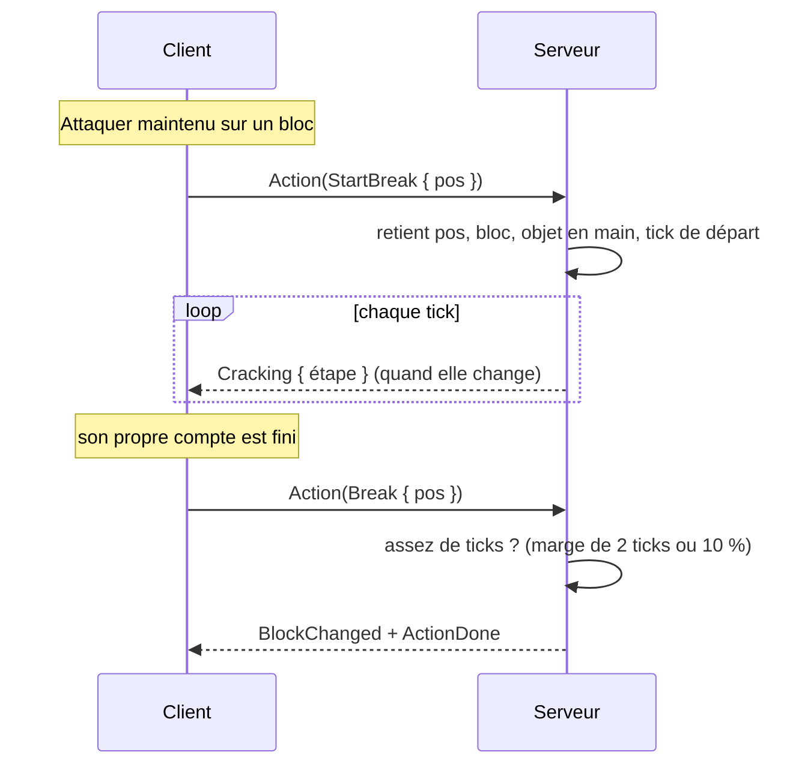

# Récolte : temps de casse, fissures, butin

## À quoi ça sert

En créatif, un clic casse un bloc. En survie, casser demande du **temps** et le bon **outil** : la terre cède en un instant, la pierre résiste, l'obsidienne demande une pioche en diamant. Pendant la casse, des **fissures** grandissent sur le bloc. Une fois cassé, le bloc laisse un **butin** qui n'est pas toujours lui-même : l'herbe donne de la terre, les feuilles ne se gardent qu'avec des cisailles. Tout cela vient des packs, et c'est le **serveur** qui décide, pour qu'un client modifié ne puisse pas casser plus vite.

## Comment ça marche

### Le temps de casse

Chaque bloc a une **dureté** (`hardness`) et peut nommer un **outil** :

```ron
tool: Some(BlockTool(kind: "strata:pickaxe", level: 1, required: true)),
```

Un objet peut **être** un outil :

```ron
tool: Some(Tool(kinds: ["strata:pickaxe"], level: 2, speed: 6.0)),
```

La règle, reprise de Minecraft, tient dans `Block::break_ticks` :

- avec l'outil du bon type, ou quand le bloc n'en exige pas : **dureté × 30 / vitesse** ticks (à mains nues, vitesse 1 : dureté × 1,5 seconde) ;
- quand le bloc **exige** un outil et que la main n'en a pas (ou d'un niveau trop bas) : **dureté × 100** ticks, et le bloc **ne donne rien** (`Block::harvests`) ;
- moins d'un tick : le bloc casse tout de suite (fleurs, torches) ; dureté négative : incassable (socle).

### Qui compte le temps ?

Les deux : le client pour afficher sans attendre, le serveur pour décider.



- Le client (`mining.rs`) compte le temps image par image tant que le bouton Attaquer est maintenu sur **la même case, le même bloc, le même objet en main**. Autre chose → il recommence (`StartBreak` sur le nouveau bloc) ; bouton lâché → `StopBreak`.
- Le serveur (`game/mining.rs`) note le début, et refuse un `Break` arrivé trop tôt. Une petite **marge** couvre les à-coups du réseau. Il arrête aussi la casse si l'objet en main change ou si le bloc disparaît.
- `StartBreak` et `StopBreak` passent par la même file que les autres clics (voir [Joueur et interaction](joueur-et-interaction.md)) pour garder l'ordre, mais n'attendent pas la limite de 10 actions par seconde : ils ne changent aucun bloc.

### Les fissures

Les textures `strata:crack_0` à `crack_9` sont **dessinées par le code** (motif `Cracks`) : des branches partent du centre et grandissent ensemble ; chaque étape montre un peu plus des **mêmes** traits, donc les fissures s'allongent au lieu de changer. Le rendu (`crack_pipeline.rs`) pose une boîte à peine plus grande que le bloc, avec la texture de l'étape sur ses six faces, mélangée par transparence au-dessus du monde.

Le serveur annonce l'étape de chaque casseur (`Cracking`) : en multijoueur, chacun verra les autres creuser. Le client dessine, pour chaque bloc, l'étape la plus avancée entre la sienne et celles reçues.

Toutes les 0,2 seconde, un **coup** : un petit éclat du bloc et le bruit d'un pas sur lui, comme dans Minecraft.

### Le butin

Un bloc sans champ `loot` donne **lui-même**. Sinon il nomme une table de `loot_tables/` :

```ron
// Feuilles, lianes et hautes herbes : gardées seulement aux cisailles.
LootTable(pools: [
    Pool(conditions: [Tool("strata:shears")], entries: [Itself()]),
])
```

Une table contient des **réserves** (`Pool`) tirées l'une après l'autre. Chaque tirage choisit une **entrée** avec une chance proportionnelle à son poids (`weight`) : un objet précis (`Item`), le bloc lui-même (`Itself`) ou rien (`Nothing`), en quantité entre `count.0` et `count.1`. Des **conditions** (`Tool`, `Not`, `Chance`) s'appliquent à une réserve entière ou à une entrée. Le hasard vient d'un petit générateur semé par la graine du monde, la position et le tick : la même partie rejouée donne le même butin, et les tests peuvent le vérifier.

### Ce que voit le joueur

L'infobulle d'un objet ajoute une ligne : « Outil requis : pioche de niveau 2 ou plus » ou « Plus rapide avec : hache ». Le wiki donne, pour chaque bloc, sa dureté, son outil, son temps à mains nues et son butin, lus dans les packs.

## Dans le code

| Quoi | Où |
|---|---|
| Formule, types `ToolDef`, `BlockTool`, étapes | `crates/core/src/content/tool.rs` |
| Tables de butin et tirage | `crates/core/src/content/loot.rs` |
| Texte des infobulles | `crates/core/src/content/describe.rs` |
| Texture des fissures | `crates/core/src/texture/cracks.rs`, `assets/packs/strata/textures/crack_*.ron` |
| Messages | `WorldAction::StartBreak`, `StopBreak`, `ServerMessage::Cracking` dans `crates/protocol/src/messages.rs` |
| Décision du serveur | `crates/server/src/game/mining.rs`, `crates/server/src/mining_rules.rs` |
| Compte du client, fissures | `crates/client/src/mining.rs`, `crates/client/src/render/crack_pipeline.rs`, `shaders/crack.wgsl` |
| Pages du wiki | `crates/wikigen/src/harvest.rs` |
| Captures | `strata --scene mining --crack x,y,z,étape ...` |

<details><summary>Côté Rust</summary>

- **`impl Block` dans un autre fichier** : `tool.rs` ajoute `break_ticks` et `harvests` au type `Block` défini dans `block.rs`. Rust permet plusieurs blocs `impl` pour un même type dans la même crate ; on range ainsi les méthodes par sujet.
- **Variantes d'énumération avec champs** : `EntryDef::Item { item, weight, count, conditions }`. En RON on écrit `Item(item: "strata:dirt", weight: 2)` ; les champs absents prennent leur valeur `#[serde(default = ...)]`.
- **`Box<LootCondition>`** : une condition `Not` contient une autre condition. Un type ne peut pas se contenir lui-même directement (sa taille serait infinie) ; la `Box` le range ailleurs dans la mémoire et ne garde qu'un pointeur.
- **`matches!(action, WorldAction::StartBreak { .. } | WorldAction::StopBreak)`** : vrai si la valeur a l'une de ces formes, sans écrire un `match` complet.
- **`std::array::from_fn`** : construit un tableau de taille fixe (les 10 couches de fissures) en appelant une fonction pour chaque indice.

</details>

## Pour aller plus loin

- Décisions D066 à D068 dans `docs/decisions.md` ; valeurs dans `docs/regles/equilibrage.md` (« Casse et outils »).
- [Inventaire, coffres et objets au sol](inventaire.md), [Joueur et interaction](joueur-et-interaction.md), [Particules](particules.md).
