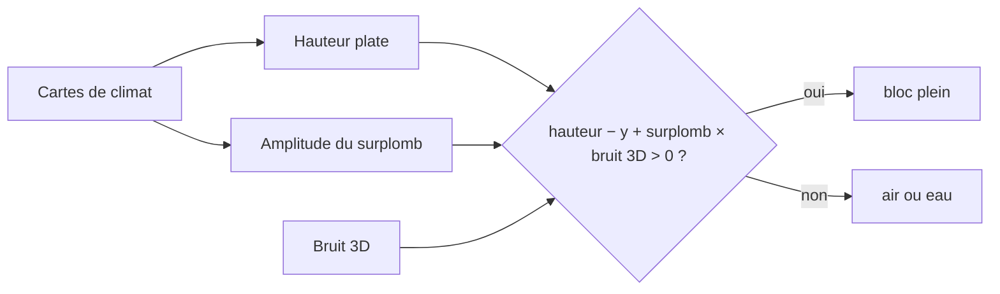

# Relief

## À quoi ça sert

Le relief donne au monde sa **forme** : océans profonds, côtes, plaines, collines, grandes chaînes de montagnes, plateaux en marches d'escalier, falaises, surplombs et rivières. Depuis la v0.2, il ne se limite plus à « une hauteur par colonne » : le sol peut se replier sur lui-même et former des avancées rocheuses ou des arches. Toutes les formes se règlent dans le pack, sans toucher au code.

## Comment ça marche

### L'idée générale : une hauteur, puis une « densité »

Le relief se calcule en deux temps :

1. **La hauteur « plate »** : pour chaque point du sol (x, z), une hauteur ordinaire, comme une carte topographique. Elle vient des cartes de climat (voir [Génération du monde](generation-du-monde.md)).
2. **La densité 3D** : on décide ensuite, bloc par bloc, si l'espace est **plein ou vide** avec une règle simple :

> un bloc est plein si **(hauteur − y) + surplomb × bruit(x, y, z) > 0**

- Sans bruit (surplomb = 0), c'est exactement « plein sous la hauteur, vide au-dessus ».
- Avec du bruit, la frontière ondule **aussi en hauteur**. Exemple : hauteur 150, surplomb 20 blocs. À y = 160, la première partie vaut −10 ; si le bruit dépasse 0,5 à cet endroit, le total devient positif : un bloc **plein flotte au-dessus** du sol attendu (une avancée). À y = 140, la première partie vaut +10 ; si le bruit descend sous −0,5, le bloc est **vide sous** la surface (un creux sous une falaise). Avancée et creux côte à côte, cela donne surplombs et arches.

Le **surplomb** (l'amplitude du bruit, en blocs) dépend de l'érosion : fort en montagne, nul en plaine, au bord de la mer et dans les rivières. Les plaines restent donc praticables, et les montagnes deviennent spectaculaires.



On ne calcule cette densité que dans une **bande** autour de la surface (de hauteur − surplomb à hauteur + surplomb) : au-dessous, tout est forcément plein ; au-dessus, forcément vide. Minecraft calcule la densité sur toute la hauteur du monde ; ici, c'est 10 à 20 fois moins de travail pour un résultat visible identique (décision D036 dans `docs/decisions.md`).

### Les courbes (splines) : transformer le climat en hauteur

Une **courbe** est une liste de points « entrée → sortie » ; entre deux points, on passe en douceur (sans cassure, sinon on verrait un pli dans le terrain), et avant le premier ou après le dernier point, la valeur reste constante.

Exemple tiré de `dimensions/terra.ron`, la courbe de **continentalité** (hauteurs en blocs au-dessus de la mer, qui est à y = 120) :

| Continentalité | −1 | −0,65 | −0,4 | −0,28 | −0,2 | 0 | 0,4 | 1 |
|---|---|---|---|---|---|---|---|---|
| Hauteur | −55 | −38 | −16 | −4 | +1,5 | +5 | +12 | +26 |

À gauche, l'océan profond ; vers −0,2, la côte (on passe au-dessus de la mer) ; à droite, l'intérieur des terres qui monte doucement. Changer ces nombres suffit à faire un monde d'archipels ou de grands continents.

Le relief combine plusieurs courbes, toutes dans le bloc `relief` :

| Courbe | Entrée | Ce qu'elle décide |
|---|---|---|
| `continent` | continentalité | hauteur de base : fonds marins, côtes, terres |
| `inland` | continentalité | de 0 (mer) à 1 (terres) : à quel point collines et montagnes peuvent s'élever ; rien ne pousse au milieu de l'océan |
| `rugged` | érosion | de 1 (terrain jeune, montagnes) à 0 (terrain usé, collines) |
| `peaks` | pics et vallées | hauteur des montagnes (jusqu'à +230) |
| `hills` | pics et vallées | hauteur des collines, là où le terrain est usé |
| `plateau` | érosion | où se forment les plateaux en terrasses |
| `overhang` | érosion | où le bruit 3D creuse falaises et surplombs |

La hauteur plate se lit alors ainsi : **mer + continent + inland × (mélange montagnes/collines selon rugged) + petit bruit de détail**.

### Pics et vallées

Une carte de bruit supplémentaire, la **bizarrerie** (*weirdness*), est « repliée » : ses valeurs moyennes deviennent des **vallées** (−1), et les valeurs assez éloignées du milieu, de part et d'autre, des **pics** (+1). Ce repli multiplie les crêtes : en marchant, on traverse une vallée, une crête, une autre vallée, au lieu d'une seule grande bosse. C'est ce nombre, entre −1 et 1, qu'utilisent les courbes `peaks` et `hills`.

Les cartes brutes de bruit restent souvent entre −0,6 et 0,6 ; elles sont **étirées** pour couvrir vraiment −1 à 1, sinon les extrémités des courbes ne seraient jamais atteintes.

### Plateaux en terrasses

Dans une bande d'érosion moyenne (courbe `plateau`), le terrain est **surélevé** (`plateau_lift`, 26 blocs) puis découpé en **marches** de `terrace_step` blocs (9). Chaque marche reste presque plate sur la plus grande partie de sa largeur, puis remonte d'un coup : on obtient des mesas et des falaises de plateau. Au bord de la bande, l'effet s'estompe progressivement pour ne pas créer de mur brutal.

### Pentes raides

Si un bloc de sol a un voisin plus haut ou plus bas d'**au moins 3 blocs**, la pente est jugée raide : sa surface devient de la **roche nue** au lieu de l'herbe, comme une vraie falaise. Chaque biome peut choisir le bloc utilisé (`steep`, pierre par défaut). Les sommets enneigés gardent leur neige.

### Rivières

Les rivières suivent la **ligne zéro** d'un bruit dédié : partout où ce bruit vaut presque exactement 0, il y a une rivière. Une ligne zéro de bruit forme naturellement de longs rubans sinueux qui ne s'arrêtent pas net, ce qui ressemble beaucoup à un réseau de rivières.

- Très près de zéro (`width`), on est dans le **lit** : le terrain est abaissé jusqu'à `depth` blocs (5) sous la mer, puis l'eau remplit jusqu'au niveau de la mer. Les rivières sont donc au niveau de la mer.
- Un peu plus loin (`banks`), les **berges** descendent en pente douce.
- En altitude (entre ~27 et `highest` = 45 blocs au-dessus de la mer), l'effet s'estompe : la rivière devient une **vallée sèche** qui entaille la montagne sans eau.
- Un biome `river` (fichier `biomes/river.ron`, marqué `river: true`) n'est choisi **que** sur le lit. Les biomes peuvent aussi exiger une plage de hauteur (`min_height`, `max_height`) : l'océan n'apparaît par exemple que sous y = 117.

Mettre `rivers: None` dans le pack supprime les rivières.

### La grille alignée sur le monde et `surface_height`

Calculer le bruit 3D pour chaque bloc coûterait trop cher. On le calcule donc aux **coins d'une grille grossière** (tous les 4 blocs à l'horizontale, tous les 8 en hauteur) et on **interpole** entre les coins (une moyenne pondérée selon la distance). Le bruit est en plus « écrasé » verticalement, ce qui favorise les corniches horizontales plutôt que des colonnes en forme de tour.

Point important : cette grille est **alignée sur le monde entier**, pas sur la colonne en cours. Les coins sont toujours aux positions multiples de 4 (et de 8 en hauteur), quelle que soit la colonne qui fait le calcul. Conséquence : la densité d'un bloc ne dépend que de sa position, et n'importe qui peut la **recalculer exactement**.

C'est ce que fait `surface_height(x, z)` : elle redonne la hauteur du plus haut bloc plein en un point quelconque, surplombs compris, sans générer la colonne. On s'en sert pour :

- poser les **arbres** enracinés dans une colonne voisine sur le vrai sol (sinon ils flotteraient ou s'enfonceraient sous une avancée) ;
- placer le **point de départ** du joueur ;
- cadrer les captures de biomes du wiki.

Un test vérifie que `surface_height` donne exactement la même hauteur que la colonne réellement générée.

### Une colonne, de haut en bas

Le remplissage d'une colonne parcourt maintenant les blocs **du haut vers le bas** : le premier bloc plein rencontré après de l'air reçoit le bloc de surface (herbe, sable, roche si pente raide…), les quelques suivants le sous-sol (terre…), puis la pierre et la roche profonde. Comme un surplomb a de l'air dessous, le dessus de l'avancée et le sol qu'elle abrite ont chacun leur propre surface : l'herbe pousse aussi au pied d'une falaise. Le plafond des grottes tient compte des surplombs pour qu'elles ne s'ouvrent pas dans l'eau.

### La carte vue du ciel : `strata --map`

Pour juger un réglage de relief sans entrer dans le jeu, on peut produire une **carte** en PNG :

```
cargo run -p strata-app --release -- --map carte.png --seed 42 --pos 0,0,0 --size 1024x1024 --map-scale 4
```

- `--pos` donne le centre (seuls x et z comptent), `--size` la taille de l'image en pixels, `--map-scale` le nombre de blocs par pixel (4 par défaut : 1024 pixels couvrent 4 096 blocs).
- Chaque biome a sa couleur (`map_color` dans son fichier), assombrie ou éclaircie selon la pente comme si la lumière venait du nord-ouest : les montagnes et les vallées ressortent en relief.
- L'eau est en bleu, d'autant plus foncé qu'elle est profonde.

La carte utilise la hauteur plate (sans les surplombs), ce qui la rend rapide. Le même code est prévu pour l'aperçu de l'écran de création de monde.

### Les réglages du pack

Tout se règle dans `assets/packs/strata/dimensions/terra.ron`, bloc `relief` : les courbes ci-dessus, `plateau_lift`, `terrace_step`, `overhang_blocks` (le surplomb maximal, 22 blocs) et `rivers`. Pour retrouver un relief sans surplombs, il suffit de mettre `overhang_blocks: 0.0`. Les valeurs extrêmes sont bornées au chargement pour qu'un pack mal écrit ne puisse pas faire déborder le terrain.

## Où c'est dans le code

| Quoi | Où |
|---|---|
| Courbes lissées | `crates/worldgen/src/spline.rs` (`Spline`, `smoothstep`) |
| Description du relief lue dans le pack | `crates/worldgen/src/defs.rs` (`Relief`, `Rivers`, champs `steep`, `min_height`, `max_height`, `river`, `map_color` de `BiomeDef`) |
| Bornes des valeurs | `crates/worldgen/src/content.rs` (`bounded_relief`) |
| Hauteur plate, pics et vallées, plateaux, rivières, choix du biome | `crates/worldgen/src/climate.rs` (`ClimateMaps::sample`, `Sample`) |
| Densité 3D, grille alignée, recherche de la surface | `crates/worldgen/src/terrain.rs` (`Overhangs`, `Grid`, `is_solid`) |
| Remplissage de la colonne, pentes raides, `surface_height` | `crates/worldgen/src/generator.rs` (`Generator::generate`, `Generator::surface_height`, `is_steep`) |
| Arbres posés sur le vrai sol | `crates/worldgen/src/features.rs` |
| Carte vue du ciel | `crates/worldgen/src/map.rs` (`render`, `MapArea`), `crates/app/src/renders.rs` (`render_map`), option dans `crates/app/src/cli.rs` |
| Réglages du relief | `assets/packs/strata/dimensions/terra.ron`, `assets/packs/strata/biomes/river.ron` |
| Tests (surplombs, falaises, rivières, `surface_height`) | `crates/worldgen/tests/relief.rs` |

<details><summary>Côté Rust</summary>

- **`#[serde(from = "Vec<(f64, f64)>")]`** sur `Spline` : dans le pack, une courbe s'écrit simplement comme une liste de paires `[(x, y), …]`. Serde lit d'abord cette liste, puis appelle `From` pour fabriquer la `Spline`, qui en profite pour **trier** les points et retirer les valeurs invalides (infini, « pas un nombre »). Le reste du code n'a jamais à vérifier que la courbe est bien formée.
- **`#[serde(deny_unknown_fields)]`** sur `Relief` : une faute de frappe dans le pack (`overhangs` au lieu de `overhang`) donne une erreur claire au lieu d'être ignorée en silence. **`#[serde(default = "zero")]`** donne une valeur par défaut à un champ absent.
- **`Option<Rivers>`** : soit `Some(...)` (des rivières), soit `None` (aucune). Le code fait `let Some(rivers) = … else { return … }` : « s'il n'y a pas de rivières, on sort tout de suite ». L'extension RON **`implicit_some`**, activée pour tous les packs, permet d'écrire `steep: "strata:stone"` au lieu de `steep: Some("strata:stone")`.
- **`partition_point`** : recherche dichotomique dans une liste triée (« où est le premier point dont l'entrée dépasse x ? »), rapide même avec beaucoup de points.
- **`div_euclid` et `rem_euclid`** : division et reste « mathématiques ». En Rust, `-3 / 4` vaut `0` et `-3 % 4` vaut `-3`, ce qui décalerait la grille pour les coordonnées négatives ; `(-3).div_euclid(4)` vaut `-1` et `(-3).rem_euclid(4)` vaut `1`, ce qui garde la grille alignée de part et d'autre de l'origine.
- **`std::array::from_fn`** : construit un tableau de taille fixe (ici 16 × 16 échantillons, ou 5 × 5 coins de grille) en appelant une fonction pour chaque case, sans valeur initiale bidon.
- **Durées de vie (`'a`)** : `ColumnSamples<'a>` et `Ground<'a>` contiennent des **références** vers des biomes stockés ailleurs (`&'a Biome`). Le `'a` dit au compilateur que ces structures ne doivent pas survivre au contenu qu'elles désignent ; on évite ainsi de copier les biomes.
- **`f64`** partout : les coordonnées peuvent atteindre des millions de blocs, et les `f32` y perdraient en précision (le terrain deviendrait « en escalier » loin de l'origine).

</details>
