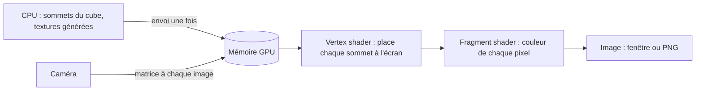

# Rendu avec wgpu (Vulkan)

## À quoi ça sert

Le rendu transforme la scène (blocs, caméra) en une image affichée à l'écran — ou enregistrée en PNG pour les captures automatiques. Strata Mundi utilise **wgpu**, une bibliothèque qui parle à la carte graphique, configurée pour n'utiliser que **Vulkan** sur tous les systèmes (un seul chemin à tester, et c'est celui du DS).

## Comment ça marche

1. **Initialisation** (`Gpu`) : on choisit une carte graphique compatible Vulkan et on ouvre un *device* (pour créer des ressources) et une *queue* (pour envoyer du travail).
2. **Ressources** : les textures 16×16 générées par le code sont rangées dans un **tableau de textures** (une couche par texture). Les sommets du cube sont envoyés une fois dans un *buffer*.
3. **Pipeline** : il décrit comment dessiner : quel *shader* (petit programme exécuté par la carte graphique, écrit en WGSL dans `shaders/block.wgsl`), quel format de sommets, test de profondeur, faces arrière ignorées (*culling*).
4. **Chaque image** : on écrit la matrice de la caméra, on ouvre une *passe de rendu* qui efface l'image en bleu ciel, on dessine chaque objet, on soumet, on présente.

Choix importants :
- **Rendu relatif à la caméra** : la position du joueur est gardée en `f64` (très précise). Au moment de dessiner, on calcule la position de chaque objet *par rapport à la caméra* et on l'envoie à la carte graphique (en `f32`, moins précis mais suffisant pour des petites distances). Sans ça, à des millions de blocs de l'origine, l'image tremblerait.
- **Reverse-Z et plan lointain infini** : la profondeur est stockée « à l'envers » (proche = 1, loin = 0), ce qui donne une précision presque uniforme jusqu'à l'horizon : pas de scintillement des faces lointaines.
- **Couleurs sRGB** : les textures et l'image finale sont en sRGB (l'espace de couleur des écrans) ; la carte graphique fait les conversions. La couleur du ciel est donc convertie en « linéaire » avant d'être donnée.
- **Ombrage par face** : comme Minecraft, le dessus est le plus clair, les côtés plus sombres, le dessous le plus sombre.
- **Perte de surface** : si la fenêtre est redimensionnée, minimisée ou si le système « perd » la surface d'affichage, on la reconfigure et on saute l'image au lieu de planter.

**Captures sans écran** (`--screenshot`) : le même `Renderer` dessine dans une texture en mémoire (`OffscreenTarget`), qu'on recopie vers le processeur puis qu'on enregistre en PNG. Sur le serveur cloud sans carte graphique, c'est **Mesa lavapipe** (Vulkan exécuté par le processeur) qui fait le travail.

## Où c'est dans le code

| Quoi | Où |
|---|---|
| Carte graphique, device, queue | `crates/client/src/render/gpu.rs` (`Gpu`) |
| Fenêtre et swapchain | `crates/client/src/render/surface.rs` (`WindowSurface`) |
| Pipeline des blocs | `crates/client/src/render/block_pipeline.rs`, `shaders/block.wgsl` |
| Sommets, cube | `crates/client/src/render/mesh.rs` (`BlockVertex`, `cube`) |
| Tableau de textures | `crates/client/src/render/texture_array.rs` |
| Image complète | `crates/client/src/render/mod.rs` (`Renderer::render`) |
| Captures | `crates/client/src/render/offscreen.rs`, `crates/client/src/screenshot.rs` |
| Caméra | `crates/client/src/camera.rs` |
| Textures procédurales | `crates/core/src/texture/` |

Côté Rust

- **`#[repr(C)]` + `bytemuck::Pod`** : `BlockVertex` a une disposition mémoire fixe, comme en C, et `bytemuck` sait le convertir en octets sans copie ni code `unsafe` pour l'envoyer à la carte graphique.
- **`include_wgsl!`** : la macro copie le fichier `.wgsl` dans le programme au moment de la compilation.
- **`pollster::block_on`** : certaines fonctions de wgpu sont `async` (elles rendent la main en attendant). `block_on` attend simplement leur résultat ; c'est suffisant à l'initialisation.
- **Immediates** (anciennement *push constants*) : 16 octets envoyés directement avec chaque commande de dessin. On s'en sert pour la position relative de chaque objet, sans créer de buffer par objet.
- **Lifetimes `'a`** dans `Target<'a>` : la structure emprunte une vue de texture ; le compilateur vérifie qu'elle ne vit pas plus longtemps que la texture.

