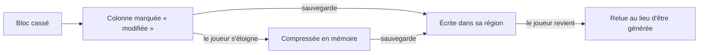

# Sauvegarde des mondes

## À quoi ça sert

Garder chaque monde entre deux parties, sans jamais perdre ce que le joueur a construit, même si la batterie du DS lâche au mauvais moment, et sans remplir le disque.

## Comment ça marche

### Un dossier par monde

```text
saves/<id>/world.ron        description : nom, graine, mode, bordure, dates, temps de jeu, version du format
           player.ron       le personnage : dimension, position, regard, barre d'objets
           icon.png         capture prise en quittant (pour la liste des mondes)
           regions/strata/terra/r.<x>.<z>.region   les colonnes modifiées
backups/<id>/<date>/        copies de sécurité
```

Le dossier de données est celui du système (`~/.local/share/strata-mundi` sous Linux, `%APPDATA%\strata-mundi` sous Windows), ou celui donné par `--data-dir`.

### Seules les colonnes modifiées sont écrites

Le monde se régénère à l'identique depuis sa graine. Une colonne que personne n'a touchée n'a donc pas besoin d'être sauvegardée : seules celles où un bloc a été cassé ou posé vont sur le disque. Un monde visité pendant des heures mais peu modifié reste minuscule.

Les colonnes sont regroupées par **régions** de 32 × 32 colonnes, un fichier par région, comme Minecraft. Dans le fichier, chaque colonne est compressée à part avec **zstd**.



### Les blocs sont enregistrés par leur nom

En mémoire, un bloc est un petit numéro (`BlockId`), qui change si on ajoute ou retire un pack. Sur le disque, chaque colonne garde donc la **liste des noms** des blocs qu'elle contient (`strata:stone`…). Au chargement, les noms sont retraduits en numéros. Un bloc dont le pack a disparu devient de l'air au lieu de faire planter le jeu.

### Jamais de fichier à moitié écrit

Chaque fichier est écrit sous un nom temporaire, forcé sur le disque (`fsync`), puis renommé d'un coup à la place de l'ancien. En cas de coupure, on garde soit l'ancienne version, soit la nouvelle, jamais un mélange. Un fichier de région illisible est mis de côté (`.damaged`) et signalé dans le journal, au lieu d'être écrasé.

### Quand le jeu sauvegarde

- Toutes les **5 minutes** (sauvegarde automatique).
- **Sauvegarder et quitter** (menu pause), et en fermant la fenêtre.
- **Fermeture du clapet du DS** : pause et sauvegarde immédiates (voir [Installation sur le DS](installation-ds.md)).

### Copies de sécurité et versions

- À chaque ouverture d'un monde, une copie complète est faite dans `backups/` ; les **3** plus récentes sont gardées.
- `world.ron` porte un numéro de format. Un monde d'une autre version apparaît grisé dans la liste, avec la raison ; il n'est jamais ouvert de travers. Pas de conversion avant la v1.0 (règle du projet).

## Où c'est dans le code

| Quoi | Où |
|---|---|
| Dossiers, liste, création, suppression | `crates/server/src/save/mod.rs` |
| Fichiers de région | `crates/server/src/save/region.rs` (`RegionStore`, `BlockNames`) |
| Écriture atomique, copies | `crates/server/src/save/atomic.rs`, `backup.rs` |
| Description et personnage | `crates/server/src/save/meta.rs` (`WorldMeta`, `PlayerData`) |
| Quand sauvegarder | `crates/server/src/persistence.rs`, `integrated.rs` |
| Relecture sûre des colonnes | `crates/core/src/chunk/section.rs` (`Section::remapped`) |
| Lancer un monde depuis les menus | `crates/app/src/launcher.rs` (`GameLauncher`) |

<details><summary>Côté Rust</summary>

- **`postcard`** transforme une structure `serde` en octets compacts ; **`zstd`** les compresse. Les fichiers lisibles par un humain (`world.ron`, `player.ron`) restent en RON.
- **`Option<T>` partout où une donnée peut manquer** : `load` renvoie `None` pour une colonne jamais modifiée ou abîmée ; le chargeur génère alors la colonne.
- **`std::fs::rename`** remplace un fichier de façon atomique sur le même disque : c'est la clé de l'écriture sûre.
- Les données lues sur le disque ne sont **jamais crues sur parole** : `remapped` vérifie chaque index avant de s'en servir, donc un fichier trafiqué ne peut pas faire paniquer le jeu.

</details>
