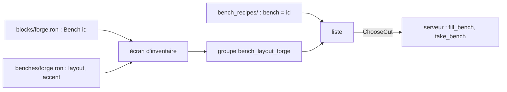

# Stations de travail

## À quoi ça sert

Chaque matériau se travaille à **sa** station : le bois et les outils à l'établi, la pierre au tailleur, les minerais au four, le métal à la **forge**, le cuir à la **tannerie**, le tissu et la laine au **métier à tisser**, les bijoux au **joaillier**, les améliorations à l'**enclume**. Le joueur comprend où aller en regardant la station ; le monde se remplit d'ateliers qu'on a envie de construire.

| Station | Genre (`StationDef`) | Ce qu'on y fait |
|---|---|---|
| Établi | `Crafting(3)` | grille 3×3 (outils, armes, blocs, stations) |
| Fours | entité de bloc `furnace` | cuisson et fonte, avec combustible |
| Tailleur de pierre | `Stonecutter` | variantes de pierre |
| Enclume | `Anvil` | améliorations, réparations |
| Forge | `Bench("strata:forge")` | lingots (depuis le minerai), anneaux, écailles, armures de métal et de diamant, bottes de mobilité |
| Tannerie | `Bench("strata:tannery")` | cuir (provisoire), armure de cuir |
| Métier à tisser | `Bench("strata:loom")` | tissu, laine (provisoire), vêtements de tissu, cape de laine |
| Joaillier | `Bench("strata:jeweller")` | anneaux, amulettes, ceintures |

## Comment ça marche

### Un seul établi, quatre stations

La forge, la tannerie, le métier à tisser et le joaillier sont le **même** établi générique (D089) : quatre cases, une liste de recettes, un résultat. Seuls changent le bloc, l'identifiant et les recettes :

```ron
// blocks/forge.ron
Block(
    textures: TopBottomSides(top: "strata:forge_top", bottom: "strata:cobblestone", sides: "strata:forge_side"),
    station: Some(Bench("strata:forge")),
    …
)

// bench_recipes/iron_plate_chestplate.ron
BenchRecipe(
    bench: "strata:forge",
    ingredients: [(Item("strata:iron_ingot"), 8), (Tag("strata:coals"), 1)],
    result: Result(item: "strata:iron_plate_chestplate"),
)
```

Choisir une recette envoie `ChooseCut` au serveur, qui pose les ingrédients de l'inventaire dans les cases (`fill_bench`) ; prendre le résultat les consomme (`take_bench`). Le client ne décide rien.

### Le charbon de la forge

La forge « brûle » du charbon sans mécanique nouvelle : le charbon est **un ingrédient comme un autre** (le tag `strata:coals`, charbon ou charbon de bois), un par pièce de métal. Pas de jauge de chaleur ni d'entité de bloc : tout est dans les recettes, réglable par pack. Les écailles de diamant se taillent sans feu.

Elle fond aussi le minerai : 4 minerais et 1 charbon donnent **5 lingots**, tout de suite. C'est un quart de plus qu'au four, mais plus de charbon (1 pour 5 lingots au lieu de 1 pour 8) et à la main : le four reste la voie qu'on automatise.

### Un écran par station

Chaque établi a son allure, décrite dans le pack :

```ron
// benches/forge.ron
Bench(layout: "forge", accent: "#7a3b1e")
```

- `layout` nomme une **disposition** : le groupe `bench_layout_<layout>` de `assets/ui/inventory.ron` (aujourd'hui `plain`, `jeweller`, `forge`, `tannery`, `loom`). Chacun place autrement les mêmes éléments : cases (2×2, en ligne pour la tannerie comme des peaux sur un séchoir, en colonne pour le métier comme une chaîne de fils), liste, résultat, aide. Au chargement, le client vérifie que le groupe existe ; sinon l'établi prend `plain` et une erreur de pack le signale.
- **Les identifiants doivent être les mêmes dans toutes les dispositions** (`bench`, `bench_choices`, `bench_result`, `bench_note`, `bench_earlier`, `bench_later`, `bench_title`, bandes `bench_band_*`) : le modèle de l'écran répond par identifiant, sans savoir quelle disposition est affichée. Seules les positions changent ; la liste fait toujours 5 × 3 cases (un test le vérifie).
- Un fichier `benches/` qui ne nomme l'établi d'aucun bloc est une erreur de pack ; `remove.ron` peut retirer une entrée `benches`.
- `accent` colore les **bandes** (`Band`, un nouvel élément d'interface) : le bandeau du titre et la surface de travail sous les cases.
- L'aide sous la liste est la traduction `bench-<espace>-<nom>` suivie de la phrase commune `ui-bench-choose` (sinon l'aide générale `ui-bench-help`).
- L'infobulle de tout objet fait à un établi dit « Fabriqué à : Forge » (`gear-made-at`).
- Sans fichier `benches/`, un établi prend la disposition `Plain` et les couleurs du thème : un pack peut ajouter un établi avec seulement un bloc et des recettes.

La liste montre 5 × 3 recettes dans toutes les dispositions ; au-delà (la forge en a 32), les boutons « < » « > » et la molette la font défiler par rangées. À la manette, la croix passe d'un élément à l'autre comme partout.



### Les recettes des stations

À l'établi : forge = 3 lingots de fer sur un four entouré de 5 galets ; tannerie = bâtons en cadre autour d'une boue sur 3 planches ; métier à tisser = 3 bâtons sur 3 fibres sur 3 planches. La tannerie et le métier sont connus dès le départ (le cuir et le tissu sont les premières armures) ; la forge s'apprend.

**Anciens mondes** : une sauvegarde qui connaissait une recette de grille déplacée sur un établi sous le même nom (une armure de fer…) reçoit une fois le bloc de cet établi et apprend sa recette (`Game::adopt_moved_recipes`), pour ne pas perdre le moyen de la fabriquer.

Le cuir et la laine restent **provisoires** (fibres et boue, fibres seules) jusqu'aux animaux de la v0.4 : leurs recettes sont déjà à la bonne station, il suffira d'en changer les ingrédients pour des peaux et de la laine de mouton.

## Dans le code

| Quoi | Où |
|---|---|
| Recettes d'établi, liste, poser, prendre | `crates/core/src/crafting/bench.rs`, `bench_load.rs` |
| Allure d'un établi (`benches/`) | `crates/core/src/crafting/bench_style.rs` |
| Fenêtre côté serveur | `crates/server/src/game/bench.rs` |
| Écran : disposition, couleur, aide, défilement | `crates/client/src/screens/bench.rs`, `assets/ui/inventory.ron` |
| Vérification des dispositions au chargement | `UiAssets::check_bench_layouts` (`crates/client/src/ui/mod.rs`), appelée par `crates/app/src/content.rs` |
| Anciens mondes | `adopt_moved_recipes` dans `crates/server/src/game/bench.rs` |
| Élément `Band` | `crates/client/src/ui/def.rs`, `ui/widgets/mod.rs` |
| Tests | `crates/core/tests/stations.rs`, `crafting/bench_tests.rs`, `crates/client/src/screens/bench_tests.rs`, `crates/server/src/game/equipment_tests.rs` |
| Wiki (page « Stations de travail ») | `crates/wikigen/src/stations.rs` |
| Contenu | `assets/packs/strata/{blocks,benches,bench_recipes,recipes,textures}/` |

<details><summary>Côté Rust</summary>

- **`Option::take_if`** : `drop_layouts` retire une disposition de son `Option` seulement si le groupe manque, et rend ce qu'il a retiré pour l'erreur.
- **`#[serde(default)]`** : `layout` et `accent` peuvent manquer ; `BenchStyle::PLAIN` (une `const`) donne `plain` et aucune couleur, et `style()` peut en rendre une référence.
- **`Option::then` puis `flatten`** : `id.starts_with("bench_band").then(|| …accent).flatten()` ne cherche la couleur que pour les bandes.
- **`strip_prefix`** : `id.strip_prefix("bench_layout_")` dit à la fois si l'id est une disposition et laquelle.
- **`saturating_add_signed`** : faire défiler de −1 au début reste à 0 au lieu de déborder.

</details>

## Pour aller plus loin

- Décisions D091 et D092 dans `docs/decisions.md` ; recettes et coûts dans `docs/regles/equilibrage.md` (« Stations de travail »).
- [Craft](craft.md), [Fours et tailleur de pierre](fours.md), [Accessoires et joaillier](accessoires-et-sets.md), [Améliorations et enclume](ameliorations.md).
