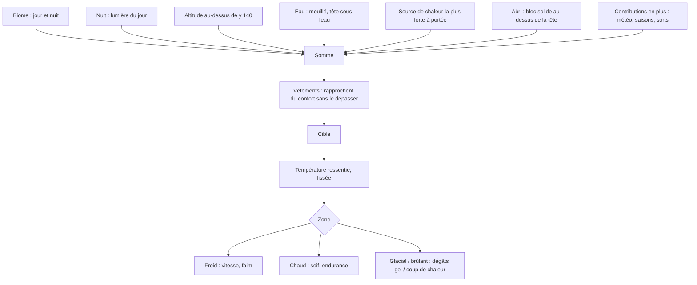

# Température

## À quoi ça sert

En survie, le joueur a chaud ou froid selon l'endroit, l'heure, l'eau, les feux proches, un toit et ses vêtements. Trop froid : il ralentit et a faim plus vite, puis gèle. Trop chaud : il a soif plus vite et reprend moins vite son endurance, puis prend un coup de chaleur. Ce fichier explique comment le serveur calcule cette température et comment le HUD l'affiche.

## Comment ça marche

La température ressentie (en °C) est une **somme de contributions nommées**. Toutes les 20 ticks (une seconde), le serveur regarde autour du corps et calcule la somme ; la température du corps **s'en approche doucement** (environ deux tiers du chemin en 20 secondes). À la première mesure, elle la prend d'un coup.

- **Zones** : glacial (< −4), froid (−4 à 8), agréable (8 à 30), chaud (30 à 42), brûlant (> 42). Les dégâts passent par la même fonction que les autres (`take_hit`) : la résistance au gel (`strata:cold_resistance`) et la résistance au feu (`strata:fire_resistance`) les réduisent, portées ou données par un effet (potion, sort).
- **Mouillé** : dans l'eau, l'humidité passe à 1 ; dehors, elle redescend à 0 en 60 secondes (trois fois plus vite près d'une source de chaleur).
- **Sources de chaleur** : chaque bloc chauffant a sa force et sa portée dans `heat_sources/` ; seule la plus forte compte (cent torches ne font pas un four). Les fours ne chauffent qu'allumés.
- **Coût** : la mesure (un cube de 13 × 13 × 13 blocs autour du corps et une colonne au-dessus de la tête) n'a lieu qu'une fois par seconde ; le reste du temps, seuls l'humidité et le compteur de dégâts avancent. Option de monde « Température » pour tout couper ; en créatif, rien n'est calculé.
- **HUD** : une échelle colorée (bleu → vert → rouge) au-dessus de la barre d'objets, avec un repère blanc ; loin du confort, une ligne « Froid 3 °C » ; quand la zone empire, un conseil pendant 8 secondes, en haut de l'écran. Les bords de l'écran se givrent ou rougeoient (option Interface « Givre et chaleur sur les bords »).

Tout se règle dans les packs : `temperature.ron` (zones, biomes, nuit, altitude, eau, abri, vêtements, effets), `heat_sources/`, `damage_types/freezing.ron` et `overheating.ron`.

## Ajouter une contribution plus tard

- **Météo, saisons (v0.5)** : le serveur pousse une entrée nommée dans `Surroundings::extra` (par exemple `strata:blizzard`, −10) ; rien d'autre à changer.
- **Dimensions extrêmes (v0.10)** : une ligne dans `dimensions` de `temperature.ron`.
- **Potions et sorts** : un effet de statut qui donne `strata:insulation`, `strata:heat_insulation` ou une résistance ; le plus fort de l'équipement et de l'effet compte (même effet non cumulable).
- **Mobs** : il suffit d'insérer un `BodyTemperature` pour leur entité ; le calcul est le même.

## Où c'est dans le code

- `crates/core/src/survival/temperature/` : `rules.rs` (`temperature.ron`, zones, échelle du HUD), `felt.rs` (contributions, `BodyTemperature` : lissage, humidité, dégâts), `heat.rs` (`heat_sources/`).
- `crates/server/src/game/temperature.rs` : mesure autour du corps, effets sur les besoins et la vitesse ; `vitals_view.rs` (message au client), `vitals_save.rs` (sauvegarde).
- `crates/client/src/screens/hud_temperature.rs` (ligne, conseil, bords), `ui/widgets/gauge.rs` (échelle à repère), `gameplay/vitals.rs` (conseil et bords qui apparaissent doucement).
- Tests : `core/survival/temperature/tests.rs`, `server/game/temperature_tests.rs`.

Côté Rust

- **`Option<f32>` pour « pas encore mesuré »** : `felt: None` veut dire « prendre la première mesure telle quelle » ; pas besoin d'un booléen à côté.
- **`#[serde(skip)]`** : la cible et le compteur de dégâts ne sont pas sauvegardés, seuls la température et l'humidité le sont.
- **Lissage exponentiel** : `felt += (cible − felt) × (1 − e^(−t/τ))` ; le résultat ne dépend pas du nombre de mesures, seulement du temps écoulé.
- **`Arc::clone(&self.rules.survival)`** : on garde les règles dans une variable locale pour pouvoir modifier les composants du jeu en même temps (le vérificateur d'emprunts refuse sinon de lire `self.rules` et d'écrire `self.ecs`).

