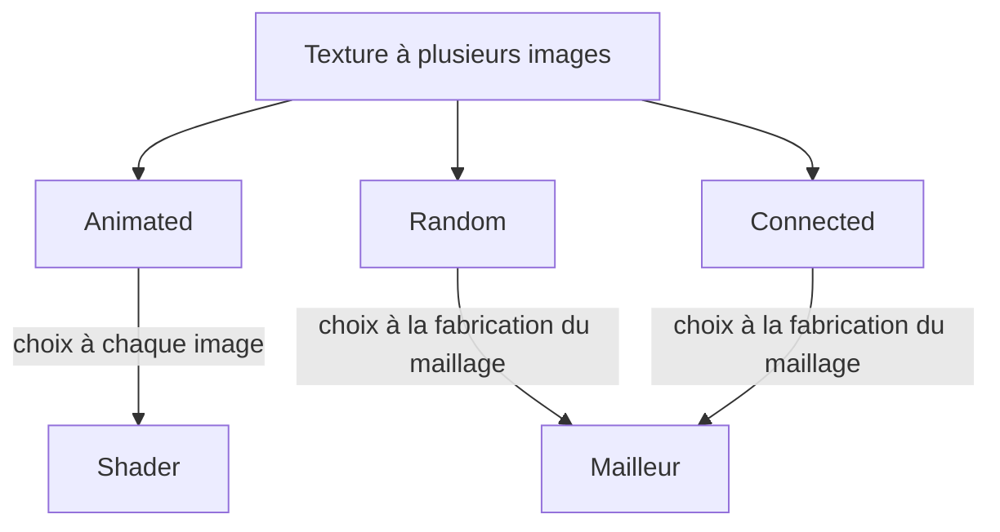

# Textures vivantes : animées, aléatoires, connectées

## À quoi ça sert

Une texture peut avoir **plusieurs images** : des étapes d'animation (feu, eau, portail), des variantes pour casser la répétition (pierre, terre, herbe) ou des raccords avec les voisins (verre, bibliothèque). Le **format des packs** (recettes `Animated`, `Random`, `Connected`, PNG en bande verticale, bornes) est décrit dans le [guide des textures](../guide-textures.md) : cette page explique seulement comment le moteur s'en sert.

## Comment ça marche

### Une couche par texture, les autres images derrière

Le tableau de textures du GPU a une couche par image. Chaque texture nommée garde **une couche à elle** (sa première image, son `TextureId` ne change jamais : blocs, icônes, wiki n'ont rien à savoir). Les images supplémentaires sont rangées **après toutes les premières**. Un petit descripteur par texture (`TextureLayout`) dit combien d'images elle a, où commencent les extra et à quoi elles servent.

```
couches : [ pierre | terre | feu | ... | pierre#2 pierre#3 | feu#2 feu#3 ... ]
           premières images               images supplémentaires
```

### Trois usages, trois endroits



- **Animée** : le shader choisit l'image. Il lit une table (un entier par couche : où sont les autres images, combien, durée de chacune) et calcule `(ticks / durée) % nombre_d'images`. Aucun remaillage, rien à renvoyer au GPU à chaque image. Le défilement de l'eau et de la lave (qui montre le sens du courant) est conservé, et l'ondulation par images (`Sway`) s'y ajoute.
- **Aléatoire** : le mailleur choisit selon un **hachage de la position du bloc** dans le monde (pas de la section) : un même bloc a la même variante partout et à chaque lancement. Les poids rendent certaines variantes plus rares.
- **Connectée** : le mailleur regarde les voisins. Pour chaque côté de la face (haut, droite, bas, gauche) où un bloc identique est présent, il prend l'image dont la bordure a été **retirée** de ce côté : deux vitres côte à côte forment une seule vitre. `Edges` donne 16 images (4 côtés = 16 combinaisons), `Vertical` 4 (haut et bas, faces latérales seulement : bibliothèques). Un voisin dont la face est elle-même couverte par un bloc identique ne compte pas, d'où le coin intérieur d'un « L » qui garde son cadre. Les bûches couchées ne se raccordent pas.

### Variantes et fusion gloutonne

La couche choisie **remplace** celle du bloc dans la clé de la face. La fusion gloutonne (voir [Chunks et maillage](chunks-et-maillage.md)) ne regroupe donc que des faces de même image : un sol de pierre à trois variantes donne plusieurs rectangles au lieu d'un seul. Le temps CPU change peu ; le vrai coût est le nombre de faces, d'où deux réglages :

- `animated_textures` « Textures animées » : coupe l'animation (coût nul : c'est une valeur du shader) ;
- `texture_variants` « Variantes de textures » : remaille le monde sans variantes ni raccords.

Les deux sont coupés au préréglage le plus bas. Les blocs sans variante ne coûtent rien (`MeshBlock.varied`).

### Fabrication des images

Au chargement, la bibliothèque dessine toutes les images avec le processeur (déterministe). `Reseed` redessine la même recette avec une autre graine ; l'image 0 garde la graine d'origine, donc les minerais posés sur la pierre ne changent pas. `Scroll` décale l'image en bouclant ; `Sway` pousse les lignes de côté selon une vague (flammes, eau). La carte graphique doit accepter assez de couches : le jeu demande la limite de l'adaptateur (256 garanties en Vulkan) et le jeu de base tient dedans (test).

## Où c'est dans le code

| Quoi | Où |
|---|---|
| Recettes d'images multiples (`Frames`, `Connection`, `Layout`, `connected`, `scrolled`, `swayed`, `split_strip`) | `crates/core/src/texture/multi.rs` |
| Bibliothèque, couches, `TextureLayout` (`frame_at`, `random_index`), `position_hash` | `crates/core/src/content/textures.rs` |
| Choix des variantes et raccords au maillage | `crates/client/src/mesher/variants.rs` (`TextureVariants`, `connection_mask`) |
| Table d'animation envoyée au GPU | `crates/client/src/render/texture_array.rs` (`animation_table`) |
| Animation dans le shader | `crates/client/src/render/shaders/block.wgsl` (`animated_layer`) |
| Tests | `crates/client/src/mesher/variants_tests.rs`, `crates/core/tests/texture_layouts.rs` |
| Scènes de contrôle | `assets/scenes/textures.ron`, `assets/scenes/fire.ron` |

<details><summary>Côté Rust</summary>

- **`enum` avec données** : `Layout::Animated { frame_time }`, `Random { weights }`, `Connected(Connection)` disent à la fois le genre et ses paramètres ; le `match` oblige à traiter chaque genre.
- **Tampon de stockage** (*storage buffer*) : un tableau de données que le shader lit. Ici un `u32` par couche, rangé par décalages de bits : `première_extra:16 | images:8 | durée:8`. Le shader redécode avec `>>` et `&`.
- **Miroir CPU/GPU** : `TextureLayout::frame_at` fait en Rust le même calcul que `animated_layer` en WGSL, pour pouvoir le tester sans carte graphique.
- **`Box<TextureRecipe>`** : une recette qui en contient une autre doit passer par un pointeur (`Box`), sinon le type aurait une taille infinie. La validation interdit tout de même l'imbrication de recettes à images multiples.
- **`impl Fn(u32, u32) -> (u32, u32)`** : `shifted` reçoit une petite fonction qui dit « pour ce pixel, va chercher celui-là » ; `scrolled` et `swayed` ne diffèrent que par cette fonction.
- **`rem_euclid`** : modulo qui reste positif, nécessaire pour boucler un décalage négatif.

</details>
