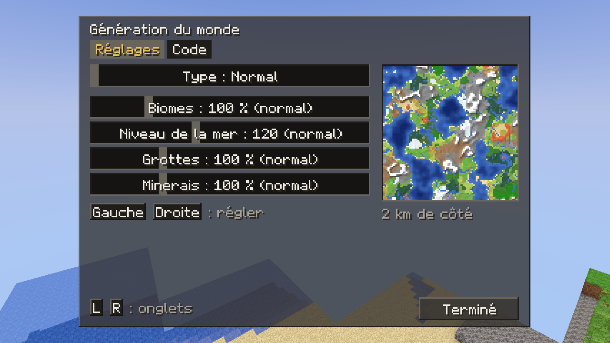
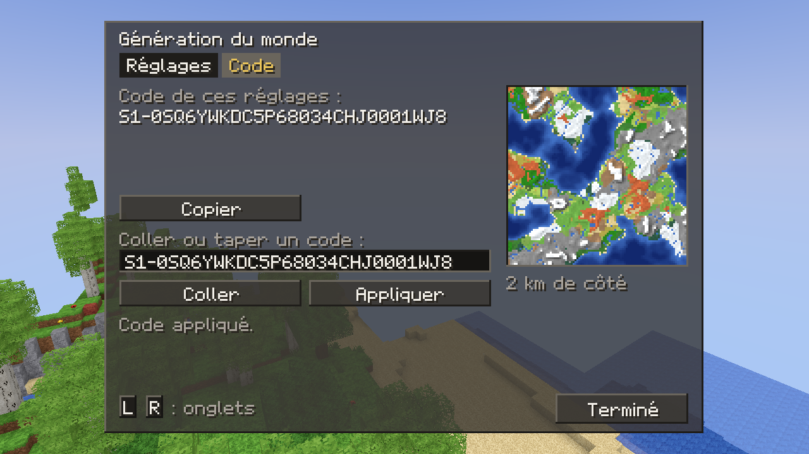

# Types de monde et éditeur de génération

## À quoi ça sert

À la création d'un monde, le joueur choisit son **type** (normal, plat, amplifié, biome unique, archipel) et peut régler la génération : taille des biomes, niveau de la mer, densité des grottes, fréquence des minerais, couches du monde plat, biome unique. Une **carte** montre le résultat avant de créer le monde, et un **code** texte permet de partager ces réglages.

## Comment ça marche

### Les réglages

Tout ce que choisit le joueur tient dans une seule valeur, `WorldgenSettings` (crate `core`) : le type (un identifiant de `world_types/` du pack), des pourcentages (100 % = le monde du pack), un niveau de la mer optionnel, un biome et des couches optionnels. « Optionnel » veut dire « celui du type » : l'éditeur range une valeur égale à celle du type comme « par défaut », et oublie biome et couches quand le type ne s’en sert pas, pour que les réglages restent courts et que le monde normal reste exactement celui du pack. Le serveur reçoit ces réglages avec la demande de création et les garde dans `world.ron`. Le détail de leur effet sur la génération est dans la décision D056.

### L'écran

Le menu « Nouveau monde » a deux **pages** qui partagent le même formulaire : la page principale (nom, graine, règles, type) et l'**éditeur** (`assets/ui/world_generation.ron`). L'éditeur a des onglets (gâchettes ou clic) :

- **Réglages** : le type et quatre curseurs. Gauche/droite avance d'un cran (25 % ou 4 blocs pour la mer) ; un clic ou un glissé à la souris place le curseur directement.
- **Couches** (monde plat) : la liste des couches, du haut vers le bas ; un clic choisit une couche, gauche/droite change son épaisseur ; dessous, le bloc (parmi les blocs posables) et l'épaisseur, puis Ajouter, Retirer, Monter, Baisser. Il reste toujours au moins une couche.
- **Biome** (biome unique) : la liste des biomes.
- **Code** : le code des réglages, Copier, un champ pour coller ou taper un code, Coller (depuis le presse-papiers) et Appliquer. Un code refusé affiche pourquoi (abîmé, version plus récente, type, biome ou bloc inconnu) et ne change rien.

Le fichier d'écran décrit des **groupes** (`Group`) : le modèle dit lequel est visible, ce qui permet un seul fichier pour tous les onglets. L'image de la carte est un widget `Image` dont le modèle donne la place dans l'atlas de l'interface.

### La carte, sans bloquer l'affichage

Calculer une carte demande des milliers d'échantillons du générateur : trop long pour le fil qui dessine les images. La carte est donc calculée sur un **fil de fond** (`Preview`) :

1. À chaque image, l'éditeur décrit la carte voulue (graine, réglages, taille). Si elle n'a pas changé, rien ne se passe.
2. Sinon, la demande reçoit un **numéro** et part vers le fil de fond. Le fil ne prend que la plus récente des demandes en attente.
3. Pendant le calcul, le fil vérifie à chaque ligne si une demande plus récente existe ; si oui, il **abandonne**. Faire glisser un curseur ne lance donc pas des dizaines de cartes complètes.
4. Une réponse dont le numéro n'est pas le dernier est ignorée : une ancienne carte ne remplace jamais une plus récente.

Le calcul lui-même (`map::render_with`, crate `worldgen`) répartit les lignes entre plusieurs fils (le réglage « fils de génération du monde »). Le client ne connaît pas le générateur : le programme principal lui donne une **source de cartes** (`MapSource`) et la liste des types (`GenerationCatalog`) par le lanceur, comme pour les sauvegardes.

L'option **Aperçu de la carte** (graphismes) règle la carte : détaillée (96 × 96 pixels, 20 blocs par pixel), grossière (48 × 48, 40 blocs par pixel, quatre fois moins de calcul ; préréglages bas, très bas et DS) ou désactivée.

Si la graine est laissée vide, le jeu en tire une au hasard dès l'ouverture du formulaire : la carte montre ainsi le monde qui sera vraiment créé.

### Les codes

Un code (`S1-…`) contient tous les réglages, compressés puis écrits avec 32 caractères sans lettres ambiguës, avec une somme de contrôle. La graine n'en fait pas partie : même code et même graine donnent le même monde. Le format est décrit dans D056. Le bouton Copier utilise le presse-papiers du système (crate `arboard`, D057).

## Où c'est dans le code

| Quoi | Où |
|---|---|
| Réglages, codes | `crates/core/src/generation/` |
| Carte parallèle et annulable | `crates/worldgen/src/map.rs` (`render_with`) |
| Types et cartes pour le client | `crates/client/src/generation.rs`, `crates/app/src/maps.rs` |
| Formulaire, pages | `crates/client/src/screens/creation/mod.rs` |
| Modèle de l'éditeur (bornes, couches, codes) | `crates/client/src/screens/creation/editor.rs` |
| Carte en fond | `crates/client/src/screens/creation/preview.rs` |
| Écran de l'éditeur | `crates/client/src/screens/creation/screen.rs`, `assets/ui/world_generation.ron` |
| Place de la carte dans l'atlas | `crates/client/src/ui/atlas.rs` (`preview_slot`) |
