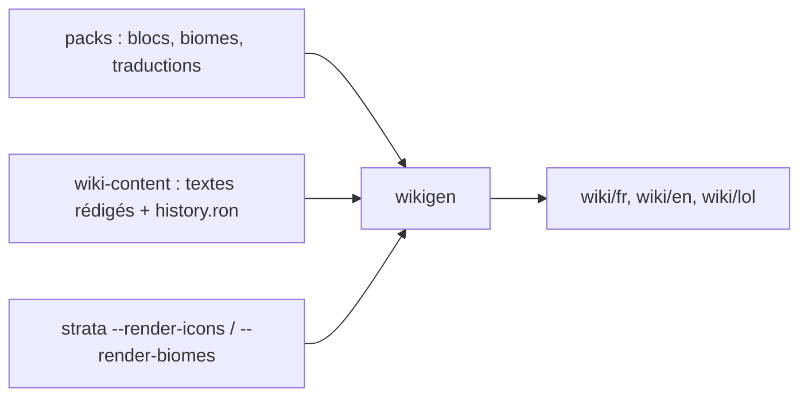

# Le wiki

## À quoi ça sert

Un site qui décrit tout le jeu, façon wiki Minecraft, en français, anglais et LOLcat. Il s'ouvre sans serveur (double-clic sur `wiki/index.html`) et il est toujours exact, parce que ses données viennent directement des packs du jeu.

## Comment ça marche

- **Données** : `wikigen` charge les packs comme le jeu (`Content`, contenu de génération). L'infobox d'un bloc (catégorie, dureté, solidité, aspect, identifiant…) et la section « Génération » (biomes où il apparaît en surface, sous la surface, dans la végétation, hauteurs des filons) sont calculées, jamais recopiées à la main. Les pages de commandes, de contrôles et de réglages lisent les tables du jeu lui-même (liste des commandes, touches par défaut, onglets d'options).
- **Textes** : `wiki-content/<langue>/<catégorie>/…/<nom>.md`, en Markdown. Une entrée sans texte affiche un avertissement ; en mode `--strict`, `wikigen` échoue et liste les textes manquants (un test le vérifie aussi).
- **Historique** : `wiki-content/history.ron` donne les versions et, pour chaque page, la version d'ajout et les changements. Il alimente l'infobox, la section « Historique », la page « Nouveautés » et l'historique des versions.
- **Images** : `strata --render-icons <dossier>` dessine l'icône de chaque objet (sans carte graphique) ; `strata --render-biomes <dossier>` cherche chaque biome dans un monde de référence (graine fixe) et le photographie de trois quarts, en rendu Vulkan (logiciel avec lavapipe sur les serveurs).
- **Site** : HTML, CSS et JavaScript sans aucune bibliothèque. Recherche dans un index propre à chaque langue (un fichier `.js`, car les navigateurs refusent de lire un `.json` ouvert depuis le disque), thème sombre selon le système ou le bouton (mémorisé), bascule de langue vers la même page.
- **Publication** : `scripts/build-wiki.sh` fait tout (images puis pages en mode strict). À chaque tag de version, la CI le lance et pousse `wiki/` sur la branche orpheline `wiki` (un seul commit, remplacé à chaque fois).

## Où c'est dans le code

- `crates/wikigen/src/` : `site.rs` (chargement, construction), `blocks.rs`, `biomes.rs`, `reference.rs` (commandes, mécaniques, contrôles, réglages), `pages.rs` (accueil, nouveautés, historique), `html.rs` (cadre des pages), `search.rs`, `texts.rs`, `history.rs`.
- `crates/wikigen/assets/` : gabarit de page, style, script.
- `crates/app/src/renders.rs` : icônes et vues des biomes.
- `assets/packs/strata/lang/*/wiki.ftl` : les mots de l'interface du wiki.

Côté Rust

- **`include_str!`** : le gabarit HTML, le CSS et le JS sont inclus dans le binaire à la compilation ; `format!(include_str!(…), titre = …)` remplit le gabarit (les accolades `{nom}` sont des emplacements).
- **`pulldown-cmark`** : transforme le Markdown en HTML.
- **`RefCell`** dans `Ctx` : chaque page signale les textes manquants pendant sa construction, alors que le contexte est partagé en lecture ; `RefCell` permet cette petite écriture contrôlée à l'exécution.

